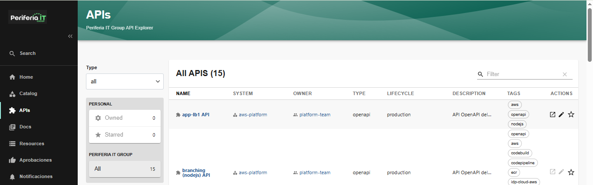
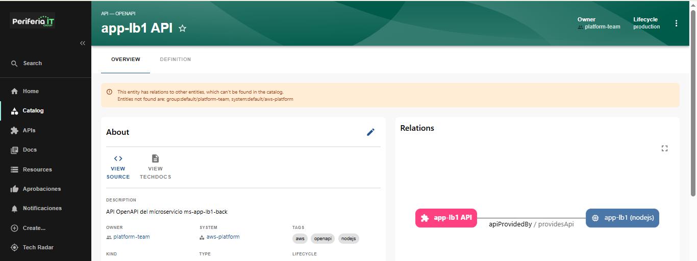
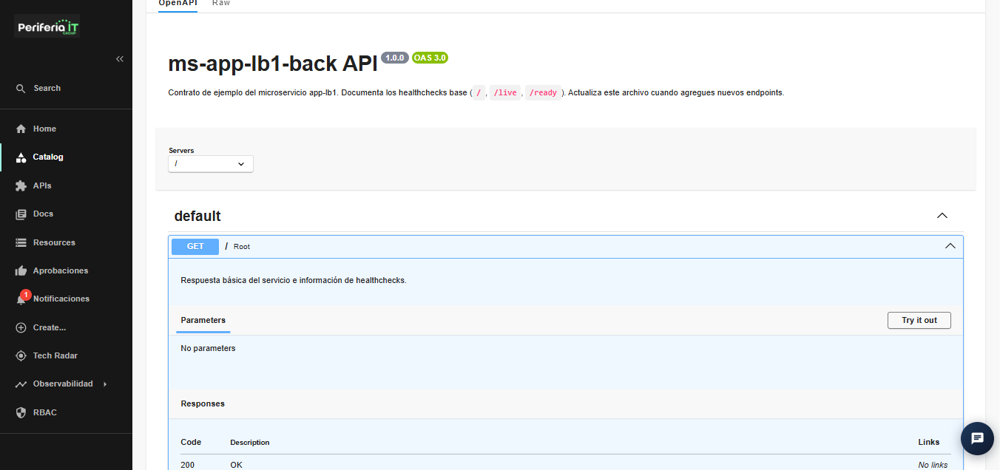
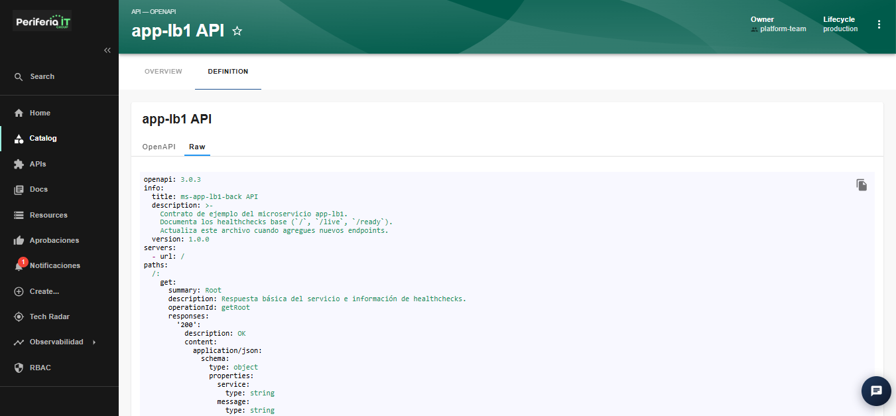

## seccion APIs

La seccion de APIs es una vista general que se tiene de las APIs que se tengan activas. se puede ver en que plataforma esta, quien es el dueño, su tipo, de que ambiente consiste o que parte de SDLC pertenece, tags y en la columna ACTIONS es para ver o editar la API ya de forma directa en la plataforma que se encuentra

Seleccionar una API mostrara sus propiedades y se pueden ver mas opciones 

### OVERVIEW

### DEFINITION

En este apartado se ve los recursos de API de la API seleccionada. se pueden observar en formato de OpenAPI o en forma de raw:

#### vista en raw:

