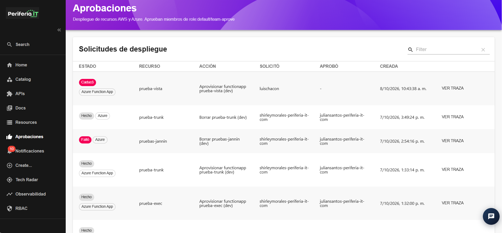
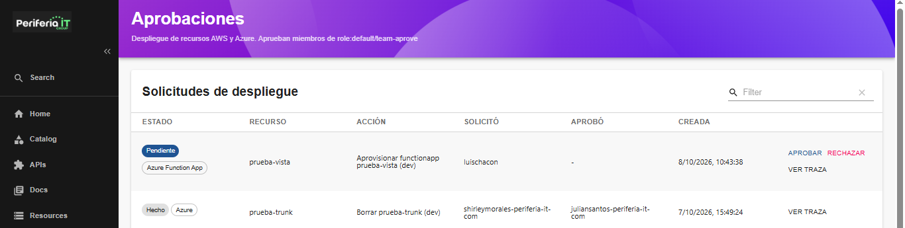
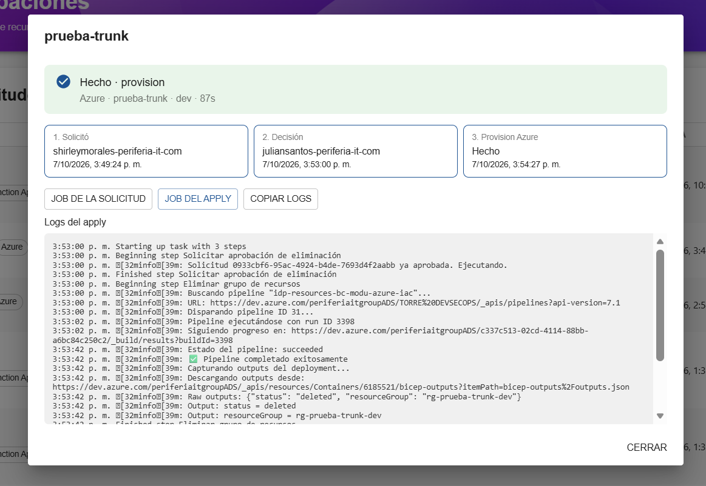
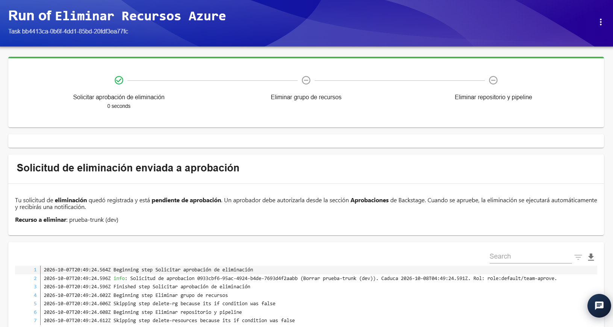
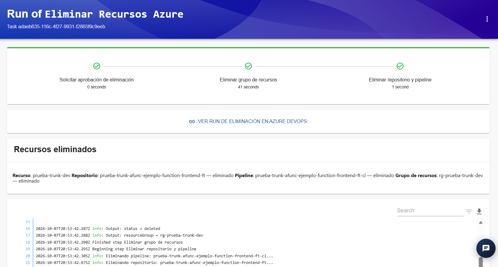
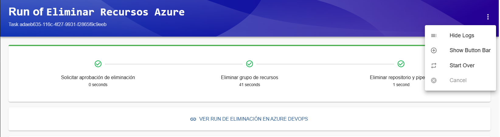

## Sección Aprobaciones

La sección **Aprobaciones** permite consultar y gestionar las solicitudes
que requieren autorización para realizar operaciones sobre recursos de
AWS y Azure.

En esta sección se muestra un listado de las solicitudes de despliegue
y se puede consultar información relacionada con su estado, recurso,
acción solicitada, usuario que realizó la solicitud, usuario que la
aprobó y fecha de creación.

### Filtros

La sección **Aprobaciones** cuenta con un campo de búsqueda que permite
filtrar las solicitudes mostradas en el listado.

Para realizar una búsqueda, se puede ingresar un término relacionado con
la solicitud que se desea consultar. El listado se actualizará mostrando
los resultados que coincidan con el criterio ingresado.

Para limpiar el filtro y volver a visualizar las solicitudes disponibles,
se puede utilizar la opción de limpiar ubicada al lado derecho del campo
de búsqueda.

### Solicitudes pendientes de aprobación

Cuando un usuario realiza una solicitud que requiere aprobación, esta se
registra en la sección **Aprobaciones** con estado **Pendiente**.

Las solicitudes pendientes muestran las opciones **APROBAR**, **RECHAZAR**
y **VER TRAZA**.

Las solicitudes deben ser gestionadas por un usuario diferente al que
realizó la solicitud y que cuente con los permisos correspondientes para
aprobarlas o rechazarlas.

El usuario que genera una solicitud **no puede aprobar ni rechazar su
propia solicitud**.

Las opciones disponibles son:

- **APROBAR:** autoriza la solicitud y permite continuar con el proceso
  asociado.
- **RECHAZAR:** rechaza la solicitud e impide que el proceso continúe.
- **VER TRAZA:** permite consultar el detalle y seguimiento de la
  solicitud.

Una vez que una solicitud es aprobada, el proceso asociado puede
continuar con las siguientes etapas de ejecución.

### Estados de las solicitudes

Las solicitudes pueden presentar diferentes estados de acuerdo con el
resultado o situación del proceso.

Entre los estados que pueden visualizarse se encuentran:

- **Pendiente:** la solicitud se encuentra a la espera de que un usuario
  autorizado la apruebe o rechace.
- **Hecho:** la solicitud y el proceso asociado finalizaron
  correctamente.
- **Falló:** se presentó un error durante la ejecución del proceso.
- **Caducó:** la solicitud superó el tiempo establecido para su
  aprobación y dejó de estar disponible para ser gestionada.

### Ver traza

La opción **VER TRAZA** permite consultar el detalle y seguimiento de una
solicitud.

En esta vista se puede consultar el flujo de ejecución de la solicitud,
incluyendo los pasos realizados, el usuario que realizó la solicitud,
el usuario que tomó la decisión y el resultado de la operación.

La vista también cuenta con las siguientes opciones:

- **JOB DE LA SOLICITUD:** permite consultar el job asociado al proceso
  que originó la solicitud.
- **JOB DEL APPLY:** permite consultar el job correspondiente a la
  aplicación de los cambios solicitados.
- **COPIAR LOGS:** permite copiar los logs mostrados en pantalla para su
  posterior consulta o análisis.

### Job de la solicitud

La opción **JOB DE LA SOLICITUD** permite consultar el proceso que originó
la solicitud.

En esta vista se muestran los pasos ejecutados y los logs generados
durante el proceso.

### Job del Apply

La opción **JOB DEL APPLY** permite consultar el proceso encargado de
aplicar los cambios correspondientes a la solicitud.

En esta vista se muestran los pasos ejecutados, el estado de cada paso y
los logs generados durante la ejecución.

### Copiar logs

La opción **COPIAR LOGS** permite copiar los logs disponibles en la vista
del job.

Esta funcionalidad facilita compartir o analizar la información generada
durante la ejecución del proceso.

### Opciones adicionales del job

En la parte superior derecha de la vista de los jobs se encuentra un
menú de opciones representado mediante el botón de tres puntos.

Este menú dispone de las siguientes opciones:

- **Hide Logs:** permite ocultar la sección de logs de la ejecución.
- **Show Button Bar:** permite mostrar la barra de botones ubicada en la
  parte inferior de la vista.
- **Start Over:** permite iniciar nuevamente el proceso.
- **Cancel:** permite cancelar la ejecución mientras el proceso se
  encuentra en curso. Esta opción se habilita durante la ejecución de
  una tarea.

### Visualización de logs

Los jobs muestran los logs generados durante la ejecución del proceso.
Estos permiten realizar seguimiento de las diferentes tareas ejecutadas
y consultar información sobre el resultado de cada operación.

Los logs pueden visualizarse directamente desde la sección correspondiente
del job y también pueden copiarse mediante la opción **COPIAR LOGS**.
