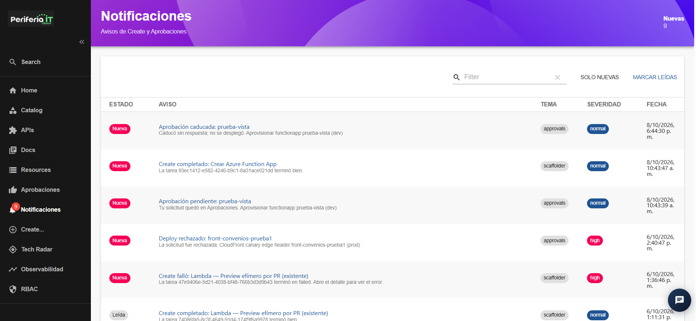
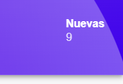
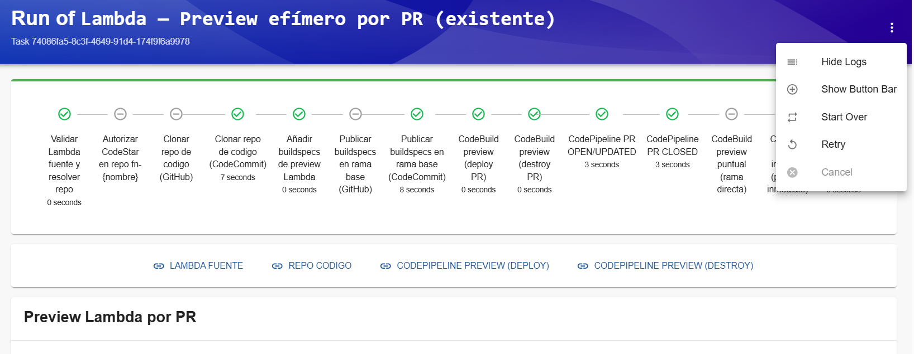

## Sección Notificaciones

La sección **Notificaciones** permite consultar los avisos generados por
el IDP como resultado de diferentes eventos y procesos ejecutados en la
plataforma.

Las notificaciones pueden estar relacionadas, entre otros, con procesos
de **Create**, **despliegues** y **Aprobaciones**.

En esta sección se presenta un listado de los avisos generados, donde se
puede consultar información relacionada con el estado de la notificación,
el evento ocurrido, el tema asociado, la severidad y la fecha en que fue
generada.

### Nuevas notificaciones

En la parte superior derecha de la sección se muestra el número de
notificaciones nuevas disponibles para el usuario.

Las notificaciones que aún no han sido consultadas se identifican con el
estado **Nueva**.

El contador de notificaciones nuevas permite identificar rápidamente
cuántos avisos se encuentran pendientes de consulta.

### Información de las notificaciones

Cada notificación presenta información relacionada con el evento que la
generó.

El listado contiene las siguientes columnas:

- **Estado:** indica el estado de lectura de la notificación. Por ejemplo,
  una notificación puede aparecer con el estado **Nueva**.

- **Aviso:** muestra el mensaje relacionado con el evento ocurrido. El
  mensaje puede indicar que una creación fue completada, que una tarea
  presentó un error o que una solicitud de aprobación cambió de estado.

- **Tema:** identifica el módulo o proceso relacionado con la
  notificación.

- **Severidad:** indica el nivel de importancia asociado al evento. En
  las notificaciones se pueden visualizar niveles como **normal** y
  **high**.

- **Fecha:** muestra la fecha y hora en que se generó la notificación.

### Tipos de notificaciones

El IDP puede generar diferentes tipos de notificaciones de acuerdo con
el resultado o estado de las operaciones realizadas.

Algunos ejemplos de notificaciones son:

- **Create completado:** indica que una tarea de creación de recursos
  finalizó correctamente.

- **Create falló:** indica que una tarea de creación de recursos terminó
  con error. La notificación muestra información relacionada con la tarea
  que presentó el fallo y permite consultar el detalle de la ejecución.

- **Aprobación pendiente:** indica que una solicitud requiere la
  intervención de un usuario autorizado para continuar con el proceso.

- **Deploy rechazado:** indica que una solicitud de despliegue fue
  rechazada durante el proceso de aprobación.

- **Aprobación caducada:** indica que una solicitud de aprobación superó
  el tiempo disponible para ser gestionada y no fue aprobada.

### Filtro de notificaciones

La sección cuenta con un campo **Filter** que permite realizar búsquedas
dentro del listado de notificaciones.

Para realizar una búsqueda, se ingresa el término correspondiente en el
campo **Filter**. El listado se actualiza mostrando las notificaciones
que coincidan con el criterio de búsqueda.

Para limpiar la búsqueda se puede utilizar la opción de limpiar ubicada
al lado derecho del campo de búsqueda.

### Solo nuevas

La opción **SOLO NUEVAS** permite mostrar únicamente las notificaciones
que se encuentran marcadas como nuevas.

Esta opción facilita la identificación de los avisos que todavía no han
sido consultados.

### Marcar leídas

La opción **MARCAR LEÍDAS** permite marcar las notificaciones nuevas como
leídas.

Esta funcionalidad permite actualizar el estado de las notificaciones
después de que han sido consultadas.

Al marcar las notificaciones como leídas, estas dejan de identificarse
como **Nueva** y el contador de notificaciones nuevas se actualiza.

### Consulta del detalle de una notificación

Al seleccionar una notificación desde el listado, el IDP redirige a la
vista de detalle de la ejecución asociada al evento.

Esta vista permite consultar el flujo completo de ejecución de la tarea,
incluyendo los diferentes pasos realizados y el estado de cada uno.

En la parte superior de la vista se muestra una línea de tiempo con los
pasos que componen la ejecución.

Cada paso permite identificar el estado de la actividad y consultar el
avance del proceso.

Dependiendo del tipo de ejecución, los pasos pueden corresponder a
actividades como validaciones, clonación de repositorios, generación de
configuraciones, ejecución de pipelines, despliegue o eliminación de
recursos.

### Opciones de la ejecución

En la parte superior derecha de la vista de ejecución se encuentra un
menú de opciones representado mediante el botón de tres puntos.

Este menú puede contener diferentes opciones dependiendo del estado de
la ejecución.

Entre las opciones disponibles se encuentran:

- **Hide Logs:** permite ocultar la sección de logs de la ejecución.

- **Show Button Bar:** permite mostrar la barra de botones disponible
  en la parte inferior de la vista.

- **Start Over:** permite iniciar nuevamente el proceso.

- **Retry:** permite volver a intentar la ejecución cuando esta opción
  se encuentra disponible.

- **Cancel:** permite cancelar la ejecución mientras el proceso se
  encuentra en curso.

Las opciones disponibles pueden variar dependiendo del tipo y estado de
la ejecución.

