## seccion create - desplegar recurso AWS

En esta seccion se tienen los templates disponibles para la aplciacion de infraestructura que ofrece IDP. En azure se puede observar cada recuso que puede desplegar en cada template y se visualiza en cada una de las tarjetas de esta vista: 

Para AWS se tiene centralizado todos los servicios que puede instanciar IDP en una sola tarjeta:

seleccionando es opcion se pide seleccionar el tipo de recurso y este lo redirija a el asistente correspondiente: 

### AWS S3 Bucket

Esta opcion genera el bucket en AWS, su stack de Terraform en el repo IaC (GitHub o AWS CodeCommit, dev/qa/prod) y hace push. Cada bucket tiene carpeta y state propios.

#### paso 1: Origen de repositorios
##### Repositorio IaC en CodeCommit

En el primer paso se solicita relacionar la region de ubicacion del Repositorio IaC dentro de CodeCommit

##### Plantillas Terraform en CodeCommit

Ademas, se debe indicar la region donde se encuentra ubicado el repositorio con el template terraform dentro de AWS:

_para pasar al siguiente paso, selecionar 'next'_

#### paso 2: Configuracion general

En este paso se indica propiedades adicionales al bucket. Se relzaiona un nombre el ambiente que se requere. Dependiendo del ambiente, IDP asignara de forma automatica un prefijo dependiendo de que ambiete se haya seleccionado 

para pasar al siguiente paso, selecionar 'PREVIEW'

#### paso 3: Review

En esta vista, es un resumen de lo indicado en pasos anteriores y que mas propiedades va a tener el bucket a crear

_para hacer que la utilidad proceda se selecciona 'CREATE'_

### AWS S3 Bucket — Actualizar

Esta opcion es para realizar modifiacion en un bucket de S3 ya existente. Hace cambios en el versionado, la visibilidad e cifrado del bucket usando stack Terraform en un repo IaC. Al Hacer push, por medio de  GitHub Actions, aplica solo ese stack. 

#### paso 1: Origen del repositorio IaC

al continuar con el asistente, en el paso uno, se debe indicar la region donde esta ubicado el repositorio IaC en CodeCommit del stack de terraform

#### Paso 2: Bucket a actualizar

En este paso, se selacciona el bucket a modificar de la lista desplegable y se permite modificar los datos que se ven en el formulario (Nombre del bucket - editable, visibilidad activar versionado cifrado del bucket y algun identifcador unico en caso de ser necesario.)

#### Paso 3: Review

Ya para confirmar los cambios, se muestra una vista previa de lo anotado en los pasos anteriores para realizar el cambio.

### AWS S3 Bucket - Eliminar

#### Paso 1: Origen del repositorio IaC

Esta accion realiza una eliminacion de bucket en AWS y marca el stack en el repo IaC como eliminado. Los archivos Terraform se conservan como traza (`DELETED.md`).

#### Paso 2: Bucket a eliminar

En este paso, se selecciona el bucket de S3 de la lista que se encontro en la region indicada en el paso anterior. se solicita confirmar el nombre y el motivo es opcional.

#### Paso 3: review

Antes de proceder con la eliminacion, se genera una vista general de lo que se va a hacer por parte de IDP

### Lambda Function 

En esta accion, se crea la función Lambda en AWS desde cero, esquema o imagen ECR. genera el stack Terraform en el repo IaC (GitHub o CodeCommit) y se seleccion como entregar el codigo: repo+pipeline, zip en S3 o manual (CLI/consola).

#### Paso 1: Origen de repositorios

En el paso 1, se solicita indicar la region en donde se necesita tener la Lambda function

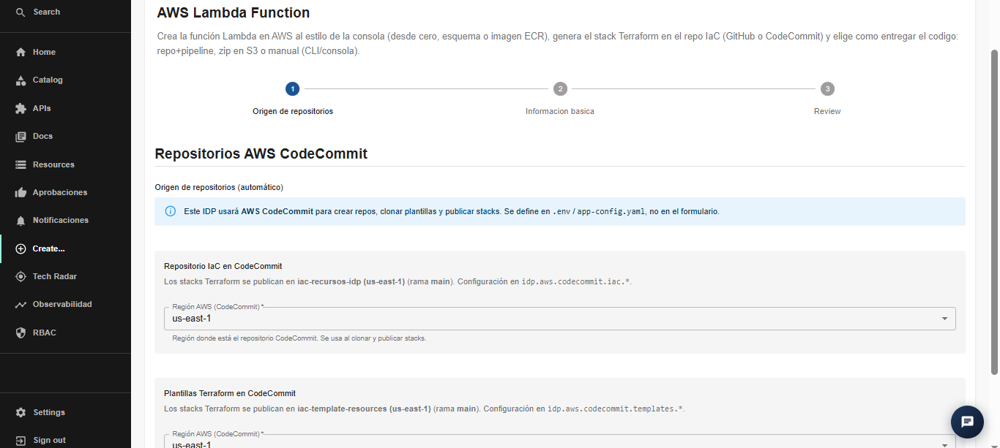

#### Paso 2: Informacion basica

En este paso, se debe seleccionar un metodo de creacion. se tienen tres formas:

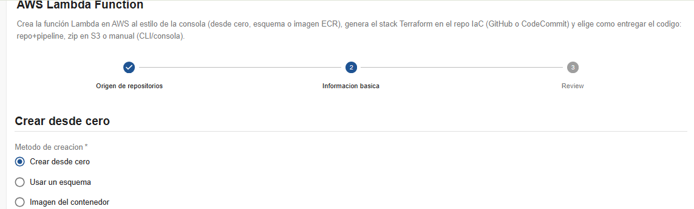

- **crear desde cero:** Ejecucion en la consola AWS «Crear función»: desde cero (Hello World y runtime). Se debe indicar nombre de la funcion, Que version y lenguaje de programacioin de necesita usar (ver lista desplegable), el Handler. si se requiere configuracion adicional. La configuracion por defecto es:
  - memoria: 256 MB 
  - timeout 30s 
  - arquitectura x86_64
  - sin VPC
  - sin capas ni DLQ. 
  - Si se selecciona aplicar configuracion adicional, se mostrara las opciones a configurar:
  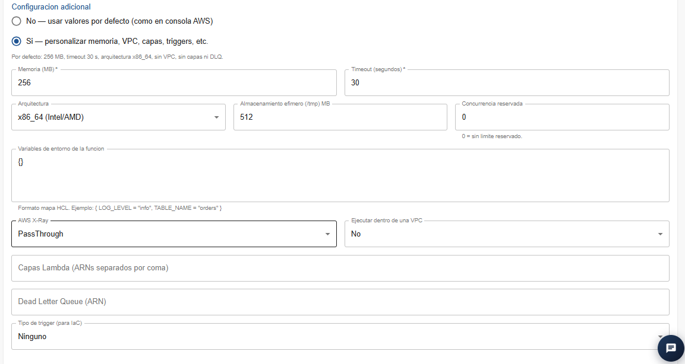

- **usar un esquema**: Es elige un blueprint, el runtime y la arquitectura quedan fijados por el esquema (la arquitectura se puede cambiar en configuración adicional).

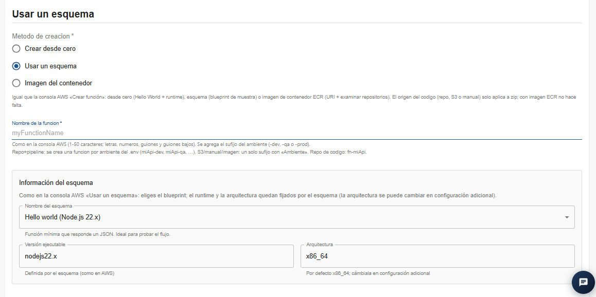

- **imagen de contenedor**: crea un contenedor ECR (URI + examinar repositorios). 

Se debe indicar el origen del codigo (repo, S3 o manual) solo aplica a zip; con imagen ECR no hace falta.

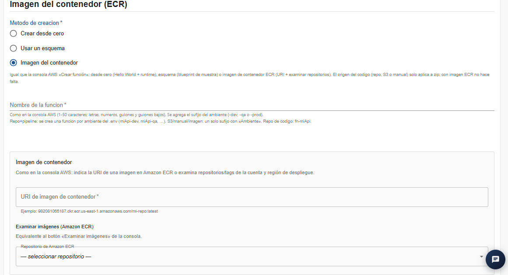

Se muestra para añadir una descripccion (opcional).

Se solicita donde se necesita el condigo despues de crear:

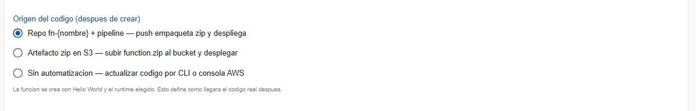

- **Repo fn-{nombre} + pipeline — push empaqueta zip y despliega:** Sube el codigo a un repo y genera su pipeline de empaquetado y despliegue

- **Artefacto zip en S3 — subir function.zip al bucket y desplegar:** se debie indicar bucket de S3 a donde se necesita subir, algun prefijo o carpeta que este o se necesite en el bucket y luego despliega. Solo se debe mencionar el nombre de carpeta o subcarpetas. la vista con esta seleccion indica el destino de la lambda 

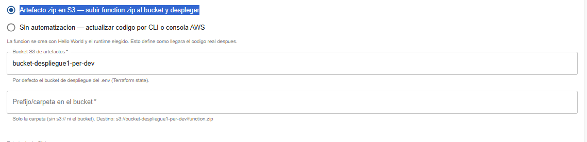

- **Sin automatizacion — actualizar codigo por CLI o consola AWS**

Se indica la estrategia Git necesaria: 

- **Gitflow**: se crea en el ambiente necesario (se confirma mas adelante) separando .env
- **Trunk-based**: se genera un pipeline único sobre rama main con 3 stages para el deploy. 

En cada caso se confirma como se vera la estructura, sus prefijos y politicas.

Al finalizar este paso, se indica en que ambiente sea necesario: 

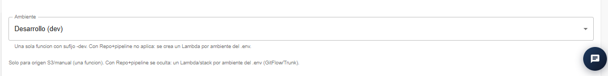

#### Paso 3: Review

Se muestra un resumen de lo que se recibio y lo que se va a realizar.

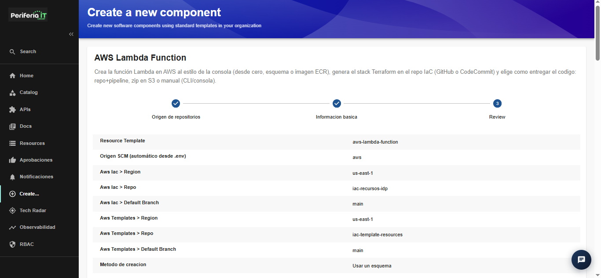

### Lambda — Preview efímero por PR (existente)
#### paso 1: Origen de repositorios

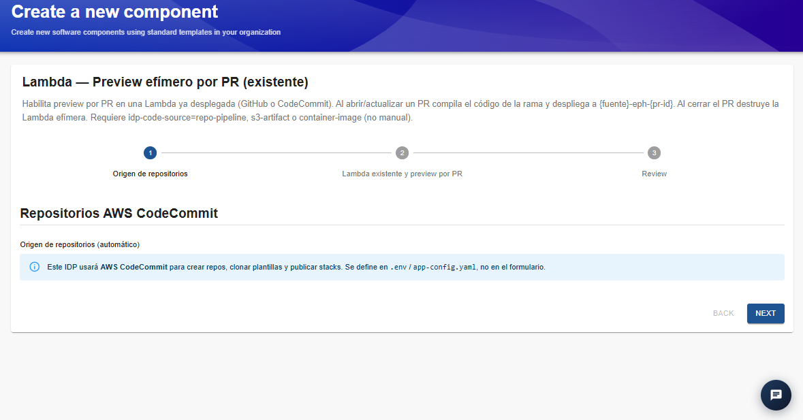

En esta seleccion se habilita una preview por PR en una Lambda ya desplegada (ya sea GitHub o CodeCommit). Al abrir/actualizar un Pull Request compila el código de la rama y despliega a `{fuente}-eph-{pr-id}`. 

Al cerrarse el pull request, se destruye la Lambda efímera. Requiere idp-code-source=repo-pipeline, s3-artifact o container-image (no manual).

#### paso 2: Lambda existente y preview por PR

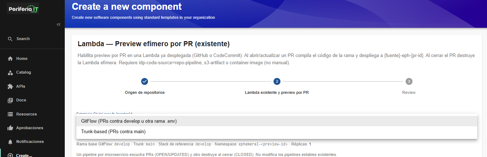

en este paso, se debe seleccionar la estrategia git del repo

**Requisitos:** Lambda creada por el IDP con tags idp-code-source (repo-pipeline, s3-artifact o container-image). Repo de código esperado: fn-{nombreBase} (ej. fuente miApi-dev → repo fn-miApi).

**Flujo habitual (repo+pipeline):** habilita pipelines → abre/actualiza PR → el pipeline compila la rama del PR (feature/xx) y despliega {fuente}-eph-pr-{n}. No eliges rama en el portal: la rama es la del PR.

**Opcional:**campo «Rama preview inmediato» compila esa rama sin PR (CodeCommit; build puntual tras habilitar).

El pipeline estable (fn-*-deploy) no se modifica.

Ya con esto, ubicara la lambda fuente ya extistente en la region. Y se ingresa el nombre de la rama preview (opcional). Tras habilitar pipelines, dispara un build con esa rama (CodeCommit). Para GitHub usa un PR: el pipeline toma la rama del PR automáticamente. Y ya al final, se debe indicar el tiempo que estara habilitada el entorno efimero

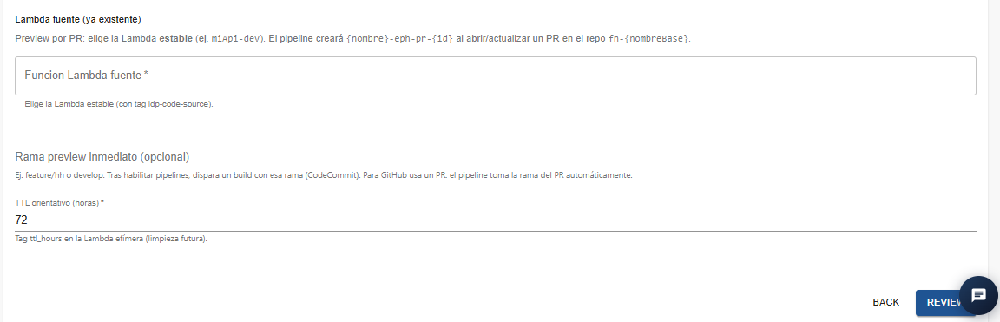

#### Paso 3: review

Se muestra un resumen de lo que se recibio y lo que se va a realizar.

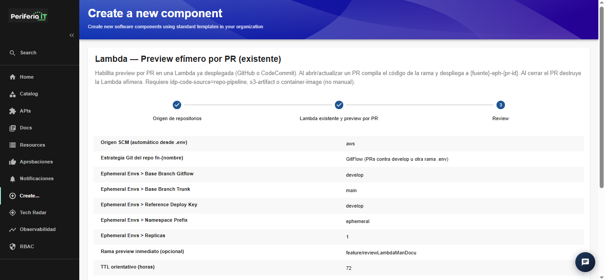

### Desplegar lambda (blue-green / Canary)

#### Paso 1: Función y estrategia

Esta accion despliega un artefacto que este comprimido en zip (o imagen ECR) publicando versiones Lambda y moviendo el alias live. Canary y Blue-Green piden aprobación en el IDP (bajo quien este en rol RBAC). Abortar o completar se ejecuta al momento. 

se debe llenar lo siguiente:
  - **la funcion lambda a desplegar**: muestra la lista de componentes disponibles en formato comprimido tecnologias y pipeline si tiene.
  - **API Gateway y ruta:** Elige el API/path que invoca esta Lambda. El deploy apuntará esa integración al alias live.
  - **Estrategia de despliegue:** se debe elgir la forma de paso de version de aplicacion en el ambiente necesitado. **Canary**: porcentaje en los que se van remplazando los entornos en el ambiente. **blue-green**: crea un ambinte similar al disponible los entornos verdes son para probar y desplegar y azul maneja el trafico real del ambiente.

Al seleccionar la estrategia de despliegue relacinada se habilitara la forma de ejecutar la accion

|Accion Canary| Accion Blue-green|
|-|-|
|iniciar canary (artefacto nuevo +%)|Manual 1/3 - preparar (alias green, sin tocar live)|
|promover canary (100% Live)|Automatico + switch|
|Abortar canary (quitar peso adicional)|Manual 2/3 - switch (live -> green)|
|...|Manual 3/3 - Completar (borrar alias green)|
|...|Abortar|

En la opcion de "Artefacto Zip (S3)", se solicita confirmacion de la version en concreto a desplegar:

|latest|buildID concreto|
|-|-|
|usa el ultimo que se debe contrar en `artifacts/latest/function`. _Solo Zip. Si no hay objetos en S3, publica un artefacto antes (pipeline o aws s3 cp)._|Se habilita un campo para especificar el BuildID de artefacto S3 para desplegar|

#### Paso 2: Review

Se muestra un resumen de lo que se recibio y lo que se va a realizar.

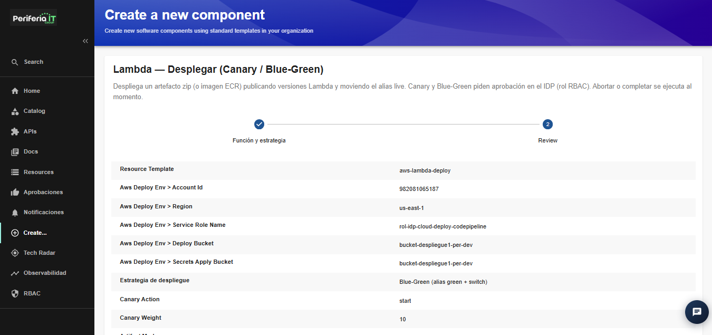

### Microservicio AWS — CI + EKS (Git strategy)

En este servicio, se hace una copia de trabajo del microservicio CI en EKS. Aquí se implementará la estrategia Git y ambientes efímeros. 

Ya con eso, crea ECR, repositorio (GitHub o CodeCommit), CodePipeline/CodeBuild y stacks Terraform en repos-microservices-cluster.

#### Paso 1: Origen de repositorios

En este paso se debe selecionar la region donde se encuentra los repositorios de codecommit, la plantilla de terraform y el destino de los Stack de EKS en forma de cluster.

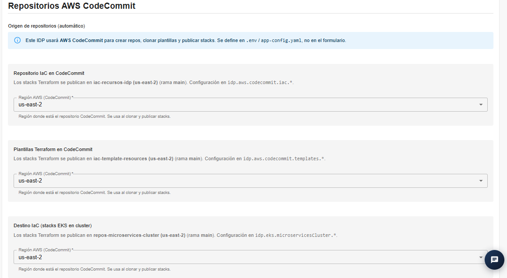

#### Paso 2: Project Information (Informacion del proyecto)

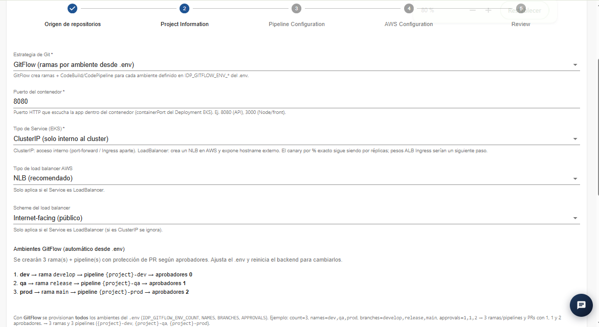

Para este paso, se debe llenar:

- **Estrategia de Git:** Uso de las estrategias ya mencionadas (trunk-based o GitFlow)
- **Puerto de contenedor:** Puerto HTTP que escucha la app dentro del contenedor (containerPort del Deployment EKS).
- **Tipo de Service (EKS):**  Tipo de Service (EKS) si es **ClusterIP** (de acceso interno (port-forward / Ingress aparte)). LoadBalancer: crea un NLB en AWS y expone hostname externo. El canary por % exacto sigue siendo por réplicas; pesos ALB Ingress serían un siguiente paso.
- **Tipo de loadbalancer:** NBL (Network Load Balancer)(recomendado - por defecto) o CLB (Classic Load Balancer)
- **Esquema del load balancer:** como se comunicara el microservicio. si es internet-facing para servicio publico o interno con VPC para ambientes bajos
- **nombre del proyecto:** Nombre base del proyecto CodeBuild (sin espacios). Se agrega sufijo por ambiente según IDP_GITFLOW_ENV_NAMES.
- **nombre del microservicio:** el nombre con el que se diferencia el microservicio
- **Tipo:** que clase de microservicio es. si se trata de frontend o backend
- **Descripccion:** descripccion corta para el pipeline 
- **lenguaje de programacion:** lenguaje del proyecto principal

_en esta vista se confirma los ambientes creara con sus ramas y pipelines. con politicas de creacion y aoturizacion de PRs. Ajusta el .env y reinicia el backend para cambiarlos._

_el nombre que tendra el repositorio sera asignado bajo el formato ms-NOMBRE_DEL_SERVICIO-front o ms-NOMBRE_DEL_SERVICIO-back segun indique su .env_

#### paso 3: Configuracion de pipeline

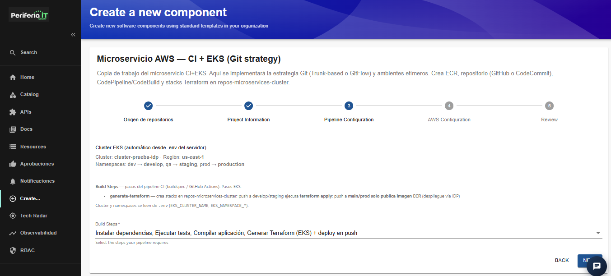

En este paso se elige el nivel de configuracion que necesita el pipeline.

|Nivel|Detalle|
|-|-|
|Instalar Dependencias|instala dependencias necesaria para el funcionamiento del microservicio|
|Ejecutar Test|Ejecucion de pruebas unitarias en el microservicio|
|Compilar aplicacion|pasos de ejecucion para la compilacion de la aplicacion|
|Escaneo de Seguridad|Revision de esquemas de seguridad que se tengan|
|Build Docker|construccion de la imagen docker|
|Publicar artefactos|subir artefactos de compilados o componente del microservicio|
|Generar terraform (EKS) + deploy en push|diseña la plantilla terraform para EKS y hace Deploy|

#### Paso 5: Review

Se muestra un resumen de lo que se recibio y lo que se va a realizar.

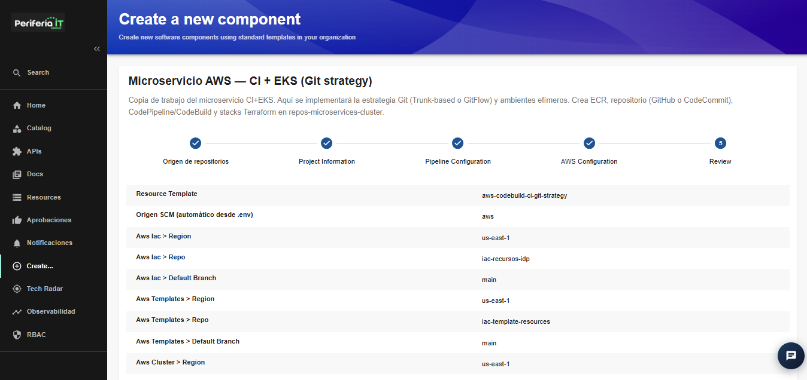

### Branch protection (GitFlow)

Aplica la protección de ramas de la forma GitFlow a un repositorio ya existente. El origen sale de IDP_SCM_PROVIDER / IDP_ENABLE_* en el .env: GitHub (branch protection) o CodeCommit (approval rules). Usa las ramas y aprobadores de IDP_GITFLOW_ENV_* (PR obligatorio, N approvals). No crea repo ni pipelines.

_la ubicacion de origen de los repositorios es automatica_

#### paso 2: Repositorio y reglas GitFlow (.env)

En este paso se debe seleccionar un repositorio que se encuentre en CodeCommit. al seleccionar uno aplicara las politicas que se pueden observar en este paso: 

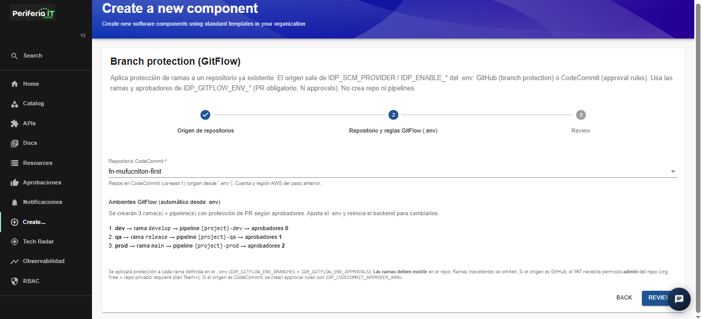

#### paso 3: Review

Se muestra un resumen de lo que se recibio y lo que se va a realizar.

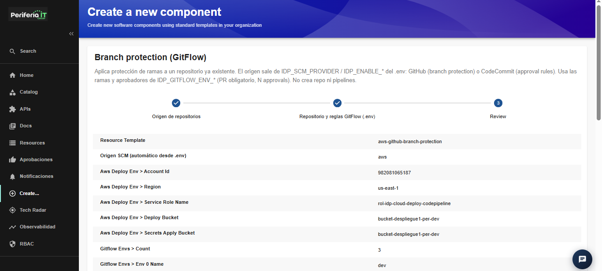

### Branch protection (Trunk)

Aplica protección a la rama trunk de un repositorio ya existente. El origen sale de IDP_SCM_PROVIDER / IDP_ENABLE_* en el .env: GitHub (branch protection) o CodeCommit (approval rules). Usa IDP_TRUNK_MAIN_APPROVALS (PR obligatorio, N aprobadores). No crea repo ni pipelines.

_la ubicacion de origen de los repositorios es automatica_

#### paso 2: Repositorio y reglas GitFlow (.env)

En este paso se debe seleccionar un repositorio que se encuentre en CodeCommit. al seleccionar uno aplicara las politicas que se pueden observar en este paso: 

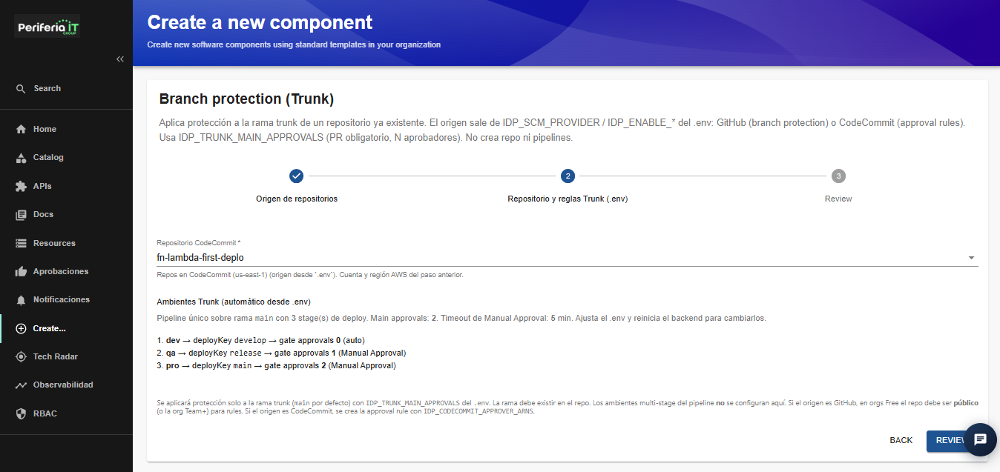

#### paso 3: Review

En este paso, se muestra un resumen de lo que se recibio y lo que se va a realizar.

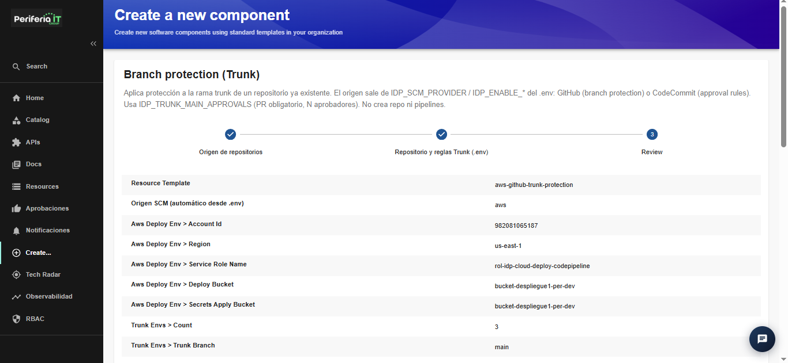

### Microservicio — Preview efímero (repo existente)

Este servicio, habilita una preview por PR en un microservicio que ya exista (GitHub o CodeCommit; GitFlow o Trunk). Crea dos CodePipelines V2 separados del pipeline estable: 

- Uno despliega al abrir/actualizar PR y otro destruye al cerrar. 

Estado Terraform en microservices/ephemeral/{preview-id}/{repo}. No modifica pipelines ni branch protection existentes.

#### paso 1: Origen de repositorios

En el primer paso se debe seleccionar la region de origen para los repositorios de CodeCommit del IaC

los stacks de terraform se publican en el repo repos-microservices-cluster en la rama main en la region us-east-1. 

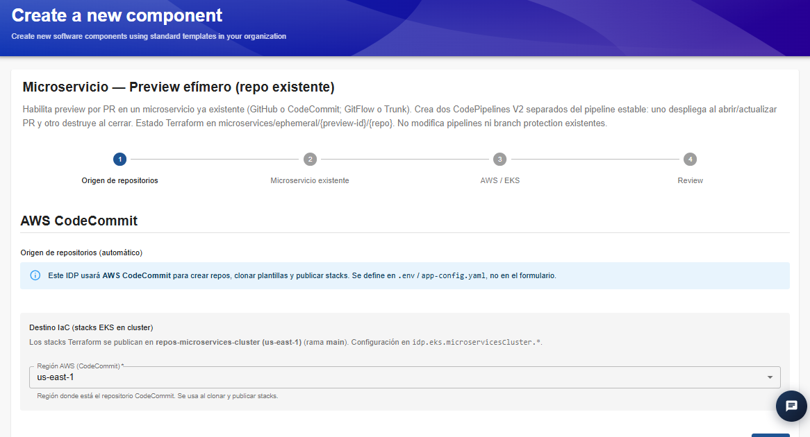

#### paso 2: Microservicio existente

en este paso, se debe definir la estrategia git del repo. aqui, se define la rama base del PR trigger. Debe coincidir con la estrategia ya configurada del microservicio.

al seleccionar un repositorio existente se relacina un pipline existente por ambiente

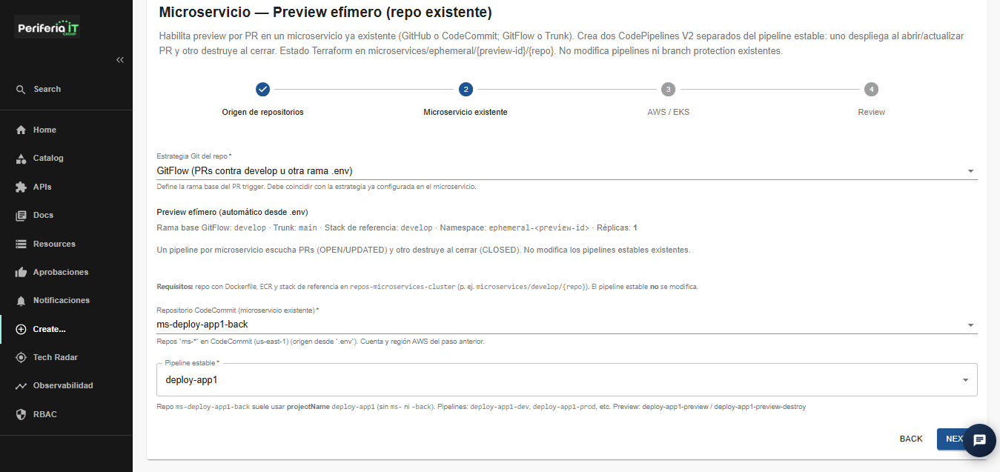

#### paso 3: AWS / EKS

en este paso se confirma los recursos de EKS que se van acrear y con cuales namespaces

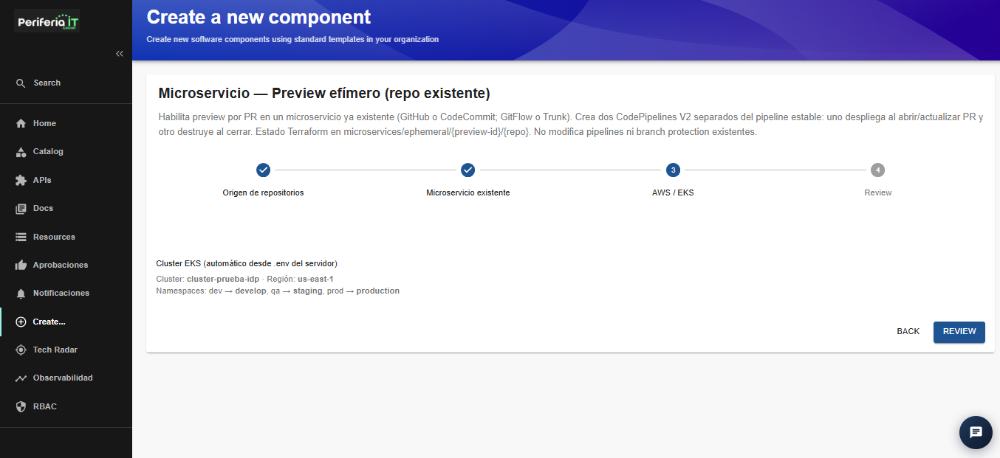

#### Paso 4: preview 

En este paso, se muestra un resumen de lo que se recibio y lo que se va a realizar.

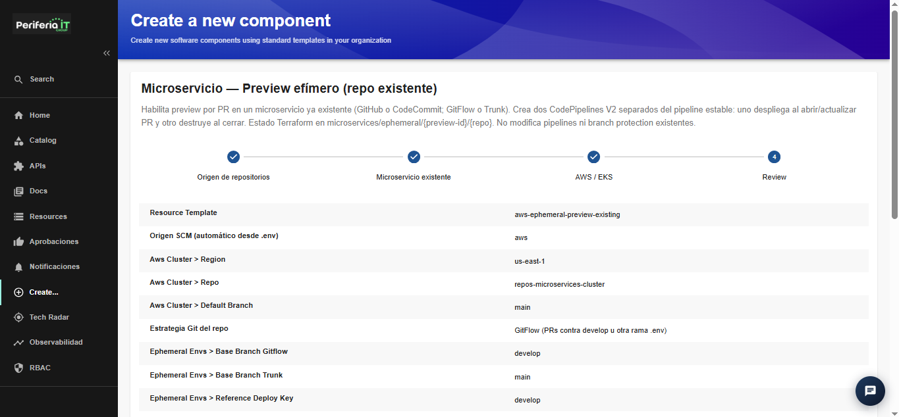

### AWS Microservice Secrets (SM + EKS)

este servicio es para la creacion de secretos para los microservicios en AWS Secrets Manager, enlaza el stack Terraform del microservicio en repos-microservices-cluster (Secret K8s o ExternalSecret) y actualiza .env.example en el repo del microservicio (GitHub o CodeCommit).

#### paso 1: origenes de los repos

es este paso se debe indicar el orgien destino del IaC para la plantilla a ejecutar y publicacion de la plantilla stack Terraform en las regiones.

_el origen de los repos se realiza de forma automatica_

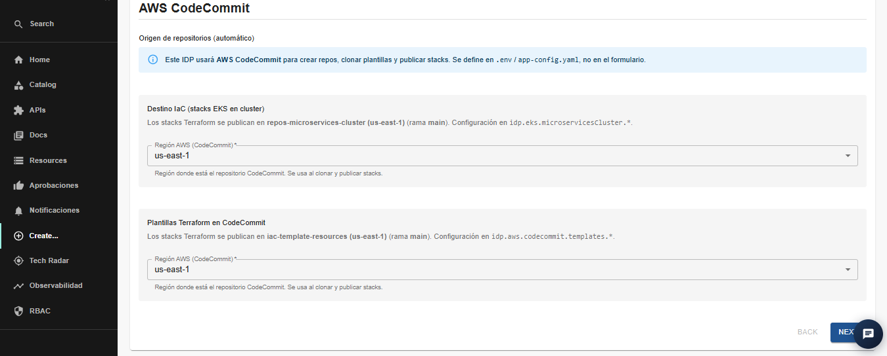

#### paso 2: Secreto y microservicio

en este paso, se debe seleccionar un servicio desplegado para generar el secreto. ya con ese dato, se indican los secretos que sean necesarios y se realiza una sincronizacion:

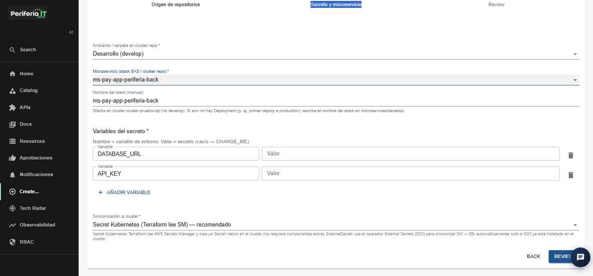

#### paso 3: Review

En este paso, se muestra un resumen de lo que se recibio y lo que se va a realizar.

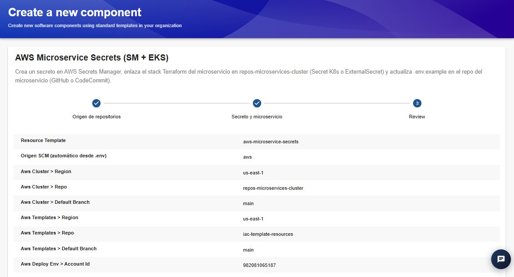

### Microservicio — Desplegar imagen (EKS)

esta accion, despliega una imagen ECR en un microservicio del cluster e actualiza terraform.tfvars, hace push y terraform apply. Estrategias: Rolling Update, Canary por réplicas, o Blue-Green (slot blue/green + switch del Service). En production, rolling/canary/blue-green piden aprobación en el IDP (mismo rol RBAC que Lambda). Abortar o completar se ejecuta al momento. Pensado para producción tras el pipeline que solo publica la imagen en main/production.

#### Paso 1: Origenes de los repos

En este paso, se debe relacionar la region destion para IaC del repositorio. Los stacks Terraform se publican en repos-microservices-cluster (us-east-1) (rama main). Configuración en `idp.eks.microservicesCluster.*.`

_el origen de los repos se realiza de forma automatica_

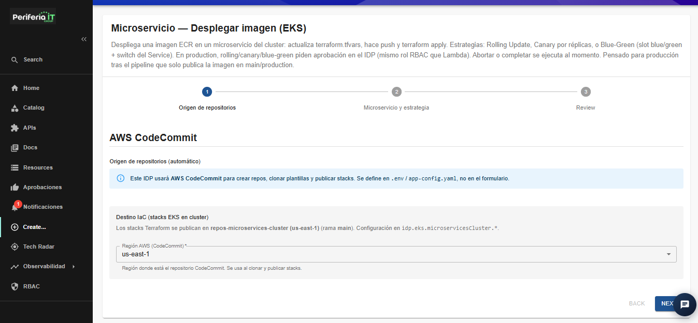

#### paso 2: Microservicio y estrategia

En este paso, se debe seleccionar el microservicio a desplegar y la estrategia para el despliegue del componente

- **Rolling update:** hacer un reemplazo gradual del deplyment actual del microservicio
- **Canary:** hacer un despliegue porcentual del microservicio al ambiente
- **blue-green:** replica el ambiente actual y realiza switch con los servicios activos

otros requisitos es relacionar el ambiente el microservicio ya desplegado, el URI de imagen de contenedor como se hace en AWS CLI, indica la URI de una imagen en Amazon ECR o examina repositorios/tags de la cuenta y región de despliegue; 

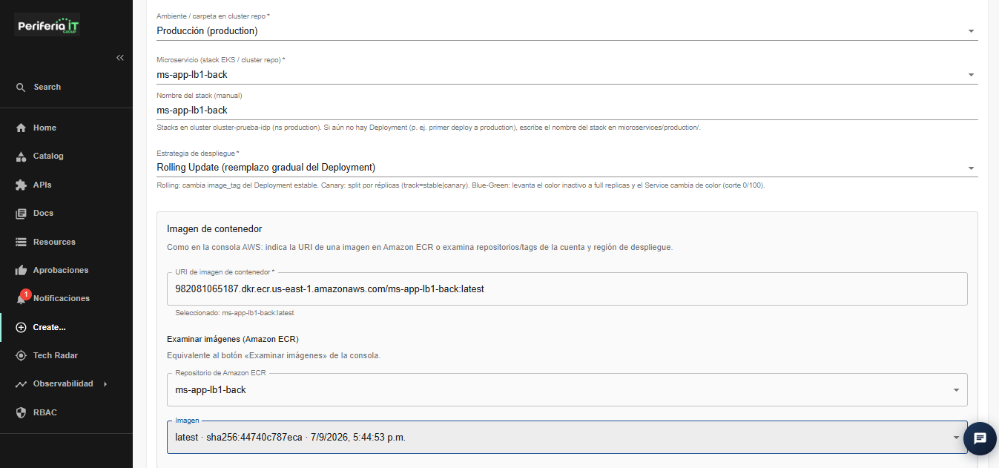 . 

#### paso 3: Review

En este paso, se muestra un resumen de lo que se recibio y lo que se va a realizar.

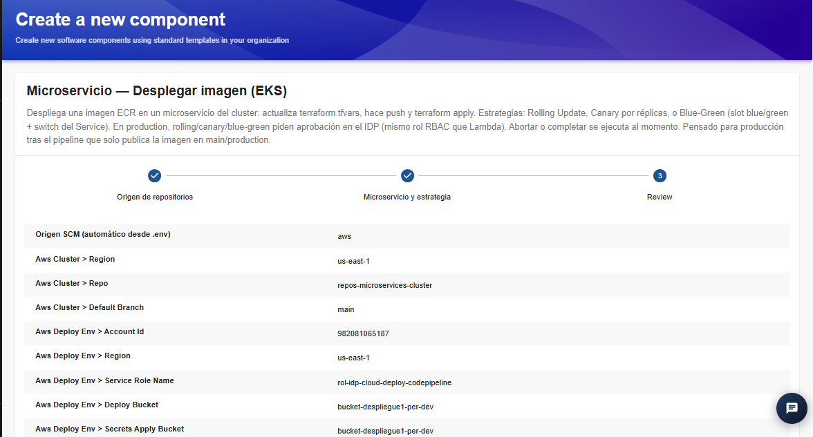

### AWS CloudFront — Sitio estático (S3 + CI/CD)

en este servicio, se crea un bucket S3 compartido con prefijo por ambiente, OAC y CloudFront por cada ambiente definido en IDP_GITFLOW_ENV_* o IDP_TRUNK_ENV_* (.env), un repo frontend pipelines GitFlow (rama por ambiente) o Trunk (un pipeline multi-stage) y stacks Terraform de infra y CI en el repo IaC.

#### paso 1: configuracion

es este paso se debe indicar la región donde está el repositorio CodeCommit del repositorio IaC en CodeCommit y las plantillas Terraform en CodeCommit. Se usa al clonar y publicar stacks.

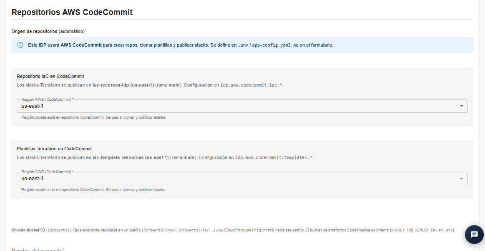

tambien, se debe indicar un nombre para el proyecto el nombre tiene que ser base en minúsculas. se creara Un solo bucket S3 con carpetas por ambiente (dev/, qa/, …), un CloudFront por ambiente apuntando a su prefijo, repo mi-app-frontend y pipelines por ambiente. 

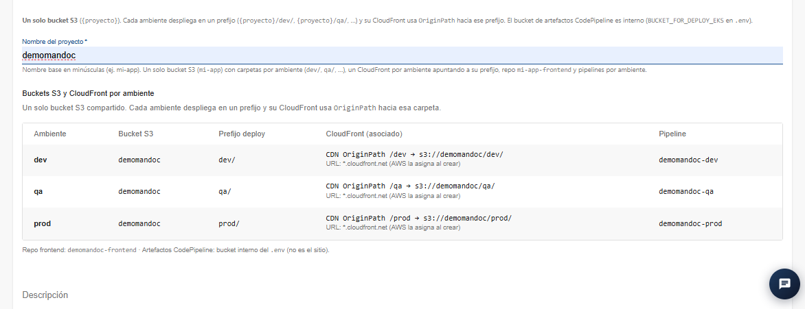

La descripccion puede ser corta y es opcional.

La estrategia de branching es por defecto GitFlow. Pero tambien puede cambiarse a trunk-based. 

En caso de ser diferente, el objeto raiz del sitio estatico. por defecto es index.html

en caso particular, ingresar un dominio personalizado. El servicio puede confirmar la disponibilidad de dominio consuktando las hosted zones en route 53. puede dejar vacío los campos. hacer esto, usara solo la URL de CloudFront (*.cloudfront.net). Al indicar dominio, se necesita un certificado ACM en `us-east-1` que lo cubra (wildcard recomendado).

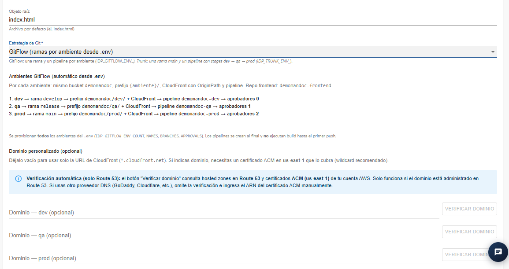

#### paso 2: review

En este paso, se muestra un resumen de lo que se recibio y lo que se va a realizar.

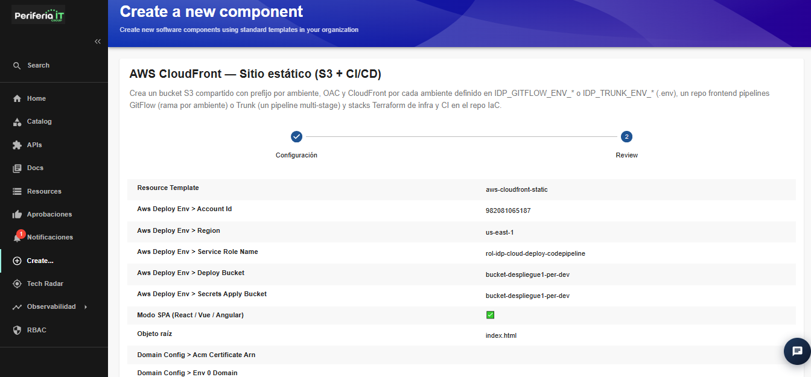

### CloudFront — Preview efímero por PR (existente)

en esta accion, se habilita una preview por PR en un sitio CloudFront ya desplegado por el IDP. Al abrir/actualizar un PR compila la rama y despliega a `s3://{proyecto}/preview-pr-{id}/` con una distribución CloudFront efímera etiquetada (`idp-lifecycle=ephemeral`). Al cerrar el PR, se destruyen los recursos.

#### paso 1: origen de los repos

_el origen de los repos se realiza de forma automatica. se usara codeCommit para la generacion de los recursos necesarios. esto es definido de forma automatica por la configuracion en los .envs_

#### paso 2: Sitio CloudFront y preview por PR

en este paso, se debe indicar que estrategia de branching se tomara para el ambiente efimero y su preview es bajo estos parametros:
  - Rama base GitFlow: develop
  - Rama base Trunk: main 
  - Stack de referencia: develop
  - Namespace: `ephemeral-<preview-id>`
  - Réplicas: 1 

ya mas adelante, se selecciona un sitio cloudfront estable que se encuentran en la lista desplegable: 

y al finalizar, se debe indicar un tiempo maximo operativo del ambiente efimero.

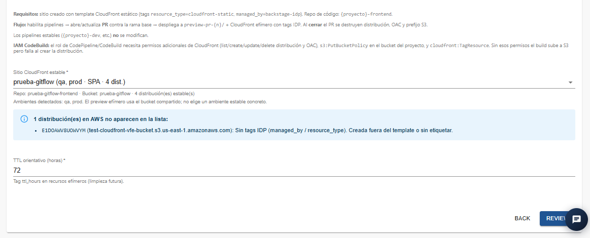

#### paso 3: review

En este paso, se muestra un resumen de lo que se recibio y lo que se va a realizar.

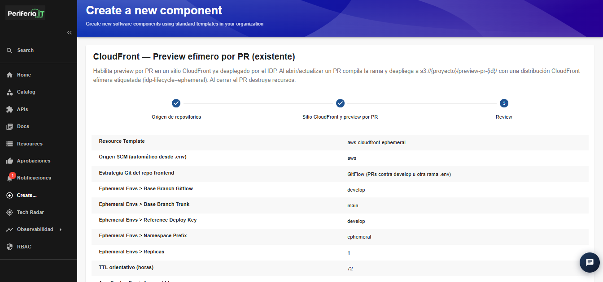

### CloudFront — Desplegar (Canary / Blue-Green)

este servicio, despliega un artefacto ya publicado por el pipeline de main. Canary CD:  (hasta 15% de staging). Canary Lambda@Edge: peso 10-80% en la URL oficial. Blue-Green: OriginPath 100% a green. En prod, canary y blue-green 

estos solicitan aprobación dentro de IDP (mismo rol RBAC que Lambda/EKS). Estos se pueden ver en la seccion aprobaciones 

#### paso 1: sitio y estrategia

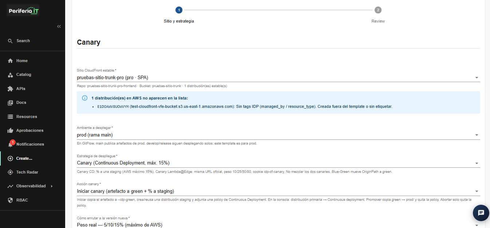

en este paso, se debe seleccionar un sitio cloudfront estable de la lista desplegable

Tambien se debe relacionar:
- ambiente (por defecto prod)
- estrategia de despliegue (por defecto canary 15%)
- accion canary (por defecto artefacto a green + % a stagging)
  - en caso de artefacto a green + % a stagging se debe indicar forma de la nueva enrutacion(enrutacion por defecto pruebas - header) y version de artefacto (por defecto latest)
    - en caso de enrutacion de nueva version de peso real se debe indicar el porcentaje canary (por defecto 15% maximo AWS) y componente (por defecto: latest)
- las otras acciones son para despliegue blue-green o abortar despliegue.

#### paso 2: review

En este paso, se muestra un resumen de lo que se recibio y lo que se va a realizar.

### AWS S3 — Subir archivos

esta accion, sube archivos a un bucket S3 que ya exista. 

#### paso 1: Destino en AWS

en este paso se elige bucket, carpeta existente o raíz, o crea una carpeta nueva y sube los archivos dentro. Usa «AWS S3 Bucket» si aún no se tiene bucket.

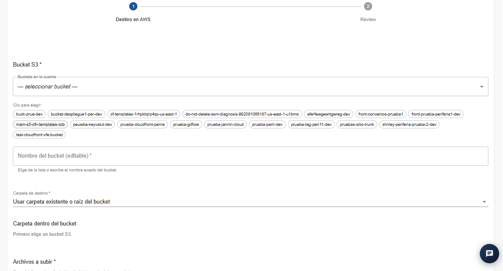

por defecto se encuentran buckets que ya esten asociados a la sesion inciada. cuando se selecciona 1 se debe indicar la carpeta destino. al ser opcional, si no se especifica, el servicio almacenara por defecto en la raiz del bucket.

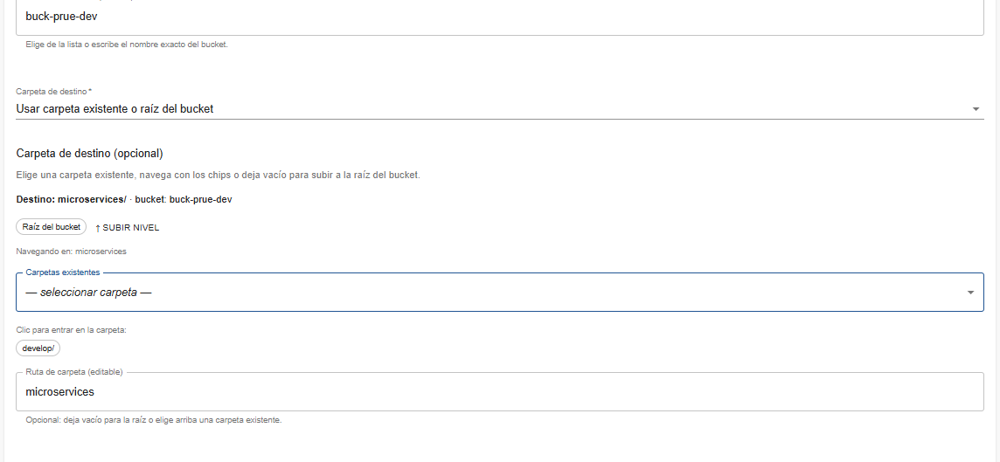

ya para finalizar, se debe adjuntar los archivos a subir. se pueden subir archivos hasta los limites:

- maximo 10 MB por archivo
- un maximo de 20 MB en total de archivos
- maximo 10 archivos

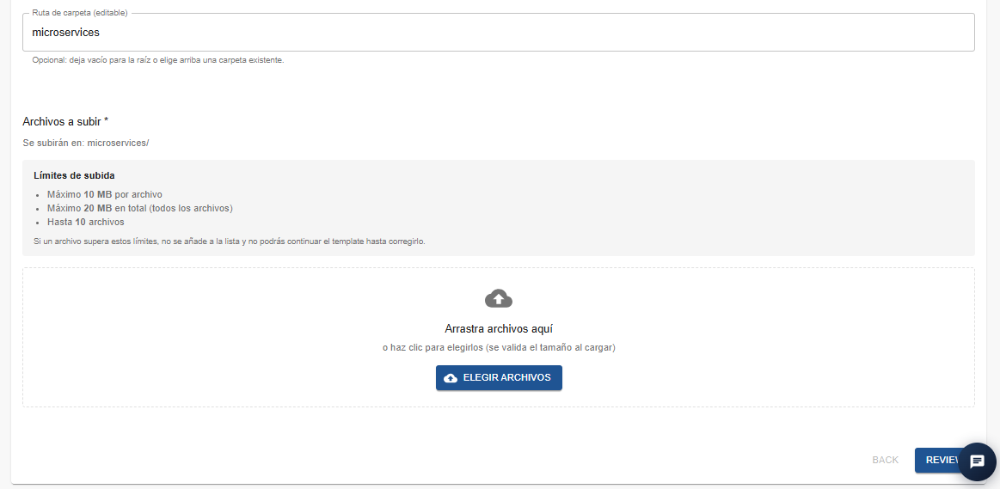

#### paso 2: review

En este paso, se muestra un resumen de lo que se recibio y lo que se va a realizar.

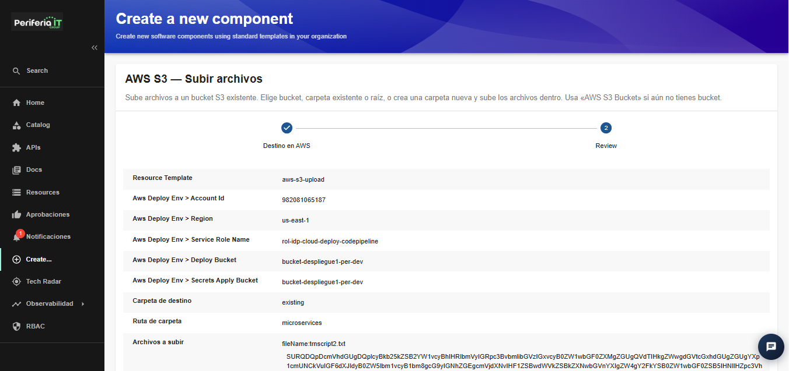

### Eliminar recurso AWS

esta accion, se genera una solicitud para borrar un recurso AWS (S3, Lambda, CloudFront, CodePipeline, CodeBuild, CodeCommit, GitHub o ECR). en este servicio siempre se pide aprobación. sin ella, no se realizan cambios en AWS. En ningún ambiente.

#### paso 1: Cuenta y tipo

se debe seleccionar de que componente se va a eliminar. se debe indicar el dueño (owner) para eliminar el recurso en GitHub y indicar el nombre del recurso a eliminar.

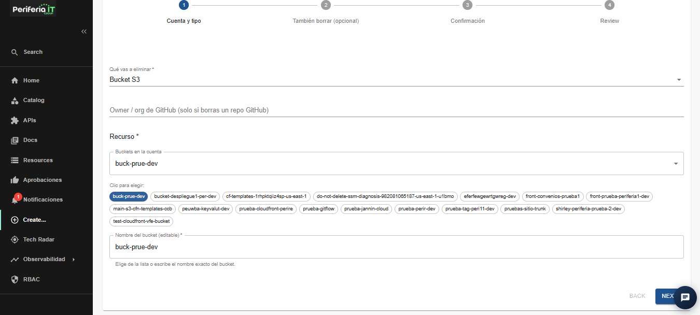

#### paso 2: También borrar (opcional)

En este paso, se indican campos para eliminar otros recursos en caso de ser necesario.

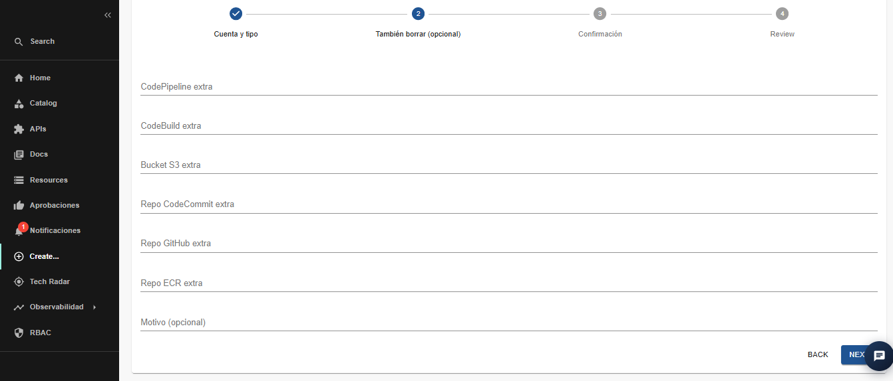

#### paso 3: Confirmación 

Este paso, es un prompt de verificacion para confirmar la eliminacion 

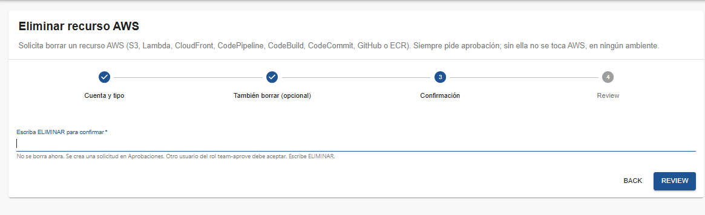

#### paso 4: review

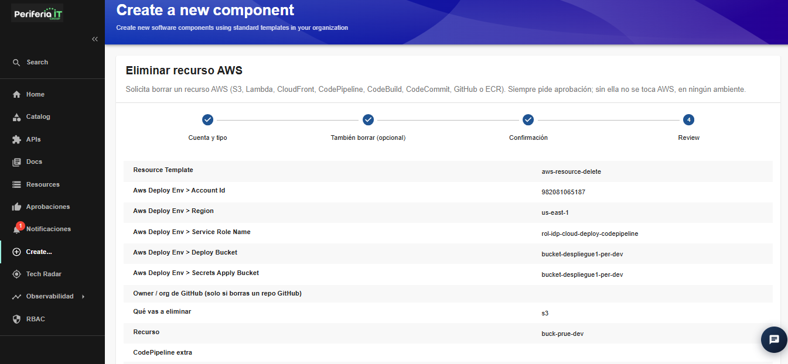

