## seccion create

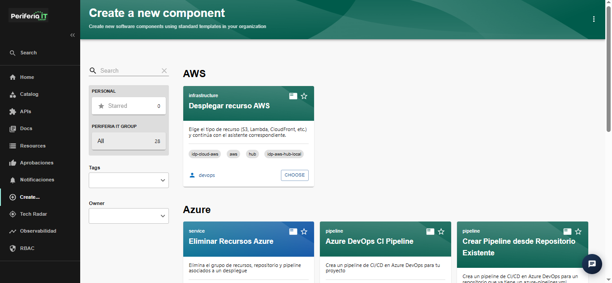

En esta seccion se tienen los templates disponibles para la aplciacion de infraestructura que ofrece IDP. En azure se puede observar cada recuso que puede desplegar en cada template y se visualiza en cada una de las tarjetas de esta vista: 

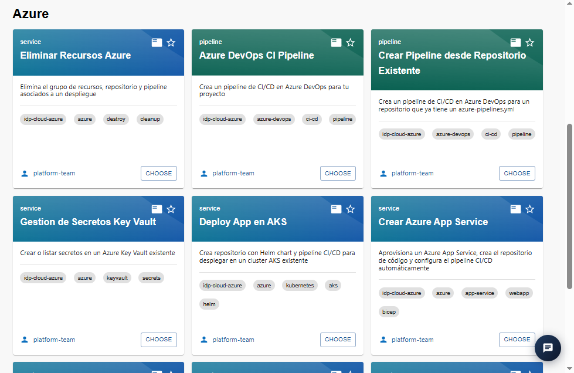

Para AWS se tiene centralizado todos los servicios que puede instanciar IDP en una sola tarjeta:

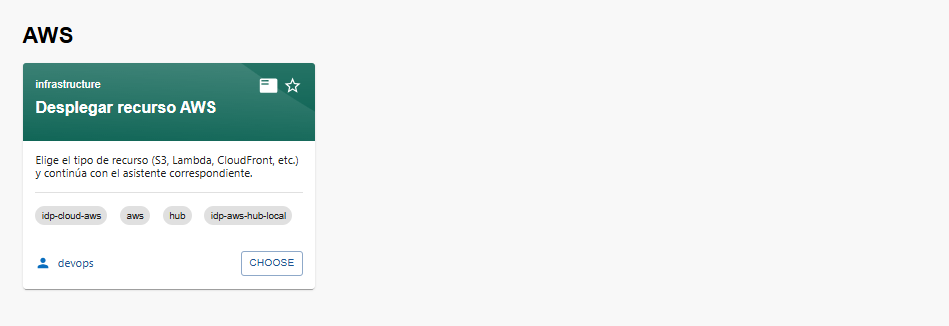

seleccionando es opcion se pide seleccionar el tipo de recurso y este lo redirija a el asistente correspondiente: 

### AWS S3 Bucket

Esta opcion genera el bucket en AWS, su stack de Terraform en el repo IaC (GitHub o AWS CodeCommit, dev/qa/prod) y hace push. Cada bucket tiene carpeta y state propios.

#### paso 1: Origen de repositorios
##### Repositorio IaC en CodeCommit

En el primer paso se solicita relacionar la region de ubicacion del Repositorio IaC dentro de CodeCommit

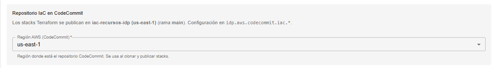

##### Plantillas Terraform en CodeCommit

Ademas, se debe indicar la region donde se encuentra ubicado el repositorio con el template terraform dentro de AWS:

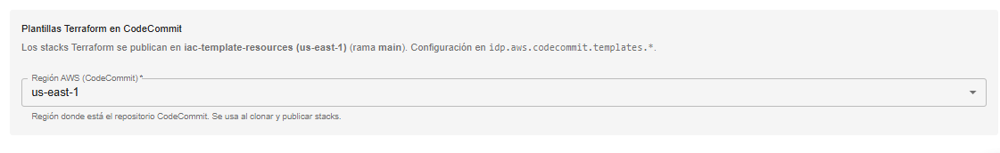

_para pasar al siguiente paso, selecionar 'next'_

#### paso 2: Configuracion general

En este paso se indica propiedades adicionales al bucket. Se relzaiona un nombre el ambiente que se requere. Dependiendo del ambiente, IDP asignara de forma automatica un prefijo dependiendo de que ambiete se haya seleccionado 

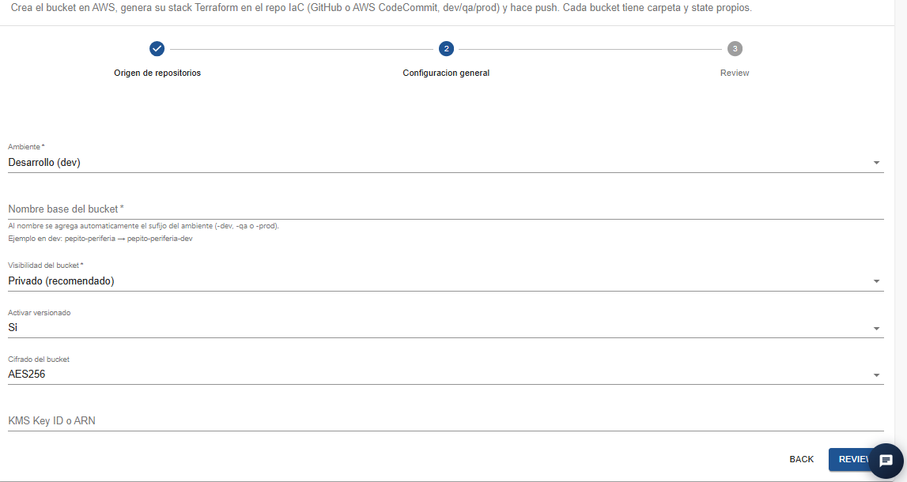

para pasar al siguiente paso, selecionar 'PREVIEW'

#### paso 3: Review

En esta vista, es un resumen de lo indicado en pasos anteriores y que mas propiedades va a tener el bucket a crear

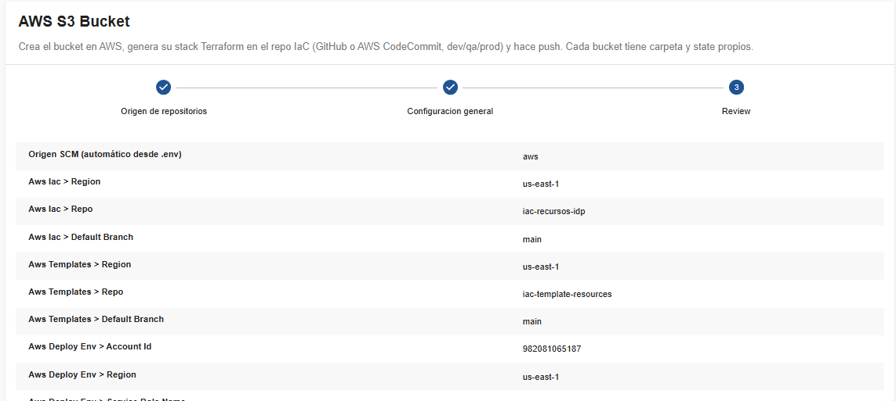

_para hacer que la utilidad proceda se selecciona 'CREATE'

### AWS S3 Bucket — Actualizar

Esta opcion es para realizar modifiacion en un bucket de S3 ya existente. Hace cambios en el versionado, la visibilidad e cifrado del bucket usando stack Terraform en un repo IaC. Al Hacer push, por medio de  GitHub Actions, aplica solo ese stack. 

#### paso 1: Origen del repositorio IaC

al continuar con el asistente, en el paso uno, se debe indicar la region donde esta ubicado el repositorio IaC en CodeCommit del stack de terraform

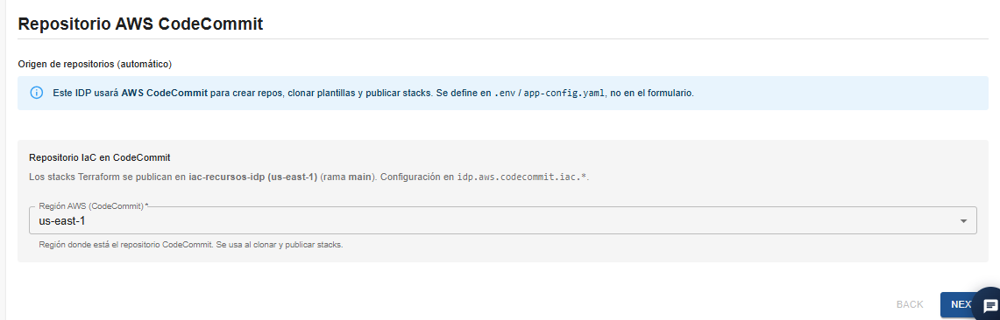

#### Paso 2: Bucket a actualizar

En este paso, se selacciona el bucket a modificar de la lista desplegable y se permite modificar los datos que se ven en el formulario (Nombre del bucket - editable, visibilidad activar versionado cifrado del bucket y algun identifcador unico en caso de ser necesario.)

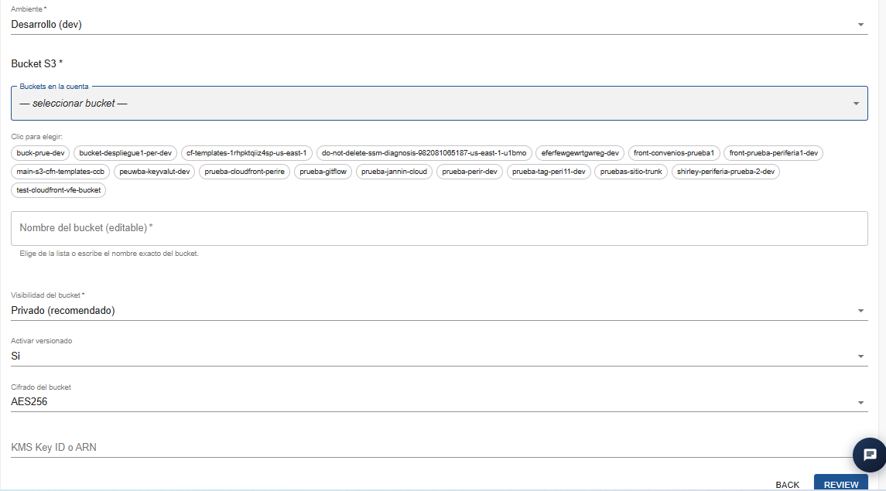

#### Paso 3: Review

Ya para confirmar los cambios, se muestra una vista previa de lo anotado en los pasos anteriores para realizar el cambio.

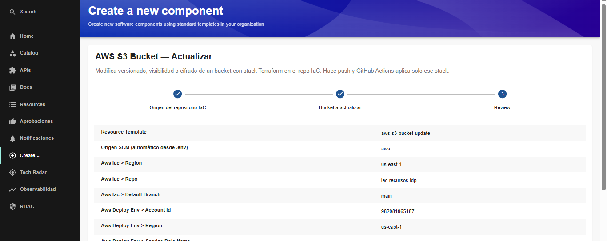

### AWS S3 Bucket - Eliminar

#### Paso 1: Origen del repositorio IaC

Esta accion realiza una eliminacion de bucket en AWS y marca el stack en el repo IaC como eliminado. Los archivos Terraform se conservan como traza (`DELETED.md`).

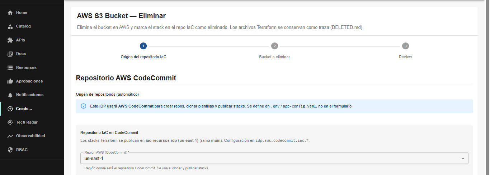

#### Paso 2: Bucket a eliminar

En este paso, se selecciona el bucket de S3 de la lista que se encontro en la region indicada en el paso anterior. se solicita confirmar el nombre y el motivo es opcional.

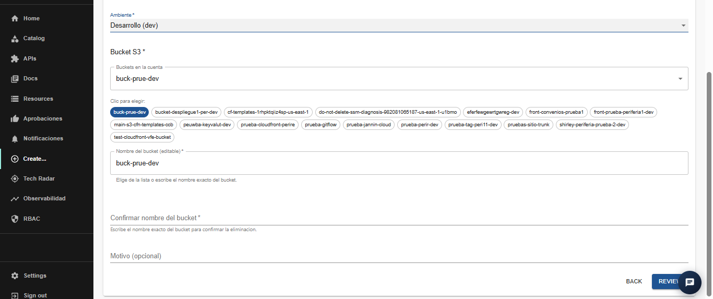

#### Paso 3: review

Antes de proceder con la eliminacion, se genera una vista general de lo que se va a hacer por parte de IDP

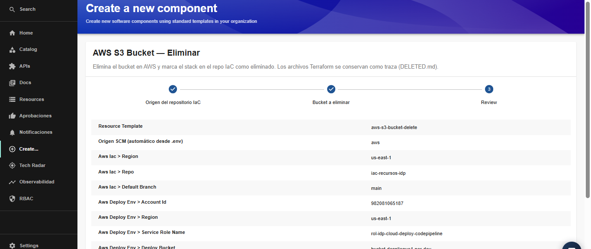

### Lambda Function 

En esta accion, se crea la función Lambda en AWS desde cero, esquema o imagen ECR. genera el stack Terraform en el repo IaC (GitHub o CodeCommit) y se seleccion como entregar el codigo: repo+pipeline, zip en S3 o manual (CLI/consola).

#### Paso 1: Origen de repositorios

En el paso 1, se solicita indicar la region en donde se necesita tener la Lambda function

#### Paso 2: Informacion basica