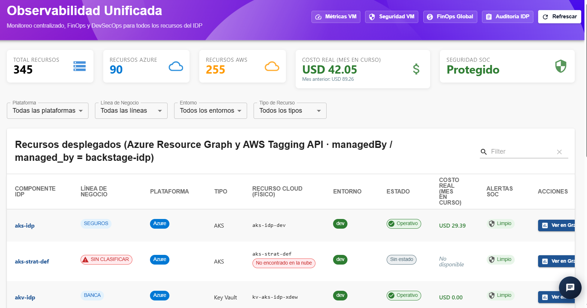
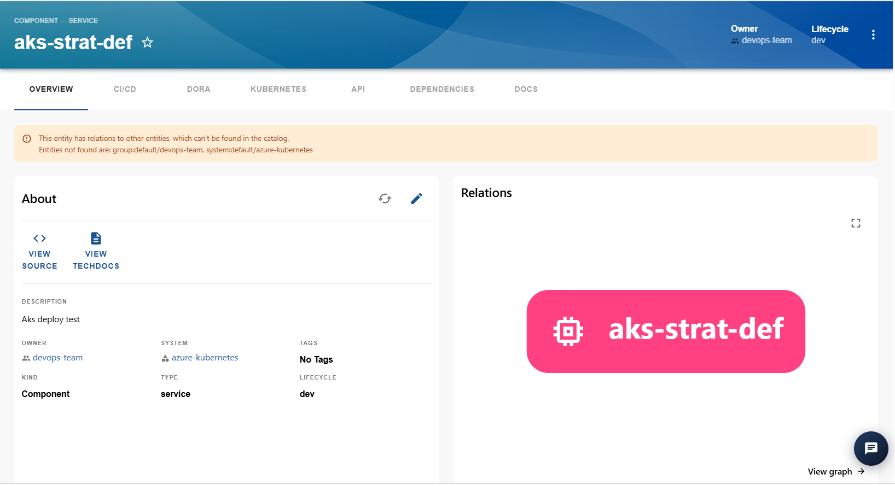
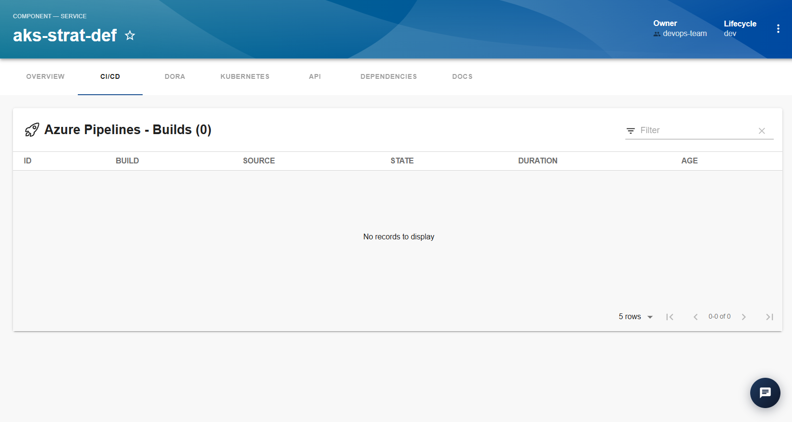
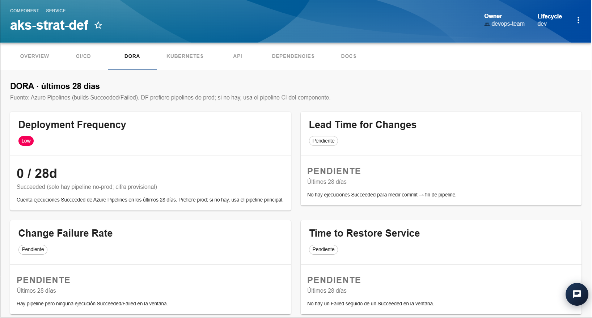
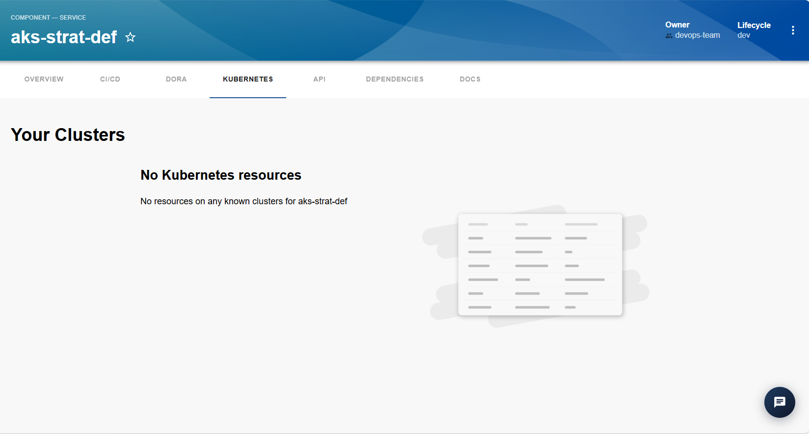
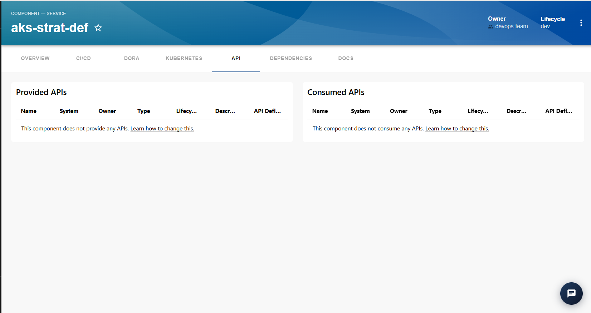
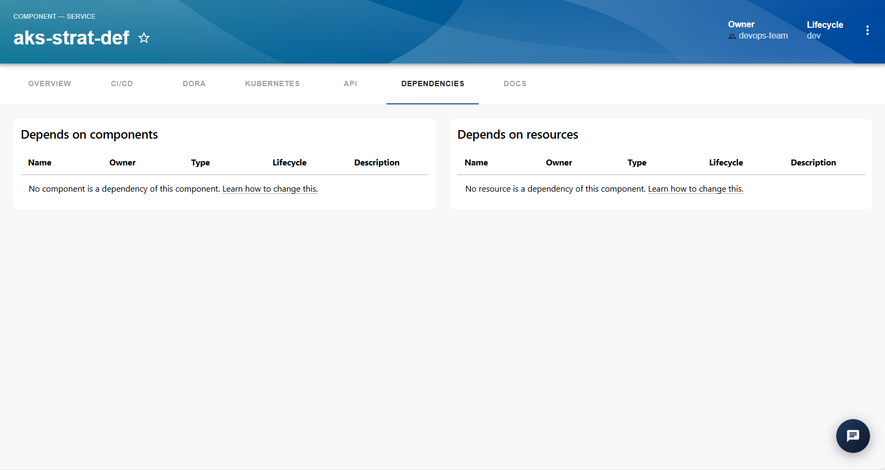

## Sección Observabilidad

La sección **Observabilidad Unificada** permite consultar información centralizada sobre los recursos gestionados por el IDP, incluyendo información de infraestructura, costos, estado operativo y seguridad.

La vista presenta indicadores generales, filtros para facilitar la búsqueda y una tabla con los recursos identificados en las plataformas cloud. También permite acceder al detalle de cada componente para consultar información adicional sobre sus características, ejecuciones, métricas, APIs y dependencias.

### 1. Indicadores generales

En la parte superior de la pantalla se muestran tarjetas con información resumida del estado de los recursos y de su gestión.

- **Total recursos:** muestra la cantidad total de recursos identificados por la plataforma.
- **Recursos Azure:** indica la cantidad de recursos asociados a Azure.
- **Recursos AWS:** indica la cantidad de recursos asociados a AWS.
- **Costo real (mes en curso):** muestra el costo acumulado del mes actual y, cuando está disponible, el valor correspondiente al mes anterior.
- **Seguridad SOC:** presenta el estado general de seguridad reportado por la plataforma.

### 2. Accesos a vistas especializadas

En la parte superior derecha se encuentran los accesos a diferentes vistas complementarias:

- **Métricas VM:** permite acceder a la vista de métricas de máquinas virtuales.
- **Seguridad VM:** permite consultar la vista relacionada con la seguridad de las máquinas virtuales.
- **FinOps Global:** permite acceder a la información financiera y de costos.
- **Auditoría IDP:** permite consultar la vista de auditoría de la plataforma.
- **Refrescar:** permite solicitar la actualización de la información mostrada.

### 3. Filtros de recursos

La sección dispone de filtros que permiten delimitar los recursos presentados en la tabla.

- **Plataforma:** permite seleccionar la plataforma cloud, como Azure o AWS, o consultar todas las plataformas.
- **Línea de negocio:** permite filtrar por la línea de negocio asociada al recurso.
- **Entorno:** permite seleccionar el entorno correspondiente, por ejemplo, desarrollo.
- **Tipo de recurso:** permite filtrar por el tipo de recurso, como AKS o Key Vault.

Los filtros facilitan la consulta de los recursos según los criterios seleccionados.

### 4. Listado de recursos desplegados

La tabla **Recursos desplegados** presenta los recursos identificados mediante Azure Resource Graph y AWS Tagging API, de acuerdo con los criterios de gestión indicados en la vista.

La información se organiza en las siguientes columnas:

- **Componente IDP:** nombre del componente registrado en la plataforma.
- **Línea de negocio:** línea de negocio asociada al componente.
- **Plataforma:** proveedor cloud donde se encuentra el recurso.
- **Tipo:** tipo de recurso de infraestructura.
- **Recurso cloud (físico):** nombre del recurso identificado en la plataforma cloud.
- **Entorno:** entorno al que pertenece el recurso.
- **Estado:** estado reportado para el recurso.
- **Costo real (mes en curso):** costo asociado al recurso durante el mes actual, cuando está disponible.
- **Alertas SOC:** indicador relacionado con las alertas de seguridad del recurso.
- **Acciones:** opciones para consultar información adicional.

### 5. Interpretación de los estados

Los recursos pueden presentar etiquetas que permiten identificar su situación dentro de la plataforma.

- **Operativo:** el recurso aparece reportado como operativo.
- **Sin estado:** no se dispone de un estado operativo para mostrar en la vista.
- **Sin clasificar:** el recurso no tiene una línea de negocio clasificada.
- **No encontrado en la nube:** el recurso esperado no fue localizado en la plataforma cloud.
- **Limpio:** el indicador de seguridad mostrado no presenta alertas para el recurso según la información disponible.

Los valores mostrados dependen de la información obtenida de las plataformas cloud y de los servicios integrados.

### 6. Búsqueda de recursos

En la parte superior derecha de la tabla se encuentra el campo **Filter**, que permite buscar elementos dentro del listado.

Para realizar una búsqueda, se introduce el término correspondiente en el campo. Para limpiar la búsqueda, se utiliza el control situado a la derecha.

### 7. Consulta del detalle de un componente

Al seleccionar el nombre de un componente en la tabla de recursos desplegados, el IDP redirige al usuario a la vista de detalle del componente dentro del catálogo.

Esta vista permite consultar información específica del elemento mediante diferentes pestañas.

En la parte superior se muestra el nombre del componente, su tipo, el propietario (*Owner*) y el ciclo de vida (*Lifecycle*). También se encuentra la opción para marcarlo como favorito.

#### 7.1. Overview

La pestaña **Overview** presenta la información general del componente:

- **Description:** descripción del componente.
- **Owner:** equipo o usuario responsable.
- **System:** sistema al que pertenece.
- **Tags:** etiquetas asociadas.
- **Kind:** clasificación del elemento, por ejemplo, Component.
- **Type:** tipo de componente, por ejemplo, service.
- **Lifecycle:** etapa del ciclo de vida, por ejemplo, dev.

También puede incluir accesos a **View Source** y **View TechDocs**, cuando están disponibles, para consultar el código fuente y la documentación técnica.

El apartado **Relations** permite visualizar las relaciones del componente con otras entidades registradas en el catálogo. 

#### 7.2. CI/CD<>

La pestaña **CI/CD** permite consultar información de las ejecuciones de integración y entrega continua asociadas al componente.

En la vista de Azure Pipelines se presenta una tabla con los siguientes campos:

- **ID:** identificador de la ejecución.
- **Build:** nombre o referencia de la compilación.
- **Source:** origen de la ejecución.
- **State:** estado de la compilación.
- **Duration:** duración de la ejecución.
- **Age:** antigüedad de la ejecución.

La tabla dispone de un campo **Filter** para buscar registros. Cuando no existen ejecuciones disponibles, se muestra el mensaje *No records to display*.

#### 7.3. DORA

La pestaña **DORA** presenta indicadores relacionados con el desempeño del proceso de entrega de software. En la vista observada, las métricas corresponden a los últimos 28 días.

- **Deployment Frequency:** frecuencia de despliegue.
- **Lead Time for Changes:** tiempo transcurrido desde los cambios hasta su entrega.
- **Change Failure Rate:** proporción de cambios que generan fallos.
- **Time to Restore Service:** tiempo necesario para restaurar el servicio después de un fallo.

Cada indicador presenta su estado y, cuando hay información disponible, el valor correspondiente.

#### 7.4. Kubernetes

La pestaña **Kubernetes** está destinada a consultar información relacionada con los recursos Kubernetes asociados al componente, cuando existe información disponible.

#### 7.5. API

La pestaña **API** presenta dos apartados:

- **Provided APIs:** APIs proporcionadas por el componente.
- **Consumed APIs:** APIs consumidas por el componente.

Las tablas permiten consultar datos como nombre, sistema, propietario, tipo, ciclo de vida, descripción y definición de las APIs.

Cuando no existen APIs asociadas, la plataforma muestra un mensaje indicando que el componente no proporciona o consume APIs.

#### 7.6. Dependencies

La pestaña **Dependencies** permite consultar las dependencias del componente mediante dos apartados:

- **Depends on components:** componentes de los que depende el elemento seleccionado.
- **Depends on resources:** recursos de los que depende el elemento seleccionado.

Las tablas presentan información como nombre, propietario, tipo, ciclo de vida y descripción, según corresponda.

Si no existen dependencias registradas, se muestra un mensaje indicando que no hay componentes o recursos asociados.

#### 7.7. Docs

La pestaña **Docs** permite consultar la documentación asociada al componente, cuando está disponible en la plataforma.

### 8. Menú de opciones del componente

En la parte superior derecha de la vista de detalle se encuentra un menú de tres puntos con las siguientes opciones:

- **Unregister entity:** permite retirar el registro de la entidad del catálogo.
- **Inspect entity:** permite inspeccionar la entidad y consultar información técnica relacionada con su registro.
- **Copy entity URL:** permite copiar la dirección de la entidad para acceder posteriormente a ella o compartir su ubicación.

Las acciones disponibles pueden depender de los permisos del usuario y de la configuración de la plataforma.