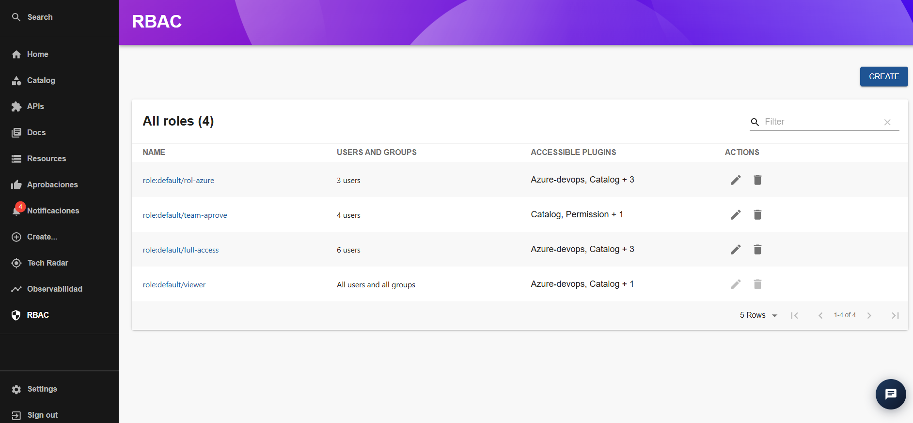

## Sección RBAC

La sección **RBAC (Role-Based Access Control)** permite consultar y administrar los roles de acceso definidos en el IDP. Los roles agrupan usuarios y grupos, y determinan a qué complementos o funcionalidades de la plataforma pueden acceder.

En la vista principal se presenta una tabla con los roles registrados y la información asociada a cada uno. También se dispone de opciones para crear, buscar, editar y eliminar roles, según los permisos disponibles.

### Listado de roles

La tabla **All roles** muestra los roles registrados en la plataforma. Para cada rol se presenta la siguiente información:

- **Name:** nombre o identificador del rol. Por ejemplo, `role:default/rol-azure`.
- **Users and Groups:** cantidad de usuarios y grupos asociados al rol. También puede indicar que el rol aplica a todos los usuarios y grupos.
- **Accessible Plugins:** complementos o funcionalidades del IDP a los que el rol tiene acceso.
- **Actions:** opciones disponibles para administrar el rol, como editarlo o eliminarlo.

Entre los roles visibles en la captura se encuentran:

- `role:default/rol-azure`
- `role:default/team-aprove`
- `role:default/full-access`
- `role:default/viewer`

Los nombres y las asignaciones mostrados corresponden a la configuración existente en el momento de la captura.

### Búsqueda de roles

En la parte superior derecha de la tabla se encuentra el campo **Filter**, que permite buscar roles dentro del listado.

Para realizar una búsqueda, se introduce el nombre o término correspondiente en el campo. Para limpiar la búsqueda, se utiliza el icono de la derecha.

### Crear un rol

En la parte superior derecha de la pantalla se encuentra el botón **CREATE**, que permite iniciar el proceso de creación de un nuevo rol.

Esta opción se utiliza para definir un rol y configurar sus asignaciones de usuarios, grupos y accesos a los complementos disponibles, según las opciones que presente el formulario.

### Editar un rol

En la columna **Actions** se encuentra el icono de lápiz, que permite acceder a la edición de un rol.

Esta opción permite modificar la configuración del rol, de acuerdo con las opciones disponibles en el formulario de edición y los permisos del usuario.

### Eliminar un rol

En la columna **Actions** también se encuentra el icono de papelera, que permite iniciar la eliminación de un rol.

Antes de realizar esta acción, se recomienda verificar qué usuarios, grupos y accesos están asociados al rol, para evitar afectar el acceso de los usuarios a las funcionalidades del IDP.

Las acciones de edición y eliminación pueden estar restringidas según el rol del usuario que accede a la plataforma.

### Paginación del listado

En la parte inferior de la tabla se encuentran los controles de paginación, que permiten navegar entre los registros y modificar la cantidad de filas mostradas por página.

Esta funcionalidad facilita la consulta cuando existe un número elevado de roles registrados.