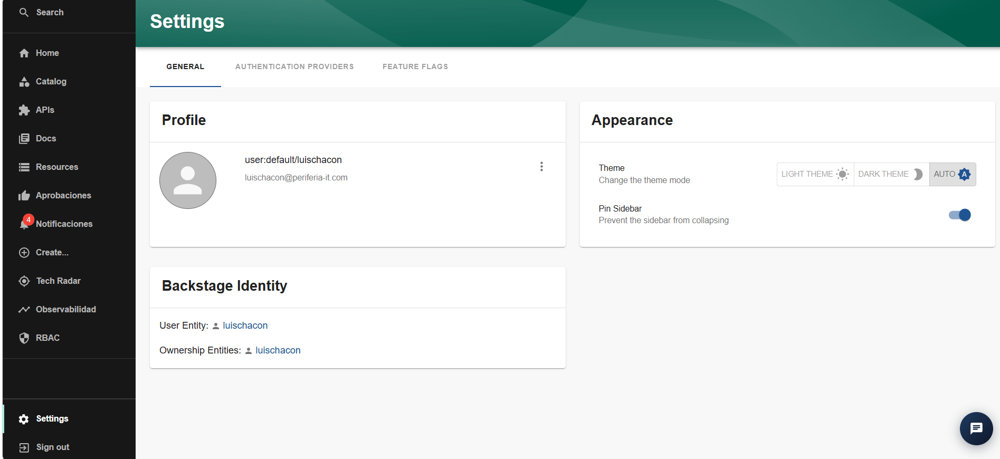

## Sección Settings

La sección **Settings** permite consultar y gestionar determinadas preferencias de la plataforma, así como revisar los proveedores de autenticación disponibles y la identidad asociada a la sesión actual.

La vista está organizada en las siguientes pestañas:

- **General:** permite consultar el perfil del usuario y configurar preferencias de apariencia.
- **Authentication Providers:** muestra los proveedores de autenticación disponibles y el estado de la sesión con cada proveedor.
- **Feature Flags:** permite acceder a la vista de indicadores de funcionalidades habilitadas o configuradas en la plataforma.

### 1. General

La pestaña **General** presenta la información del perfil, las preferencias de apariencia y los datos de identidad asociados al usuario.

#### Profile

En este apartado se muestra información del usuario que ha iniciado sesión, como:

- Identificador de usuario dentro del IDP.
- Correo electrónico asociado a la cuenta.
- Imagen de perfil.
- Menú de opciones del perfil, disponible mediante el icono de tres puntos.

#### Appearance

Este apartado permite personalizar la apariencia de la interfaz.

**Theme**

Permite seleccionar el modo de visualización de la plataforma:

- **Light Theme:** utiliza el tema claro.
- **Dark Theme:** utiliza el tema oscuro.
- **Auto:** ajusta el tema según la configuración automática disponible.

**Pin Sidebar**

Permite mantener fija la barra lateral de navegación para evitar que se contraiga automáticamente.

#### Backstage Identity

Este apartado presenta información relacionada con la identidad del usuario dentro de Backstage.

- **User Entity:** muestra la entidad de usuario asociada a la sesión.
- **Ownership Entities:** muestra la entidad o las entidades de propiedad asociadas al usuario.

Los valores mostrados dependen de la identidad con la que se haya iniciado sesión y de la información registrada en el catálogo.

### 2. Authentication Providers

La pestaña **Authentication Providers** muestra los proveedores de autenticación disponibles para interactuar con la plataforma y los servicios asociados.

En la vista observada aparecen los siguientes proveedores:

#### Microsoft

Permite autenticarse mediante una identidad de Microsoft y proporciona acceso de autenticación hacia las APIs e identidades de Microsoft.

Cuando existe una sesión activa, se muestra la información de la cuenta autenticada y el botón **SIGN OUT**, que permite cerrar la sesión asociada a ese proveedor.

#### GitHub

Permite autenticarse mediante una cuenta de GitHub y proporciona acceso de autenticación hacia las APIs e identidades de GitHub.

Cuando el proveedor no tiene una sesión activa, aparece el botón **SIGN IN**, que permite iniciar el proceso de autenticación.

Las opciones visibles dependen del estado de autenticación de cada proveedor y de la configuración de la plataforma.

### 3. Feature Flags

La pestaña **Feature Flags** permite acceder a la vista relacionada con los indicadores de funcionalidades de la plataforma.

Estos indicadores pueden utilizarse para controlar la disponibilidad de determinadas funcionalidades según la configuración del IDP.

Para documentar su funcionamiento específico, es necesario revisar la vista correspondiente y comprobar qué indicadores aparecen y qué opciones de consulta o modificación están disponibles.

