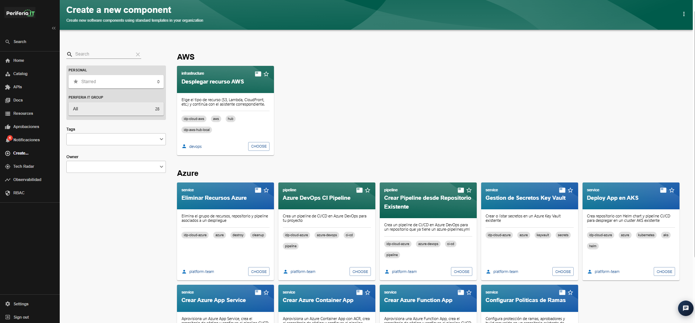
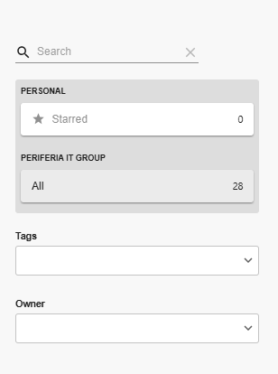

## Sección Create

La sección **Create** permite crear nuevos componentes de software y aprovisionar recursos de infraestructura mediante plantillas estandarizadas disponibles en el IDP. Desde esta vista, los usuarios pueden consultar las plantillas habilitadas para AWS y Azure, identificar su funcionalidad y seleccionar la que corresponda a la necesidad del proyecto.

La vista principal está organizada en un panel lateral de filtros, un área central donde se muestran las plantillas disponibles y un menú de opciones adicionales ubicado en la esquina superior derecha.

### 2. Panel de búsqueda y filtros

En el costado izquierdo se encuentran las opciones que permiten localizar y organizar las plantillas disponibles.

- **Search:** permite buscar plantillas por su nombre o por información relacionada.
- **Personal:** permite consultar las plantillas marcadas como favoritas mediante la opción *Starred*.
- **Periferia IT Group:** permite visualizar las plantillas disponibles para la organización. La opción *All* muestra el conjunto de plantillas disponibles para el usuario.
- **Tags:** permite filtrar las plantillas según las etiquetas asociadas.
- **Owner:** permite filtrar las plantillas de acuerdo con su propietario.

Estos filtros facilitan la localización de una plantilla específica cuando existe una cantidad considerable de opciones disponibles.

### 3. Área de plantillas disponibles

En el área central se presentan las plantillas agrupadas según la plataforma o el proveedor de nube al que corresponden.

**AWS**

En esta sección se encuentra la tarjeta *Desplegar recurso AWS*, que permite seleccionar el tipo de recurso que se desea aprovisionar y continuar con el asistente correspondiente.

**Azure**

En esta sección se muestran tarjetas independientes para las diferentes operaciones disponibles. Entre las plantillas visibles se encuentran:

- **Eliminar Recursos Azure:** permite iniciar el proceso de eliminación de recursos asociados a un despliegue.
- **Azure DevOps CI Pipeline:** permite crear un pipeline de integración y entrega continua en Azure DevOps.
- **Crear Pipeline desde Repositorio Existente:** permite generar un pipeline a partir de un repositorio existente.
- **Gestión de Secretos Key Vault:** permite crear o gestionar secretos en Azure Key Vault.
- **Deploy App en AKS:** permite desplegar una aplicación en un clúster de Azure Kubernetes Service.
- **Crear Azure App Service:** permite aprovisionar un Azure App Service y configurar los elementos asociados al despliegue.
- **Crear Azure Container App:** permite aprovisionar una Azure Container App y configurar su despliegue.
- **Crear Azure Function App:** permite aprovisionar una Azure Function App y los elementos asociados a su configuración.
- **Configurar Políticas de Ramas:** permite configurar políticas de protección y gobernanza de ramas en Azure DevOps.

La disponibilidad y el comportamiento de cada plantilla dependen de su configuración y de los servicios integrados con el IDP.

### 4. Información de las tarjetas

Cada tarjeta presenta información que ayuda a identificar la plantilla antes de seleccionarla:

- **Categoría:** indica la clasificación de la plantilla, por ejemplo, *service*, *pipeline* o *infrastructure*.
- **Nombre:** identifica la operación que realiza la plantilla.
- **Descripción:** ofrece una explicación breve de su propósito.
- **Tags:** muestran etiquetas relacionadas con la tecnología, el servicio o la funcionalidad.
- **Owner:** identifica al equipo o responsable asociado a la plantilla.
- **Favoritos:** el icono de estrella permite marcar o desmarcar una plantilla como favorita.
- **Choose:** permite seleccionar la plantilla e iniciar el flujo correspondiente.

### 5. Selección de una plantilla

Para iniciar una operación, se debe localizar la plantilla requerida y seleccionar el botón **Choose** de su tarjeta.

A continuación, el IDP dirige al usuario al asistente de configuración de la plantilla seleccionada, donde se solicitan los parámetros necesarios para ejecutar la operación. Dependiendo de la plantilla, el flujo puede incluir la selección de repositorios, la configuración de recursos, la revisión de los parámetros y la confirmación de la ejecución.

Los pasos y campos específicos se documentan individualmente en cada plantilla.

### 6. Menú de opciones adicionales

En la esquina superior derecha se encuentra un menú desplegable que ofrece las siguientes opciones:

- **Manage Templates:** permite acceder a la gestión de las plantillas.
- **Templating Extensions:** permite consultar las extensiones relacionadas con el sistema de plantillas.
- **Installed Actions:** permite consultar las acciones instaladas disponibles en la plataforma.
- **Task List:** permite acceder a la lista de tareas o ejecuciones asociadas a las operaciones realizadas.

Estas opciones complementan la vista principal y permiten acceder a funcionalidades de administración, configuración y seguimiento.

### 7. Consideraciones de uso

Antes de seleccionar una plantilla, se recomienda revisar su descripción, etiquetas y propietario para confirmar que corresponde a la operación que se necesita realizar.

Asimismo, es importante verificar los parámetros solicitados durante el asistente y tener en cuenta que algunas operaciones pueden crear, modificar o eliminar recursos, repositorios y pipelines. Por ello, se deben revisar cuidadosamente los datos antes de confirmar la ejecución.

En las siguientes secciones se documentará cada plantilla de Azure y AWS, describiendo su propósito, los campos que solicita, el procedimiento de ejecución y el resultado esperado.