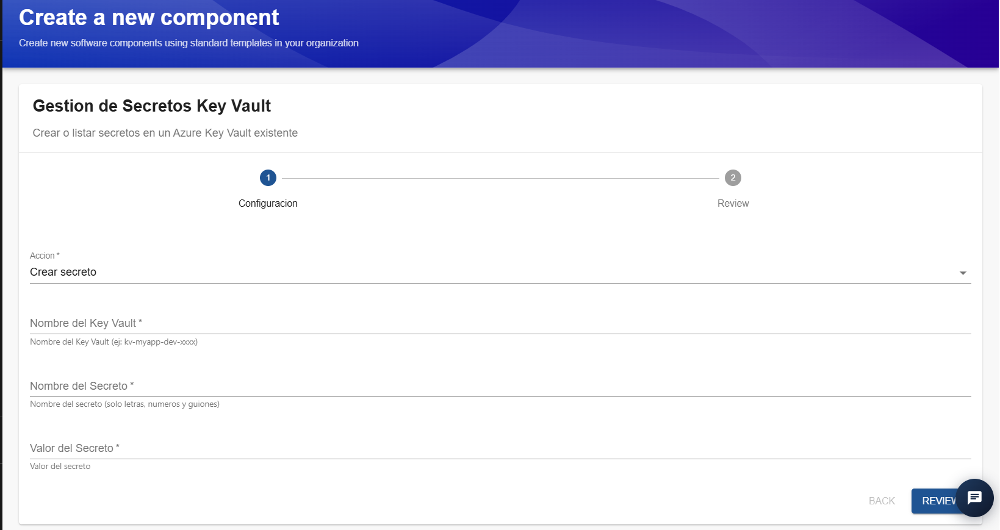
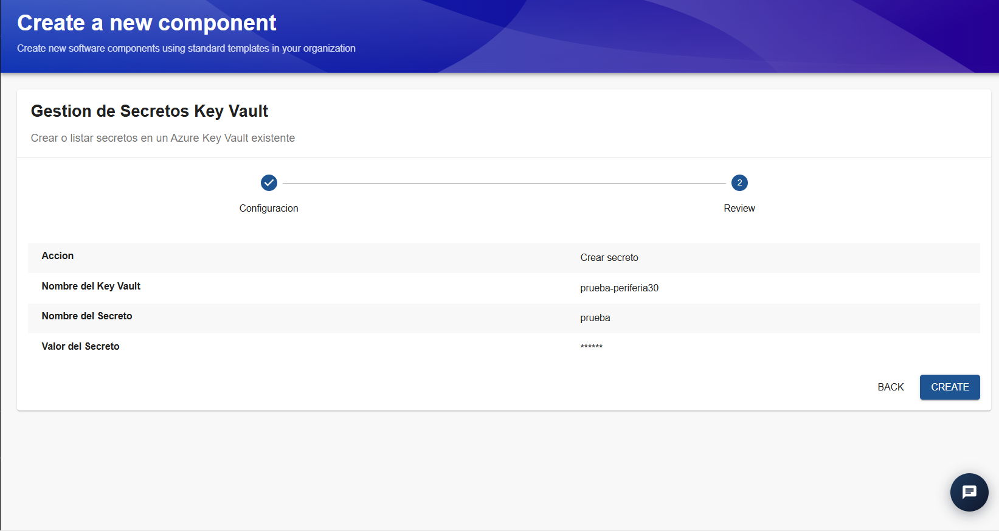
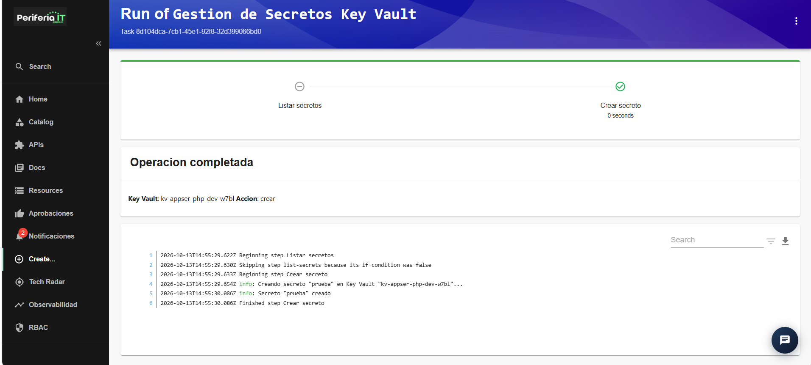

## Plantillas de Azure

La sección de plantillas de Azure contiene las opciones disponibles para automatizar tareas de aprovisionamiento, configuración, despliegue y administración de recursos en Microsoft Azure. Cada plantilla está diseñada para una operación específica y proporciona un asistente que guía al usuario durante el proceso.

## Plantilla: Eliminar Recursos Azure

Esta plantilla permite solicitar la eliminación de los recursos asociados a un despliegue en Azure. Según las opciones seleccionadas, el proceso puede incluir la eliminación del grupo de recursos de Azure, el pipeline de CI/CD y el repositorio asociado en Azure DevOps.

La operación se realiza mediante un asistente de tres pasos: **Recurso a eliminar, Confirmación y Review**. Antes de ejecutar la eliminación, el IDP solicita una aprobación para validar que la operación esté autorizada.

### Paso 1. Recurso a eliminar

En este paso se identifica el despliegue sobre el que se desea realizar la eliminación y se especifican los datos necesarios para localizar sus recursos asociados.

Los campos disponibles son:

- **Nombre del Recurso:** campo obligatorio donde se introduce el nombre base del recurso o despliegue que se desea eliminar. Por ejemplo, `prueba-shirley`.
- **Ambiente:** campo obligatorio que permite seleccionar el ambiente al que pertenece el despliegue. 
- **Nombre del Repositorio:** campo obligatorio donde se indica el nombre del repositorio asociado en Azure DevOps.
- **Proyecto de Azure DevOps:** identifica el proyecto de Azure DevOps en el que se encuentra el repositorio. En el ejemplo se muestra `TORRE DEVSECOPS`.
- **Service Connection:** indica la conexión de servicio utilizada para interactuar con Azure. En el ejemplo se muestra `PERIFERIA_IT_CORP_IA_TOWER`.

Una vez completados y verificados los campos, se selecciona **Next** para continuar.

### Paso 2. Confirmación

En este paso se seleccionan los elementos que se desean eliminar y se realiza una confirmación explícita de la operación.

Las opciones disponibles son:

- **Eliminar grupo de recursos (Azure):** permite incluir la eliminación del grupo de recursos asociado al despliegue en Azure.
- **Eliminar pipeline CI/CD:** permite incluir la eliminación del pipeline de integración y entrega continua asociado.
- **Eliminar repositorio:** permite incluir la eliminación del repositorio de código asociado.

Las opciones aparecen seleccionadas por defecto en la captura. Antes de continuar, revisa cuáles deben permanecer seleccionadas de acuerdo con el alcance de la operación.

Adicionalmente, se encuentra el campo obligatorio **Escriba ELIMINAR para confirmar**. En este campo se debe escribir exactamente `ELIMINAR` para confirmar que se comprende el carácter irreversible de la operación.

Una vez seleccionadas las opciones y completada la confirmación, se pulsa **Review**.

### Paso 3. Review

En esta pantalla se presenta un resumen de los datos ingresados y de las opciones seleccionadas durante los pasos anteriores.

La información que se muestra incluye:

- **Ambiente:** ambiente del despliegue seleccionado.
- **Proyecto de Azure DevOps:** proyecto al que pertenece el repositorio.
- **Service Connection:** conexión utilizada para interactuar con Azure.
- **Nombre del Recurso:** nombre del despliegue que se desea eliminar.
- **Nombre del Repositorio:** repositorio asociado a la operación.
- **Eliminar grupo de recursos (Azure):** indica si se seleccionó esta opción.
- **Eliminar pipeline CI/CD:** indica si se seleccionó esta opción.
- **Eliminar repositorio:** indica si se seleccionó esta opción.
- **Approved Request Id y Approved Token:** campos relacionados con la aprobación de la solicitud.
- **Escriba ELIMINAR para confirmar:** muestra la confirmación ingresada.

En esta etapa se debe revisar cuidadosamente el resumen y comprobar que los datos y las opciones correspondan a la operación prevista.

Si se requiere corregir algún dato, se puede utilizar **Back** para regresar a los pasos anteriores.

Cuando la información sea correcta, se selecciona **Create** para registrar y enviar la solicitud de eliminación.

### Paso 4. Solicitud de aprobación

Después de seleccionar **Create**, el IDP registra la solicitud y presenta la pantalla de ejecución de la plantilla.

Si la solicitud requiere aprobación, se muestra el mensaje **Solicitud de eliminación enviada a aprobación**. Esto significa que la petición quedó registrada, pero la eliminación todavía no se ha completado.

En esta pantalla se informa que:

- La solicitud de eliminación quedó registrada.
- La operación está pendiente de aprobación.
- Un usuario autorizado debe revisar y aprobar la solicitud desde la sección **Aprobaciones** del IDP.
- Cuando se apruebe, el proceso podrá continuar automáticamente y el usuario recibirá una notificación.

También se muestra el recurso sobre el que se solicitó la eliminación.

**Importante:** el solicitante no puede aprobar su propia solicitud. La autorización debe realizarla otro usuario que cuente con los permisos correspondientes. Si la solicitud no se aprueba, caduca o es rechazada, la eliminación no debe considerarse completada.

### Paso 5. Seguimiento de la ejecución

En la pantalla de ejecución se muestra el flujo de trabajo de la plantilla, sus pasos y los registros de ejecución (*logs*).

El flujo contempla las siguientes etapas:

1. **Solicitar aprobación de eliminación:** registra la solicitud y espera la autorización correspondiente.
2. **Eliminar grupo de recursos:** ejecuta la eliminación del grupo de recursos cuando se ha autorizado y esta opción fue seleccionada.
3. **Eliminar repositorio y pipeline:** ejecuta la eliminación de los elementos de Azure DevOps seleccionados, una vez que se cumplen las condiciones correspondientes.

### Consideraciones finales

- Esta plantilla debe utilizarse con precaución, ya que puede ejecutar operaciones destructivas.
- La aprobación constituye un control adicional antes de ejecutar la eliminación, pero no sustituye la validación previa del alcance.
- Una solicitud registrada no equivale a una eliminación completada.

# Plantilla: Gestión de Secretos Key Vault

## 1. Descripción general

La plantilla **Gestión de Secretos Key Vault** permite crear o listar secretos almacenados en un Azure Key Vault existente. Su objetivo es facilitar la gestión de información sensible desde el IDP, centralizando las operaciones sobre secretos sin necesidad de realizar manualmente cada acción desde el portal de Azure.

Los secretos pueden contener información confidencial utilizada por aplicaciones, servicios y procesos de automatización, como contraseñas, cadenas de conexión, tokens y claves de acceso.

La plantilla cuenta con dos etapas principales: **Configuración** y **Review**. Después de confirmar los datos, el IDP ejecuta la acción seleccionada y presenta el resultado de la operación.

### 2. Paso 1. Configuración

En esta primera pantalla se selecciona la operación que se desea realizar y se proporcionan los datos necesarios para identificar el Key Vault y el secreto.

### Campos disponibles

**Acción**

Campo obligatorio que permite seleccionar la operación que se ejecutará. En la interfaz se observa la opción `Crear secreto`.

La plantilla contempla operaciones relacionadas con la creación y el listado de secretos. Los campos y las acciones que se ejecutan pueden variar según la opción seleccionada.

**Nombre del Key Vault**

Campo obligatorio donde se introduce el nombre del Azure Key Vault existente en el que se realizará la operación.

Ejemplo: `prueba-periferia30`.

Es importante indicar el nombre correcto del almacén de secretos y verificar que se encuentre disponible en la suscripción de Azure correspondiente.

**Nombre del Secreto**

Campo obligatorio que identifica el secreto que se desea crear o consultar.

Según la indicación de la interfaz, el nombre debe contener únicamente letras, números y guiones.

Ejemplo: `prueba`.

Se recomienda utilizar nombres descriptivos que permitan identificar la finalidad del secreto sin exponer información confidencial.

**Valor del Secreto**

Campo obligatorio para introducir el valor que se almacenará cuando se selecciona la acción de creación.

Puede contener una contraseña, una cadena de conexión, un token u otro dato sensible requerido por una aplicación.

### Procedimiento

1. Selecciona la acción que deseas ejecutar.
2. Introduce el nombre del Key Vault existente.
3. Especifica el nombre del secreto.
4. Si la acción seleccionada es `Crear secreto`, introduce el valor que deseas almacenar.
5. Verifica que los datos sean correctos.
6. Selecciona **Review** para continuar.

### 3. Paso 2. Review

Después de completar la configuración, se presenta una pantalla de revisión con el resumen de los datos ingresados.

En el ejemplo de creación se muestran los siguientes campos:

- **Acción:** `Crear secreto`.
- **Nombre del Key Vault:** `prueba-periferia30`.
- **Nombre del Secreto:** `prueba`.
- **Valor del Secreto:** aparece enmascarado mediante asteriscos.

Esta pantalla permite verificar la información antes de ejecutar la operación. El enmascaramiento del valor ayuda a evitar su exposición visual durante la revisión.

### Procedimiento

1. Revisa la acción seleccionada.
2. Confirma el nombre del Key Vault.
3. Verifica el nombre del secreto.
4. Comprueba que el valor se haya ingresado correctamente, sin intentar exponerlo en pantalla.
5. Si necesitas modificar algún dato, selecciona **Back** para regresar a la configuración.
6. Si toda la información es correcta, selecciona **Create** para ejecutar la operación.

**Importante:** antes de crear el secreto, confirma que el Key Vault y el nombre seleccionado sean los correctos. Un error en estos datos puede provocar que la información se almacene en un lugar distinto al esperado.

### 4. Paso 3. Resultado de la ejecución

Una vez seleccionada la opción **Create**, el IDP muestra la pantalla de ejecución de la plantilla.

Cuando la operación termina correctamente, se presenta el mensaje **Operación completada**, junto con información general de la ejecución:

- **Key Vault:** identifica el almacén sobre el que se realizó la operación.
- **Acción:** indica la operación ejecutada, por ejemplo, `crear`.
- **Flujo de ejecución:** muestra los pasos que se ejecutaron y su estado.
- **Logs:** permiten consultar los mensajes generados durante el proceso.

### 5. Consideraciones finales

La plantilla Gestión de Secretos Key Vault facilita la creación y consulta de secretos desde el IDP, integrando estas operaciones en un flujo guiado y con una pantalla de revisión previa.

Antes de utilizarla, es necesario verificar el almacén de destino, la acción seleccionada y los permisos requeridos. Después de ejecutarla, se debe comprobar el resultado mediante el estado de la operación, los logs y, cuando corresponda, la validación del secreto en Azure Key Vault.

# Plantilla: Deploy App en AKS

### 1. Descripción general

La plantilla **Deploy App en AKS** permite crear la estructura inicial de un proyecto de aplicación, generar un repositorio de código en Azure DevOps, configurar una estrategia de Git y preparar un pipeline de CI/CD para desplegar la aplicación en un clúster de Azure Kubernetes Service (AKS) existente.

La plantilla automatiza varias tareas de configuración que, de otro modo, tendrían que realizarse manualmente. Entre ellas se encuentran la creación del repositorio, la inicialización de la estrategia Git, la configuración del pipeline, la definición de variables y la aplicación de políticas de ramas.

El flujo está dividido en cuatro etapas:

1. **Información de la App:** define las características generales de la aplicación y su despliegue.
2. **Cluster AKS:** identifica el clúster de destino y el registro de imágenes.
3. **Repositorio de código:** define el nombre y las características del repositorio que se generará.
4. **Review:** permite revisar los parámetros antes de enviar la solicitud.

Una vez confirmada la información, la solicitud pasa por el flujo de aprobación configurado en el IDP. Después de ser aprobada, se ejecutan las tareas correspondientes a la creación y configuración del proyecto.

### 2. Paso 1. Información de la App

En esta primera etapa se definen los datos de identificación de la aplicación, el entorno y algunos parámetros que utilizará su despliegue en Kubernetes.

### Campos disponibles

**Nombre de la App**

Campo obligatorio que identifica la aplicación que se va a crear.

Ejemplo: `ejemplo-manual`.

Se recomienda utilizar nombres cortos, descriptivos y sin espacios ni caracteres especiales, siguiendo las convenciones de nomenclatura de la organización.

**Descripción**

Permite registrar una breve explicación de la finalidad de la aplicación o del servicio.

Ejemplo: `API de ejemplo para pruebas internas`.

Es recomendable utilizar una descripción que facilite la identificación del componente en el catálogo del IDP.

**Ambiente**

Campo obligatorio que identifica el entorno al que estará asociada la aplicación.

En el ejemplo se utiliza `dev`, correspondiente al entorno de desarrollo.

La selección debe coincidir con el ambiente para el cual se configurará el despliegue. No se debe seleccionar un ambiente productivo para pruebas o validaciones preliminares.

**Puerto de la app**

Campo obligatorio que define el puerto en el que la aplicación escucha dentro del contenedor.

En el ejemplo se utiliza `8080`.

**Réplicas**

Permite indicar la cantidad de réplicas de la aplicación que se desplegarán inicialmente.

En el ejemplo se utiliza `1`.

Las réplicas representan las instancias de la aplicación que Kubernetes intentará mantener en ejecución. La cantidad adecuada depende de los requisitos de disponibilidad, consumo de recursos y carga esperada.

**Estrategia de despliegue**

Define cómo se aplicarán las actualizaciones de la aplicación.

En la interfaz se observa la opción `Default`, acompañada de una descripción de las siguientes alternativas:

- **Default:** utiliza el comportamiento predeterminado, con actualización gradual según la configuración de Kubernetes.
- **RollingUpdate:** permite reemplazar progresivamente las instancias existentes por las nuevas, reduciendo normalmente la interrupción del servicio.
- **Recreate:** elimina las instancias existentes y crea las nuevas, lo que puede generar una interrupción temporal.

La opción seleccionada debe ajustarse a las necesidades de disponibilidad de la aplicación.

**Namespace de Kubernetes**

Permite definir el namespace en el que se desplegarán los recursos de la aplicación.

En el ejemplo se utiliza `idp-apps`.

El namespace permite organizar y separar recursos dentro del clúster. Según la configuración de la plantilla, puede crearse automáticamente si todavía no existe.

**Equipo responsable**

Identifica el equipo encargado de la aplicación.

En el ejemplo se utiliza `platform-team`.

Se recomienda asignar el equipo que realmente será responsable de mantener, operar y dar soporte al servicio.

**Service Connection de Azure**

Identifica la conexión de servicio que utilizará la automatización para acceder a los recursos de Azure.

En el ejemplo aparece `PERIFERIA_IT_CORP_IA_TOWER`.

Esta conexión debe estar configurada previamente y contar con los permisos necesarios para realizar las operaciones requeridas sobre el clúster y los recursos asociados.

### Procedimiento

1. Introduce el nombre de la aplicación.
2. Añade una descripción que identifique su propósito.
3. Selecciona el ambiente correspondiente.
4. Define el puerto en el que escucha la aplicación.
5. Especifica el número inicial de réplicas.
6. Selecciona la estrategia de despliegue.
7. Indica el namespace de Kubernetes.
8. Define el equipo responsable.
9. Selecciona o confirma la Service Connection de Azure.
10. Verifica la información y pulsa **Next** para continuar.

### 3. Paso 2. Cluster AKS

En esta etapa se especifica el clúster de Kubernetes donde se desplegará la aplicación y el registro de contenedores donde se almacenarán las imágenes.

### Campos disponibles

**Nombre del Cluster AKS**

Identifica el clúster de Azure Kubernetes Service que recibirá el despliegue.

En el ejemplo se utiliza `aks-idp-dev`.

La plantilla requiere un clúster existente y accesible mediante la configuración de Azure correspondiente.

**Resource Group del Cluster**

Indica el grupo de recursos de Azure al que pertenece el clúster.

En el ejemplo se utiliza `rg-aks-idp`.

Este dato permite localizar el recurso correcto dentro de la suscripción de Azure.

**Nombre del ACR**

Identifica el Azure Container Registry (ACR) donde se almacenarán las imágenes de contenedor utilizadas por la aplicación.

En el ejemplo se utiliza `acrakisdpdev`.

La interfaz indica que, si el usuario no dispone de un registro propio, puede utilizar el ACR compartido del IDP.

### Procedimiento

1. Introduce el nombre del clúster AKS existente.
2. Especifica el Resource Group al que pertenece.
3. Introduce el nombre del ACR que se utilizará.
4. Verifica que los tres valores correspondan a recursos existentes y relacionados.
5. Pulsa **Next** para continuar.

### Consideraciones importantes

- El clúster debe estar operativo y disponible.
- La identidad utilizada por la automatización debe tener los permisos necesarios para acceder al clúster.
- El ACR debe permitir publicar las imágenes y permitir que AKS las descargue.
- El Resource Group debe corresponder al clúster seleccionado.
- Antes de desplegar en producción, se recomienda validar las cuotas, la capacidad disponible y las políticas de acceso del clúster.

### 4. Paso 3. Repositorio de código

En esta etapa se definen las características del repositorio que se creará para almacenar el código fuente y la configuración inicial de la aplicación.

### Campos disponibles

**Nombre del proyecto**

Permite identificar el proyecto base del que formará parte el repositorio.

En el ejemplo se utiliza `prueba-manual`.

**Componente**

Permite seleccionar el tipo de componente que se está creando.

En el ejemplo se utiliza `aks`.

La opción seleccionada puede influir en la estructura y los archivos iniciales que genera la plantilla.

**Nombre del servicio**

Define el nombre del servicio dentro del proyecto.

En el ejemplo se utiliza `ejemplo`.

Se recomienda utilizar un nombre representativo de la funcionalidad del servicio.

**Tipo de código**

Permite indicar qué tipo de código contendrá el repositorio.

En el ejemplo se selecciona `backend`.

La estructura generada dependerá de las opciones implementadas en la plantilla.

**Arquitectura**

Define el estilo arquitectónico de la aplicación.

En el ejemplo se selecciona `ms`, correspondiente a la convención utilizada para identificar una arquitectura de microservicios.

**Nombre generado**

La plantilla construye automáticamente el nombre del repositorio a partir de los valores seleccionados.

En el ejemplo se genera:

`prueba-manual-aks-ejemplo-backend-ms`

La interfaz muestra un indicador de disponibilidad. Antes de continuar, comprueba que el nombre generado esté disponible.

**Proyecto de Azure DevOps**

Identifica el proyecto de Azure DevOps donde se creará el repositorio.

En el ejemplo se utiliza `TORRE DEVSECOPS`.

Es importante verificar que el proyecto seleccionado sea el correcto y que la automatización tenga permisos para crear repositorios.

**Estrategia de Git**

Permite seleccionar el modelo de ramificación que se utilizará en el repositorio.

En el ejemplo se selecciona `GitFlow (main + develop)`.

La estrategia define cómo se organizarán las ramas y cómo se gestionarán los cambios durante el desarrollo.

**Versión inicial (opcional)**

Permite introducir una versión inicial para el proyecto, cuando corresponda.

Al ser un campo opcional, puede dejarse vacío si no existe una versión inicial definida.

### Procedimiento

1. Introduce el nombre del proyecto.
2. Selecciona el componente.
3. Define el nombre del servicio.
4. Selecciona el tipo de código.
5. Escoge la arquitectura correspondiente.
6. Verifica el nombre generado y su disponibilidad.
7. Selecciona el proyecto de Azure DevOps.
8. Define la estrategia de Git.
9. Introduce una versión inicial, si aplica.
10. Pulsa **Review** para revisar todos los parámetros.

### 5. Paso 4. Review

La pantalla Review presenta un resumen de los datos configurados en las etapas anteriores.

En esta pantalla se pueden revisar, entre otros, los siguientes valores:

- Ambiente.
- Puerto de la aplicación.
- Número de réplicas.
- Estrategia de despliegue.
- Namespace de Kubernetes.
- Equipo responsable.
- Service Connection de Azure.
- Nombre de la aplicación y descripción.
- Clúster AKS y Resource Group.
- Nombre del ACR.
- Proyecto y nombre del repositorio.
- Estrategia de Git.

### Procedimiento

1. Comprueba que la información de la aplicación sea correcta.
2. Verifica el clúster y el registro de contenedores seleccionados.
3. Revisa el nombre del repositorio y el proyecto de Azure DevOps.
4. Confirma la estrategia de Git.
5. Si detectas un error, pulsa **Back** para regresar a la etapa correspondiente.
6. Si la información es correcta, pulsa **Create** para enviar la solicitud.

La creación no debe considerarse completada únicamente por haber enviado el formulario: es necesario revisar el resultado de la ejecución.

### 6. Paso 5. Solicitud de aprobación y ejecución

Después de pulsar **Create**, el IDP presenta la pantalla de ejecución de la plantilla.

En el ejemplo aparece el mensaje **Solicitud enviada a aprobación**, que indica que la solicitud fue registrada y está pendiente de autorización.

La interfaz informa que un aprobador debe autorizarla desde la sección **Aprobaciones** de Backstage. Cuando se apruebe, la automatización continuará y se generará una notificación sobre el resultado.

### Etapas del flujo de ejecución

La pantalla muestra los siguientes pasos:

1. **Solicitar aprobación de despliegue:** registra la solicitud y espera la autorización correspondiente.
2. **Generar estructura del proyecto:** prepara la estructura inicial del proyecto.
3. **Crear repositorio en Azure DevOps:** crea el repositorio de código.
4. **Inicializar estrategia Git:** establece las ramas iniciales según la estrategia seleccionada.
5. **Crear pipeline CI/CD:** configura el pipeline de integración y entrega continua.
6. **Configurar variables del pipeline:** define las variables requeridas para la automatización.
7. **Configurar políticas de ramas:** establece las reglas de protección y gobernanza configuradas por la plantilla.
8. **Registrar en catálogo de Backstage:** incorpora el componente al catálogo del IDP.

### Procedimiento de validación

1. Verifica que la solicitud haya quedado registrada.
2. Accede a **Aprobaciones** para consultar su estado.
3. Espera la autorización de un usuario con los permisos correspondientes.
4. Una vez aprobada, consulta la notificación de resultado.
5. Abre el detalle de la ejecución y revisa el estado de cada paso.
6. Comprueba en Azure DevOps que el repositorio y el pipeline se hayan creado correctamente.
7. Valida que la configuración de Git y las políticas de ramas correspondan a lo seleccionado.
8. Comprueba el despliegue en AKS cuando el flujo de automatización y el pipeline hayan completado las tareas correspondientes.

# Plantilla: Crear Azure App Service

## 1. Descripción general

La plantilla **Crear Azure App Service** permite aprovisionar un recurso de Azure App Service, generar un repositorio de código en Azure DevOps y configurar automáticamente los elementos necesarios para establecer un pipeline de integración y entrega continua (CI/CD).

Azure App Service es un servicio de Azure que permite alojar aplicaciones web y API sin necesidad de administrar directamente la infraestructura subyacente.

La plantilla está organizada en tres etapas:

1. **Información del recurso:** permite definir las características del recurso que se va a aprovisionar en Azure.
2. **Repositorio de código:** permite establecer el nombre y las características del repositorio que se creará en Azure DevOps.
3. **Review:** presenta un resumen de la configuración para validarla antes de enviar la solicitud.

Una vez enviada, la solicitud pasa por el flujo de aprobación configurado en el IDP. Después de su aprobación, se ejecutan las tareas de aprovisionamiento y configuración correspondientes.

## 2. Paso 1. Información del recurso

En esta etapa se definen los parámetros principales del recurso de Azure App Service, incluyendo el grupo de recursos, el ambiente, la región, el lenguaje de desarrollo y el equipo responsable.

### Campos disponibles

**Nombre del Grupo de Recursos**

Campo obligatorio que permite definir el nombre base del grupo de recursos donde se aprovisionará la infraestructura.

Ejemplo: `prueba-shirley`.

Se recomienda utilizar nombres descriptivos y sin espacios ni caracteres especiales, de acuerdo con las convenciones de nomenclatura de Azure y de la organización.

**Descripción**

Permite registrar información sobre la finalidad del servicio que se va a crear.

Se recomienda utilizar una descripción breve que permita identificar el propósito de la aplicación.

**Ambiente**

Campo obligatorio que identifica el ambiente al que pertenece el recurso.

En el ejemplo se utiliza `dev`, correspondiente al entorno de desarrollo.

Se debe seleccionar el ambiente adecuado para el propósito de la aplicación y las políticas de despliegue establecidas.

**Región de Azure**

Define la región geográfica de Azure donde se aprovisionará el recurso.

**Para esta implementación, la región disponible es `westus2`.**

Aunque la interfaz puede mostrar inicialmente `eastus2`, se debe cambiar el valor a `westus2` antes de continuar con el formulario.

La selección correcta de la región es importante para asegurar que el aprovisionamiento se realice en una ubicación habilitada para esta implementación y compatible con las restricciones de disponibilidad o cuota existentes.

**Lenguaje**

Campo obligatorio que permite seleccionar la tecnología o el lenguaje con el que se desarrollará la aplicación.

En el ejemplo se utiliza `Node.js`.

La selección debe corresponder a la tecnología del proyecto, ya que puede determinar parte de la configuración inicial del servicio y del código base generado.

**Equipo responsable**

Permite identificar el equipo encargado de mantener y administrar la aplicación.

En el ejemplo se utiliza `platform-team`.

Se recomienda asignar el equipo que asumirá la responsabilidad operativa y técnica del servicio.

**Service Connection de Azure**

Identifica la conexión de servicio de Azure DevOps que utilizará la automatización para aprovisionar el recurso.

En el ejemplo aparece `PERIFERIA_IT_CORP_IA_TOWER`.

La conexión debe existir previamente y contar con los permisos necesarios para crear los recursos requeridos en la suscripción de Azure.

### Procedimiento

1. Introduce el nombre del grupo de recursos.
2. Añade una descripción del servicio, si corresponde.
3. Selecciona el ambiente.
4. En el campo **Región de Azure**, selecciona `westus2`.
5. Selecciona el lenguaje de desarrollo de la aplicación.
6. Introduce o confirma el equipo responsable.
7. Verifica la Service Connection de Azure.
8. Comprueba que los valores sean correctos y pulsa **Next** para continuar.

### Consideración importante sobre la región

Antes de avanzar, verifica que el campo de región muestre `westus2`.

No continúes con `eastus2` si el objetivo es realizar el despliegue en la región habilitada para esta implementación. Si el recurso no puede aprovisionarse, también se deben revisar las cuotas disponibles y los servicios admitidos en la región seleccionada.

## 3. Paso 2. Repositorio de código

En esta etapa se define la estructura lógica del repositorio que se creará en Azure DevOps para almacenar el código fuente de la aplicación.

La interfaz incluye una advertencia sobre los permisos necesarios para que funcione el versionamiento semántico automático.

### Prerrequisito de permisos en Azure DevOps

Para que el versionamiento semántico automático funcione correctamente, el usuario de compilación del proyecto (*Build Service*) debe contar con permisos sobre los repositorios.

Según la indicación de la interfaz, un administrador debe configurar estos permisos una sola vez desde:

**Project Settings → Repositories → Security**

La configuración debe aplicarse en el nodo raíz del proyecto, no únicamente sobre un repositorio específico, para que los permisos puedan heredarse en los nuevos repositorios.

Los permisos indicados en la interfaz son:

- **Contribute:** permite contribuir con cambios al repositorio.
- **Create tag:** permite crear etiquetas asociadas a versiones.
- **Manage Notes:** permite administrar notas relacionadas con las versiones.

La asignación debe realizarse siguiendo el principio de mínimo privilegio y validando el alcance necesario para la automatización.

### Campos disponibles

**Nombre del proyecto**

Identifica el proyecto base al que pertenecerá el repositorio.

En el ejemplo se utiliza `proyecto-ejemplo`.

**Componente**

Permite seleccionar la categoría del componente que se va a crear.

En el ejemplo se utiliza `appservices`.

**Nombre del servicio**

Define el nombre del servicio dentro del proyecto.

En el ejemplo se utiliza `manual`.

**Tipo de código**

Permite identificar el tipo de código que contendrá el repositorio.

En el ejemplo se selecciona `frontend`.

Se debe escoger la opción que corresponda al componente que se desarrollará.

**Arquitectura**

Permite definir la arquitectura asociada al servicio.

En el ejemplo se utiliza `ms`, de acuerdo con la convención disponible en la plantilla.

**Nombre generado**

La plantilla genera automáticamente el nombre del repositorio a partir de los datos introducidos.

En el ejemplo se genera:

`proyecto-ejemplo-appservices-manual-frontend-ms`

La interfaz muestra un indicador de disponibilidad. Antes de avanzar, verifica que el nombre generado esté disponible y corresponda al componente esperado.

**Proyecto de Azure DevOps**

Identifica el proyecto de Azure DevOps en el que se creará el repositorio.

En el ejemplo se utiliza `TORRE DEVSECOPS`.

La interfaz indica que se puede conservar el valor predeterminado si no es necesario cambiarlo.

**Estrategia de Git**

Permite seleccionar el modelo de ramificación del repositorio.

En el ejemplo se utiliza `GitFlow (main + develop)`.

Esta estrategia define cómo se organizan las ramas y cómo se gestionan los cambios durante el desarrollo.

**Tag Versión inicial (opcional)**

Permite especificar una etiqueta de versión inicial para el proyecto.

Por ejemplo: `0.1.0`.

Si no se necesita establecer una versión inicial, el campo puede dejarse vacío. La interfaz indica que este dato es opcional.

### Procedimiento

1. Introduce el nombre del proyecto.
2. Selecciona el componente `appservices` o la categoría que corresponda.
3. Define el nombre del servicio.
4. Selecciona el tipo de código.
5. Selecciona la arquitectura correspondiente.
6. Comprueba el nombre generado y su disponibilidad.
7. Confirma el proyecto de Azure DevOps.
8. Selecciona la estrategia de Git.
9. Introduce una etiqueta de versión inicial, si aplica.
10. Pulsa **Review** para revisar la configuración.

### Consideraciones importantes

- Comprueba que el nombre del repositorio no esté duplicado.
- Verifica que el proyecto de Azure DevOps seleccionado sea el correcto.
- Confirma que los permisos del usuario de compilación estén configurados para permitir las operaciones requeridas.
- Selecciona la estrategia de Git que utilizará realmente el equipo.
- Si se define una versión inicial, utiliza el formato de versión admitido por la plantilla.

## 4. Paso 3. Review

La pantalla Review presenta un resumen de los valores introducidos en las etapas anteriores.

Entre los datos que se pueden verificar se encuentran:

- Ambiente.
- Región de Azure.
- Lenguaje.
- Equipo responsable.
- Service Connection.
- Nombre del grupo de recursos.
- Descripción.
- Proyecto de Azure DevOps.
- Estrategia de Git.
- Nombre del repositorio generado.

### Procedimiento

1. Comprueba que el ambiente sea el correcto.
2. Verifica especialmente que la región sea `westus2`.
3. Confirma que el lenguaje seleccionado corresponda a la aplicación.
4. Revisa el grupo de recursos y el equipo responsable.
5. Comprueba que el proyecto y el nombre del repositorio sean correctos.
6. Valida la estrategia de Git y la versión inicial, si se ha definido.
7. Si necesitas corregir algún dato, utiliza **Back** para regresar a la etapa correspondiente.
8. Si todo está correcto, pulsa **Create** para enviar la solicitud.

## 5. Solicitud de aprobación y ejecución

Después de pulsar **Create**, el IDP muestra la pantalla de ejecución de la plantilla.

En el ejemplo se presenta el mensaje **Solicitud enviada a aprobación**, indicando que la solicitud de aprovisionamiento quedó registrada y está pendiente de autorización.

Un aprobador debe autorizarla desde la sección **Aprobaciones** de Backstage. Una vez aprobada, el flujo de automatización puede continuar y se genera una notificación sobre el resultado.

### Etapas del flujo de ejecución

La interfaz presenta las siguientes tareas:

1. **Solicitar aprobación de despliegue:** registra la solicitud y espera la autorización correspondiente.
2. **Aprovisionar Azure App Service:** crea el recurso de App Service y los recursos asociados definidos por la automatización.
3. **Generar código base:** prepara la estructura inicial de código de la aplicación.
4. **Crear repositorio en Azure DevOps:** genera el repositorio de código.
5. **Inicializar estrategia Git:** configura la estrategia de ramificación seleccionada.
6. **Crear pipeline CI/CD:** establece el pipeline de integración y entrega continua.
7. **Configurar variables del pipeline:** define las variables requeridas para la ejecución de la automatización.
8. **Configurar políticas de ramas:** aplica las reglas de protección configuradas en la plantilla.
9. **Registrar en catálogo de Backstage:** incorpora el componente al catálogo del IDP.

En la captura de ejecución proporcionada, la solicitud de aprobación aparece completada, mientras que los pasos posteriores figuran como omitidos porque dependen de la aprobación.

Por este motivo, la captura evidencia el registro de la solicitud, pero no confirma que el recurso de App Service ni el repositorio hayan sido creados.

### Procedimiento de validación

1. Confirma que la solicitud se haya registrado correctamente.
2. Accede a la sección **Aprobaciones** de Backstage para consultar su estado.
3. Espera la aprobación por parte del usuario autorizado.
4. Consulta la notificación una vez que el flujo avance.
5. Revisa los registros de ejecución y el estado de cada tarea.
6. Verifica en Azure que el App Service y los recursos asociados se hayan aprovisionado en `westus2`.
7. Comprueba en Azure DevOps que el repositorio y el pipeline se hayan creado correctamente.
8. Valida la estrategia Git, las variables y las políticas de ramas.
9. Comprueba el resultado del despliegue de la aplicación según las capacidades configuradas en el pipeline.

## 6. Consideraciones generales

- **Región obligatoria para esta implementación:** seleccionar `westus2` antes de enviar la solicitud.
- **Cuotas y disponibilidad:** si el aprovisionamiento falla, revisar las cuotas de la suscripción, la disponibilidad del servicio y las restricciones regionales.
- **Permisos:** comprobar que la Service Connection tenga los permisos necesarios y que el usuario de compilación cuente con los permisos de repositorio requeridos.
- **Nomenclatura:** utilizar nombres descriptivos y consistentes para los recursos y repositorios.
- **Lenguaje:** seleccionar la tecnología que corresponda al código que se generará.
- **Gobernanza:** utilizar la estrategia de Git y las políticas de ramas definidas para el proyecto.
- **Aprobación:** distinguir entre enviar una solicitud y completar el aprovisionamiento.
- **Validación final:** comprobar tanto el resultado de la automatización como la existencia y el estado de los recursos en Azure y Azure DevOps.

## 7. Resultado esperado

Cuando la automatización finaliza correctamente, se espera contar con un Azure App Service aprovisionado en la región `westus2`, un repositorio de código en Azure DevOps, una estructura inicial para la aplicación y un pipeline CI/CD configurado, junto con la estrategia de Git, las variables y las políticas de ramas correspondientes.

El resultado debe verificarse en los registros de ejecución y en los servicios de Azure y Azure DevOps. La creación del recurso no implica por sí sola que la aplicación esté desplegada y funcionando correctamente.

