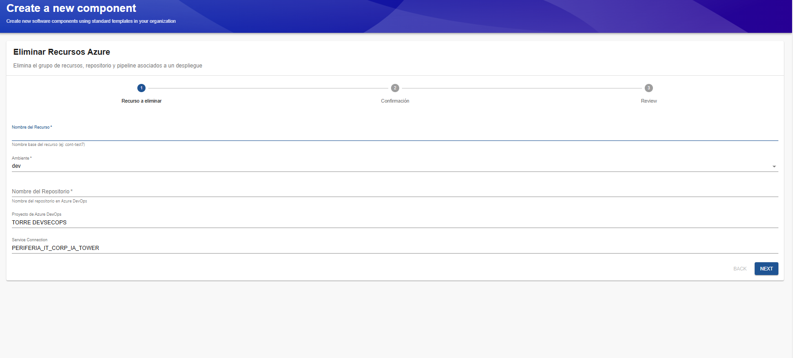
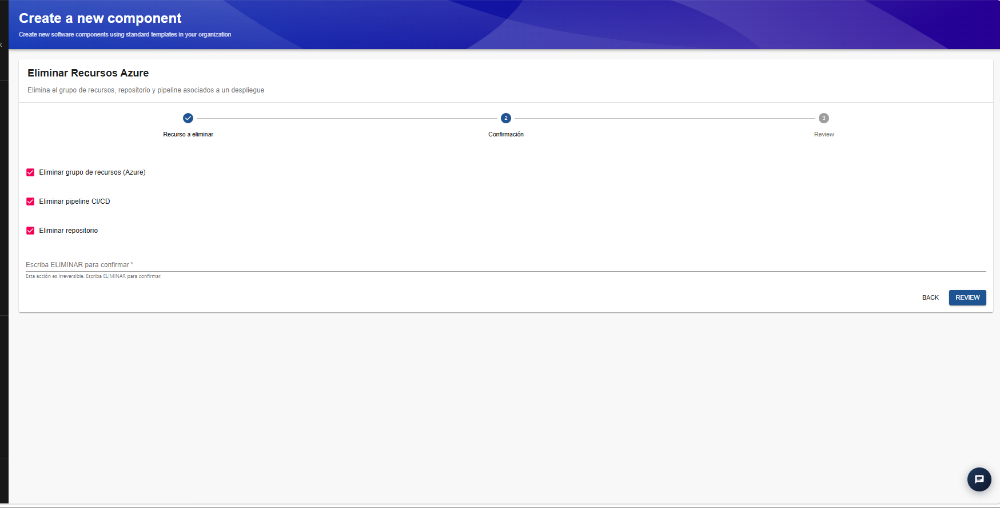
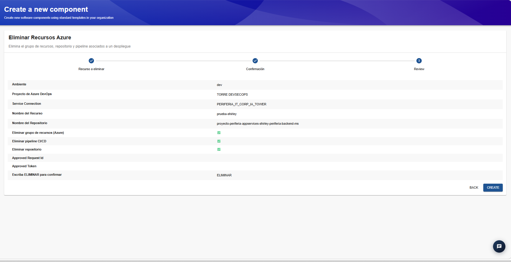
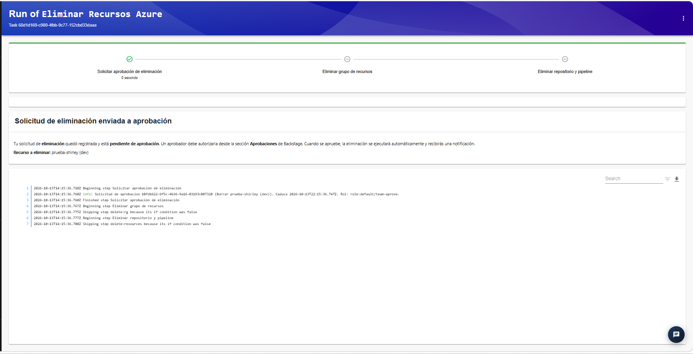

## Plantilla: Eliminar Recursos Azure

Esta plantilla permite solicitar la eliminación de los recursos asociados a un despliegue en Azure. Según las opciones seleccionadas, el proceso puede incluir la eliminación del grupo de recursos de Azure, el pipeline de CI/CD y el repositorio asociado en Azure DevOps.

La operación se realiza mediante un asistente de tres pasos: **Recurso a eliminar, Confirmación y Review**. Antes de ejecutar la eliminación, el IDP solicita una aprobación para validar que la operación esté autorizada.

### Paso 1. Recurso a eliminar

En este paso se identifica el despliegue sobre el que se desea realizar la eliminación y se especifican los datos necesarios para localizar sus recursos asociados.

Los campos disponibles son:

- **Nombre del Recurso:** campo obligatorio donde se introduce el nombre base del recurso o despliegue que se desea eliminar. Por ejemplo, `prueba-shirley`.
- **Ambiente:** campo obligatorio que permite seleccionar el ambiente al que pertenece el despliegue. 
- **Nombre del Repositorio:** campo obligatorio donde se indica el nombre del repositorio asociado en Azure DevOps.
- **Proyecto de Azure DevOps:** identifica el proyecto de Azure DevOps en el que se encuentra el repositorio. En el ejemplo se muestra `TORRE DEVSECOPS`.
- **Service Connection:** indica la conexión de servicio utilizada para interactuar con Azure. En el ejemplo se muestra `PERIFERIA_IT_CORP_IA_TOWER`.

Una vez completados y verificados los campos, se selecciona **Next** para continuar.

### Paso 2. Confirmación

En este paso se seleccionan los elementos que se desean eliminar y se realiza una confirmación explícita de la operación.

Las opciones disponibles son:

- **Eliminar grupo de recursos (Azure):** permite incluir la eliminación del grupo de recursos asociado al despliegue en Azure.
- **Eliminar pipeline CI/CD:** permite incluir la eliminación del pipeline de integración y entrega continua asociado.
- **Eliminar repositorio:** permite incluir la eliminación del repositorio de código asociado.

Las opciones aparecen seleccionadas por defecto en la captura. Antes de continuar, revisa cuáles deben permanecer seleccionadas de acuerdo con el alcance de la operación.

Adicionalmente, se encuentra el campo obligatorio **Escriba ELIMINAR para confirmar**. En este campo se debe escribir exactamente `ELIMINAR` para confirmar que se comprende el carácter irreversible de la operación.

Una vez seleccionadas las opciones y completada la confirmación, se pulsa **Review**.

### Paso 3. Review

En esta pantalla se presenta un resumen de los datos ingresados y de las opciones seleccionadas durante los pasos anteriores.

La información que se muestra incluye:

- **Ambiente:** ambiente del despliegue seleccionado.
- **Proyecto de Azure DevOps:** proyecto al que pertenece el repositorio.
- **Service Connection:** conexión utilizada para interactuar con Azure.
- **Nombre del Recurso:** nombre del despliegue que se desea eliminar.
- **Nombre del Repositorio:** repositorio asociado a la operación.
- **Eliminar grupo de recursos (Azure):** indica si se seleccionó esta opción.
- **Eliminar pipeline CI/CD:** indica si se seleccionó esta opción.
- **Eliminar repositorio:** indica si se seleccionó esta opción.
- **Approved Request Id y Approved Token:** campos relacionados con la aprobación de la solicitud.
- **Escriba ELIMINAR para confirmar:** muestra la confirmación ingresada.

En esta etapa se debe revisar cuidadosamente el resumen y comprobar que los datos y las opciones correspondan a la operación prevista.

Si se requiere corregir algún dato, se puede utilizar **Back** para regresar a los pasos anteriores.

Cuando la información sea correcta, se selecciona **Create** para registrar y enviar la solicitud de eliminación.

### Paso 4. Solicitud de aprobación

Después de seleccionar **Create**, el IDP registra la solicitud y presenta la pantalla de ejecución de la plantilla.

Si la solicitud requiere aprobación, se muestra el mensaje **Solicitud de eliminación enviada a aprobación**. Esto significa que la petición quedó registrada, pero la eliminación todavía no se ha completado.

En esta pantalla se informa que:

- La solicitud de eliminación quedó registrada.
- La operación está pendiente de aprobación.
- Un usuario autorizado debe revisar y aprobar la solicitud desde la sección **Aprobaciones** del IDP.
- Cuando se apruebe, el proceso podrá continuar automáticamente y el usuario recibirá una notificación.

También se muestra el recurso sobre el que se solicitó la eliminación.

**Importante:** el solicitante no puede aprobar su propia solicitud. La autorización debe realizarla otro usuario que cuente con los permisos correspondientes. Si la solicitud no se aprueba, caduca o es rechazada, la eliminación no debe considerarse completada.

### Paso 5. Seguimiento de la ejecución

En la pantalla de ejecución se muestra el flujo de trabajo de la plantilla, sus pasos y los registros de ejecución (*logs*).

El flujo contempla las siguientes etapas:

1. **Solicitar aprobación de eliminación:** registra la solicitud y espera la autorización correspondiente.
2. **Eliminar grupo de recursos:** ejecuta la eliminación del grupo de recursos cuando se ha autorizado y esta opción fue seleccionada.
3. **Eliminar repositorio y pipeline:** ejecuta la eliminación de los elementos de Azure DevOps seleccionados, una vez que se cumplen las condiciones correspondientes.

### Consideraciones finales

- Esta plantilla debe utilizarse con precaución, ya que puede ejecutar operaciones destructivas.
- La aprobación constituye un control adicional antes de ejecutar la eliminación, pero no sustituye la validación previa del alcance.
- Una solicitud registrada no equivale a una eliminación completada.
