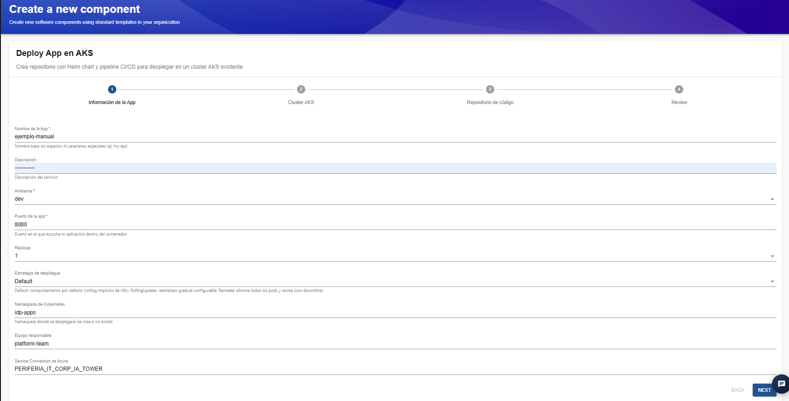
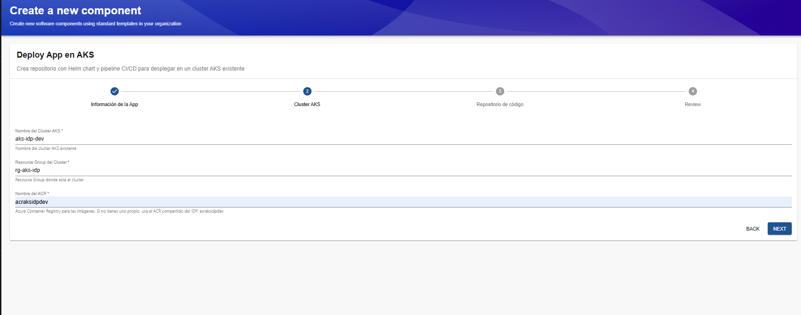
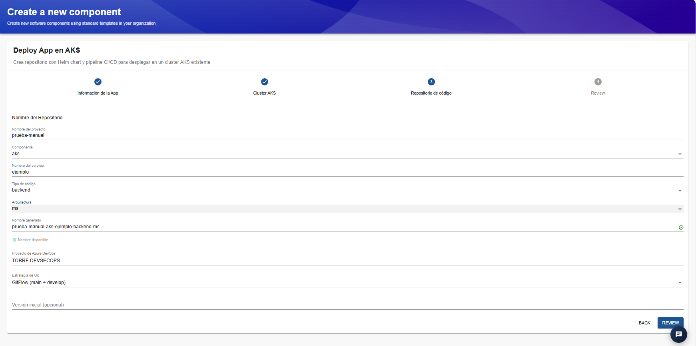
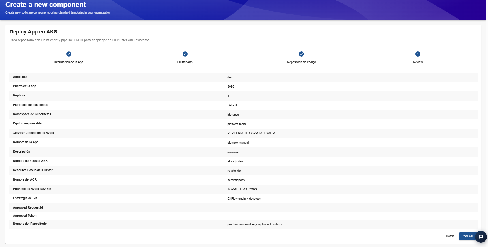
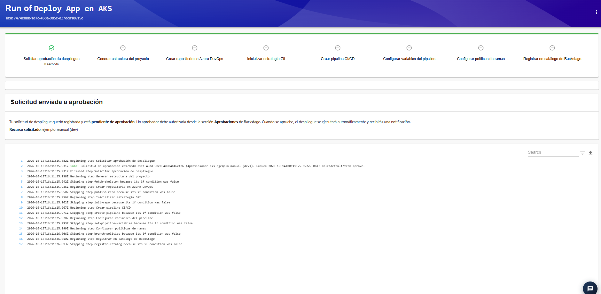

# Plantilla: Deploy App en AKS

### 1. Descripción general

La plantilla **Deploy App en AKS** permite crear la estructura inicial de un proyecto de aplicación, generar un repositorio de código en Azure DevOps, configurar una estrategia de Git y preparar un pipeline de CI/CD para desplegar la aplicación en un clúster de Azure Kubernetes Service (AKS) existente.

La plantilla automatiza varias tareas de configuración que, de otro modo, tendrían que realizarse manualmente. Entre ellas se encuentran la creación del repositorio, la inicialización de la estrategia Git, la configuración del pipeline, la definición de variables y la aplicación de políticas de ramas.

El flujo está dividido en cuatro etapas:

1. **Información de la App:** define las características generales de la aplicación y su despliegue.
2. **Cluster AKS:** identifica el clúster de destino y el registro de imágenes.
3. **Repositorio de código:** define el nombre y las características del repositorio que se generará.
4. **Review:** permite revisar los parámetros antes de enviar la solicitud.

Una vez confirmada la información, la solicitud pasa por el flujo de aprobación configurado en el IDP. Después de ser aprobada, se ejecutan las tareas correspondientes a la creación y configuración del proyecto.

### 2. Paso 1. Información de la App

En esta primera etapa se definen los datos de identificación de la aplicación, el entorno y algunos parámetros que utilizará su despliegue en Kubernetes.

### Campos disponibles

**Nombre de la App**

Campo obligatorio que identifica la aplicación que se va a crear.
Ejemplo: `ejemplo-manual`.
Se recomienda utilizar nombres cortos, descriptivos y sin espacios ni caracteres especiales, siguiendo las convenciones de nomenclatura de la organización.

**Descripción**

Permite registrar una breve explicación de la finalidad de la aplicación o del servicio.
Ejemplo: `API de ejemplo para pruebas internas`.
Es recomendable utilizar una descripción que facilite la identificación del componente en el catálogo del IDP.

**Ambiente**

Campo obligatorio que identifica el entorno al que estará asociada la aplicación.
En el ejemplo se utiliza `dev`, correspondiente al entorno de desarrollo.
La selección debe coincidir con el ambiente para el cual se configurará el despliegue. No se debe seleccionar un ambiente productivo para pruebas o validaciones preliminares.

**Puerto de la app**

Campo obligatorio que define el puerto en el que la aplicación escucha dentro del contenedor.
En el ejemplo se utiliza `8080`.

**Réplicas**

Permite indicar la cantidad de réplicas de la aplicación que se desplegarán inicialmente.
En el ejemplo se utiliza `1`.
Las réplicas representan las instancias de la aplicación que Kubernetes intentará mantener en ejecución. La cantidad adecuada depende de los requisitos de disponibilidad, consumo de recursos y carga esperada.

**Estrategia de despliegue**

Define cómo se aplicarán las actualizaciones de la aplicación.
En la interfaz se observa la opción `Default`, acompañada de una descripción de las siguientes alternativas:

- **Default:** utiliza el comportamiento predeterminado, con actualización gradual según la configuración de Kubernetes.
- **RollingUpdate:** permite reemplazar progresivamente las instancias existentes por las nuevas, reduciendo normalmente la interrupción del servicio.
- **Recreate:** elimina las instancias existentes y crea las nuevas, lo que puede generar una interrupción temporal.

La opción seleccionada debe ajustarse a las necesidades de disponibilidad de la aplicación.

**Namespace de Kubernetes**

Permite definir el namespace en el que se desplegarán los recursos de la aplicación.
En el ejemplo se utiliza `idp-apps`.
El namespace permite organizar y separar recursos dentro del clúster. Según la configuración de la plantilla, puede crearse automáticamente si todavía no existe.

**Equipo responsable**

Identifica el equipo encargado de la aplicación.
En el ejemplo se utiliza `platform-team`.
Se recomienda asignar el equipo que realmente será responsable de mantener, operar y dar soporte al servicio.

**Service Connection de Azure**

Identifica la conexión de servicio que utilizará la automatización para acceder a los recursos de Azure. En el ejemplo aparece `PERIFERIA_IT_CORP_IA_TOWER`.
Esta conexión debe estar configurada previamente y contar con los permisos necesarios para realizar las operaciones requeridas sobre el clúster y los recursos asociados.

### 3. Paso 2. Cluster AKS

En esta etapa se especifica el clúster de Kubernetes donde se desplegará la aplicación y el registro de contenedores donde se almacenarán las imágenes.

### Campos disponibles

**Nombre del Cluster AKS**

Identifica el clúster de Azure Kubernetes Service que recibirá el despliegue.
En el ejemplo se utiliza `aks-idp-dev`.
La plantilla requiere un clúster existente y accesible mediante la configuración de Azure correspondiente.

**Resource Group del Cluster**

Indica el grupo de recursos de Azure al que pertenece el clúster.
En el ejemplo se utiliza `rg-aks-idp`.
Este dato permite localizar el recurso correcto dentro de la suscripción de Azure.

**Nombre del ACR**

Identifica el Azure Container Registry (ACR) donde se almacenarán las imágenes de contenedor utilizadas por la aplicación.
En el ejemplo se utiliza `acrakisdpdev`.
La interfaz indica que, si el usuario no dispone de un registro propio, puede utilizar el ACR compartido del IDP.

### 4. Paso 3. Repositorio de código

En esta etapa se definen las características del repositorio que se creará para almacenar el código fuente y la configuración inicial de la aplicación.

### Campos disponibles

**Nombre del proyecto**

Permite identificar el proyecto base del que formará parte el repositorio.
En el ejemplo se utiliza `prueba-manual`.

**Componente**

Permite seleccionar el tipo de componente que se está creando.
En el ejemplo se utiliza `aks`.
La opción seleccionada puede influir en la estructura y los archivos iniciales que genera la plantilla.

**Nombre del servicio**

Define el nombre del servicio dentro del proyecto.
En el ejemplo se utiliza `ejemplo`.
Se recomienda utilizar un nombre representativo de la funcionalidad del servicio.

**Tipo de código**

Permite indicar qué tipo de código contendrá el repositorio.
En el ejemplo se selecciona `backend`.
La estructura generada dependerá de las opciones implementadas en la plantilla.

**Arquitectura**

Define el estilo arquitectónico de la aplicación.
En el ejemplo se selecciona `ms`, correspondiente a la convención utilizada para identificar una arquitectura de microservicios.

**Nombre generado**

La plantilla construye automáticamente el nombre del repositorio a partir de los valores seleccionados.En el ejemplo se genera:
`prueba-manual-aks-ejemplo-backend-ms`
La interfaz muestra un indicador de disponibilidad. Antes de continuar, comprueba que el nombre generado esté disponible.

**Proyecto de Azure DevOps**

Identifica el proyecto de Azure DevOps donde se creará el repositorio.
En el ejemplo se utiliza `TORRE DEVSECOPS`.Es importante verificar que el proyecto seleccionado sea el correcto y que la automatización tenga permisos para crear repositorios.

**Estrategia de Git**

Permite seleccionar el modelo de ramificación que se utilizará en el repositorio.
En el ejemplo se selecciona `GitFlow (main + develop)`.
La estrategia define cómo se organizarán las ramas y cómo se gestionarán los cambios durante el desarrollo.

**Versión inicial (opcional)**

Permite introducir una versión inicial para el proyecto, cuando corresponda. Al ser un campo opcional, puede dejarse vacío si no existe una versión inicial definida.

### 5. Paso 4. Review

La pantalla Review presenta un resumen de los datos configurados en las etapas anteriores.
En esta pantalla se pueden revisar, entre otros, los siguientes valores:

- Ambiente.
- Puerto de la aplicación.
- Número de réplicas.
- Estrategia de despliegue.
- Namespace de Kubernetes.
- Equipo responsable.
- Service Connection de Azure.
- Nombre de la aplicación y descripción.
- Clúster AKS y Resource Group.
- Nombre del ACR.
- Proyecto y nombre del repositorio.
- Estrategia de Git.

La creación no debe considerarse completada únicamente por haber enviado el formulario: es necesario revisar el resultado de la ejecución.

### 6. Paso 5. Solicitud de aprobación y ejecución

Después de pulsar **Create**, el IDP presenta la pantalla de ejecución de la plantilla.

En el ejemplo aparece el mensaje **Solicitud enviada a aprobación**, que indica que la solicitud fue registrada y está pendiente de autorización. La interfaz informa que un aprobador debe autorizarla desde la sección **Aprobaciones** de Backstage. Cuando se apruebe, la automatización continuará y se generará una notificación sobre el resultado.

### Etapas del flujo de ejecución

La pantalla muestra los siguientes pasos:

1. **Solicitar aprobación de despliegue:** registra la solicitud y espera la autorización correspondiente.
2. **Generar estructura del proyecto:** prepara la estructura inicial del proyecto.
3. **Crear repositorio en Azure DevOps:** crea el repositorio de código.
4. **Inicializar estrategia Git:** establece las ramas iniciales según la estrategia seleccionada.
5. **Crear pipeline CI/CD:** configura el pipeline de integración y entrega continua.
6. **Configurar variables del pipeline:** define las variables requeridas para la automatización.
7. **Configurar políticas de ramas:** establece las reglas de protección y gobernanza configuradas por la plantilla.
8. **Registrar en catálogo de Backstage:** incorpora el componente al catálogo del IDP.

