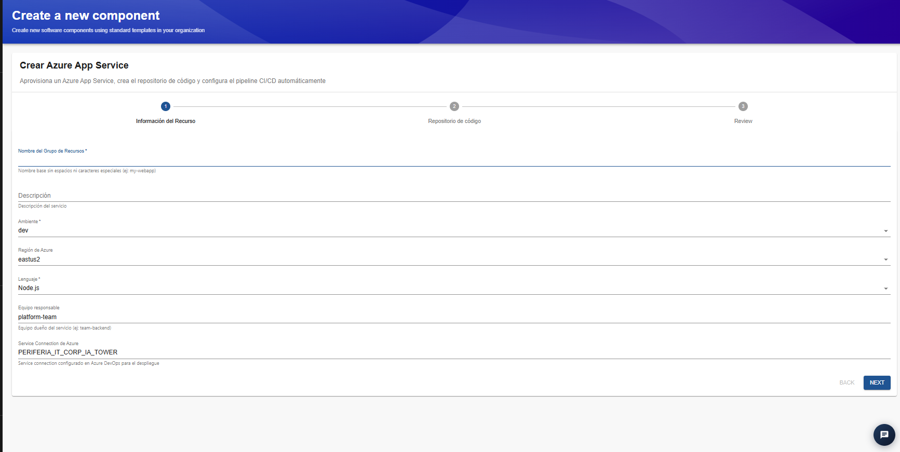
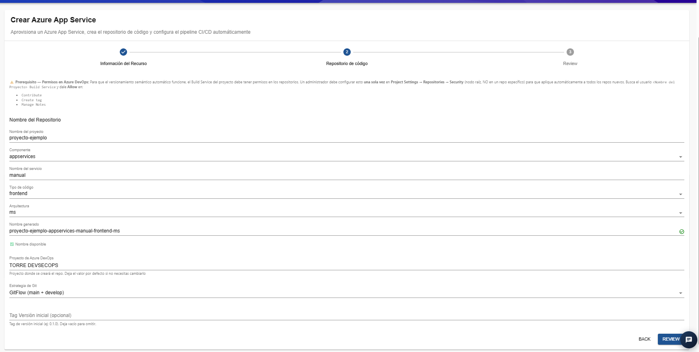
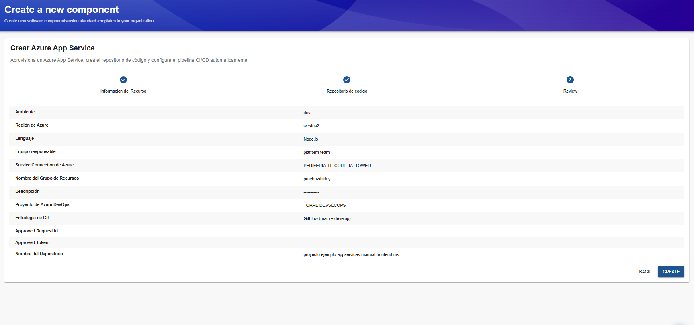
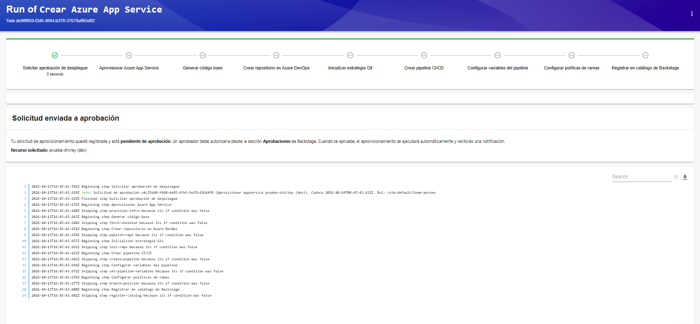

# Plantilla: Crear Azure App Service

## 1. Descripción general

La plantilla **Crear Azure App Service** permite aprovisionar un recurso de Azure App Service, generar un repositorio de código en Azure DevOps y configurar automáticamente los elementos necesarios para establecer un pipeline de integración y entrega continua (CI/CD). Azure App Service es un servicio de Azure que permite alojar aplicaciones web y API sin necesidad de administrar directamente la infraestructura subyacente.

La plantilla está organizada en tres etapas:

1. **Información del recurso:** permite definir las características del recurso que se va a aprovisionar en Azure.
2. **Repositorio de código:** permite establecer el nombre y las características del repositorio que se creará en Azure DevOps.
3. **Review:** presenta un resumen de la configuración para validarla antes de enviar la solicitud.

Una vez enviada, la solicitud pasa por el flujo de aprobación configurado en el IDP. Después de su aprobación, se ejecutan las tareas de aprovisionamiento y configuración correspondientes.

## 2. Paso 1. Información del recurso

En esta etapa se definen los parámetros principales del recurso de Azure App Service, incluyendo el grupo de recursos, el ambiente, la región, el lenguaje de desarrollo y el equipo responsable.

### Campos disponibles

**Nombre del Grupo de Recursos**

Campo obligatorio que permite definir el nombre base del grupo de recursos donde se aprovisionará la infraestructura.
Ejemplo: `prueba-shirley`.
Se recomienda utilizar nombres descriptivos y sin espacios ni caracteres especiales, de acuerdo con las convenciones de nomenclatura de Azure y de la organización.

**Descripción**

Permite registrar información sobre la finalidad del servicio que se va a crear.
Se recomienda utilizar una descripción breve que permita identificar el propósito de la aplicación.

**Ambiente**

Campo obligatorio que identifica el ambiente al que pertenece el recurso.
En el ejemplo se utiliza `dev`, correspondiente al entorno de desarrollo.
Se debe seleccionar el ambiente adecuado para el propósito de la aplicación y las políticas de despliegue establecidas.

**Región de Azure**

Define la región geográfica de Azure donde se aprovisionará el recurso.
**Para esta implementación, la región disponible es `westus2`.**
La selección correcta de la región es importante para asegurar que el aprovisionamiento se realice en una ubicación habilitada para esta implementación y compatible con las restricciones de disponibilidad o cuota existentes.

**Lenguaje**

Campo obligatorio que permite seleccionar la tecnología o el lenguaje con el que se desarrollará la aplicación.
En el ejemplo se utiliza `Node.js`.
La selección debe corresponder a la tecnología del proyecto, ya que puede determinar parte de la configuración inicial del servicio y del código base generado.

**Equipo responsable**

Permite identificar el equipo encargado de mantener y administrar la aplicación.
En el ejemplo se utiliza `platform-team`.
Se recomienda asignar el equipo que asumirá la responsabilidad operativa y técnica del servicio.

**Service Connection de Azure**

Identifica la conexión de servicio de Azure DevOps que utilizará la automatización para aprovisionar el recurso.
En el ejemplo aparece `PERIFERIA_IT_CORP_IA_TOWER`.
La conexión debe existir previamente y contar con los permisos necesarios para crear los recursos requeridos en la suscripción de Azure.

## 3. Paso 2. Repositorio de código

En esta etapa se define la estructura lógica del repositorio que se creará en Azure DevOps para almacenar el código fuente de la aplicación. La interfaz incluye una advertencia sobre los permisos necesarios para que funcione el versionamiento semántico automático.

### Campos disponibles

**Nombre del proyecto**
Identifica el proyecto base al que pertenecerá el repositorio.
En el ejemplo se utiliza `proyecto-ejemplo`.

**Componente**

Permite seleccionar la categoría del componente que se va a crear.
En el ejemplo se utiliza `appservices`.

**Nombre del servicio**

Define el nombre del servicio dentro del proyecto.
En el ejemplo se utiliza `manual`.

**Tipo de código**

Permite identificar el tipo de código que contendrá el repositorio.
En el ejemplo se selecciona `frontend`.
Se debe escoger la opción que corresponda al componente que se desarrollará.

**Arquitectura**

Permite definir la arquitectura asociada al servicio.
En el ejemplo se utiliza `ms`, de acuerdo con la convención disponible en la plantilla.

**Nombre generado**

La plantilla genera automáticamente el nombre del repositorio a partir de los datos introducidos.
En el ejemplo se genera:
`proyecto-ejemplo-appservices-manual-frontend-ms`
La interfaz muestra un indicador de disponibilidad. Antes de avanzar, verifica que el nombre generado esté disponible y corresponda al componente esperado.

**Proyecto de Azure DevOps**

Identifica el proyecto de Azure DevOps en el que se creará el repositorio.
En el ejemplo se utiliza `TORRE DEVSECOPS`.
La interfaz indica que se puede conservar el valor predeterminado si no es necesario cambiarlo.

**Estrategia de Git**

Permite seleccionar el modelo de ramificación del repositorio.
En el ejemplo se utiliza `GitFlow (main + develop)`.
Esta estrategia define cómo se organizan las ramas y cómo se gestionan los cambios durante el desarrollo.

**Tag Versión inicial (opcional)**

Permite especificar una etiqueta de versión inicial para el proyecto.
Por ejemplo: `0.1.0`.
Si no se necesita establecer una versión inicial, el campo puede dejarse vacío. La interfaz indica que este dato es opcional.

## 4. Paso 3. Review

La pantalla Review presenta un resumen de los valores introducidos en las etapas anteriores.

Entre los datos que se pueden verificar se encuentran:

- Ambiente.
- Región de Azure.
- Lenguaje.
- Equipo responsable.
- Service Connection.
- Nombre del grupo de recursos.
- Descripción.
- Proyecto de Azure DevOps.
- Estrategia de Git.
- Nombre del repositorio generado.

## 5. Solicitud de aprobación y ejecución

Después de pulsar **Create**, el IDP muestra la pantalla de ejecución de la plantilla.

En el ejemplo se presenta el mensaje **Solicitud enviada a aprobación**, indicando que la solicitud de aprovisionamiento quedó registrada y está pendiente de autorización.

Un aprobador debe autorizarla desde la sección **Aprobaciones** de Backstage. Una vez aprobada, el flujo de automatización puede continuar y se genera una notificación sobre el resultado.

### Etapas del flujo de ejecución

La interfaz presenta las siguientes tareas:

1. **Solicitar aprobación de despliegue:** registra la solicitud y espera la autorización correspondiente.
2. **Aprovisionar Azure App Service:** crea el recurso de App Service y los recursos asociados definidos por la automatización.
3. **Generar código base:** prepara la estructura inicial de código de la aplicación.
4. **Crear repositorio en Azure DevOps:** genera el repositorio de código.
5. **Inicializar estrategia Git:** configura la estrategia de ramificación seleccionada.
6. **Crear pipeline CI/CD:** establece el pipeline de integración y entrega continua.
7. **Configurar variables del pipeline:** define las variables requeridas para la ejecución de la automatización.
8. **Configurar políticas de ramas:** aplica las reglas de protección configuradas en la plantilla.
9. **Registrar en catálogo de Backstage:** incorpora el componente al catálogo del IDP.

## 6. Consideraciones generales

- **Región obligatoria para esta implementación:** seleccionar `westus2` antes de enviar la solicitud.
- **Cuotas y disponibilidad:** si el aprovisionamiento falla, revisar las cuotas de la suscripción, la disponibilidad del servicio y las restricciones regionales.
- **Permisos:** comprobar que la Service Connection tenga los permisos necesarios y que el usuario de compilación cuente con los permisos de repositorio requeridos.
- **Nomenclatura:** utilizar nombres descriptivos y consistentes para los recursos y repositorios.
- **Lenguaje:** seleccionar la tecnología que corresponda al código que se generará.
- **Gobernanza:** utilizar la estrategia de Git y las políticas de ramas definidas para el proyecto.
- **Aprobación:** distinguir entre enviar una solicitud y completar el aprovisionamiento.
- **Validación final:** comprobar tanto el resultado de la automatización como la existencia y el estado de los recursos en Azure y Azure DevOps.

