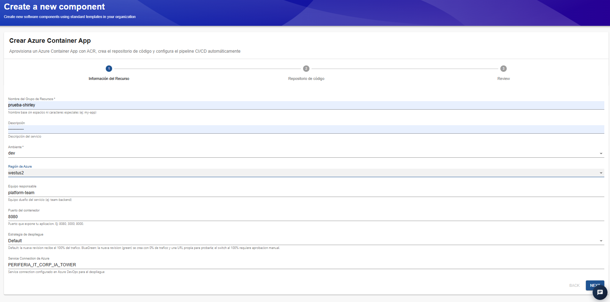
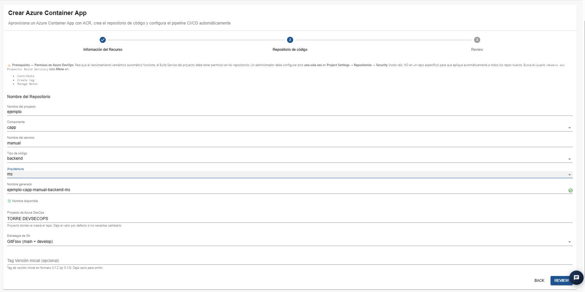
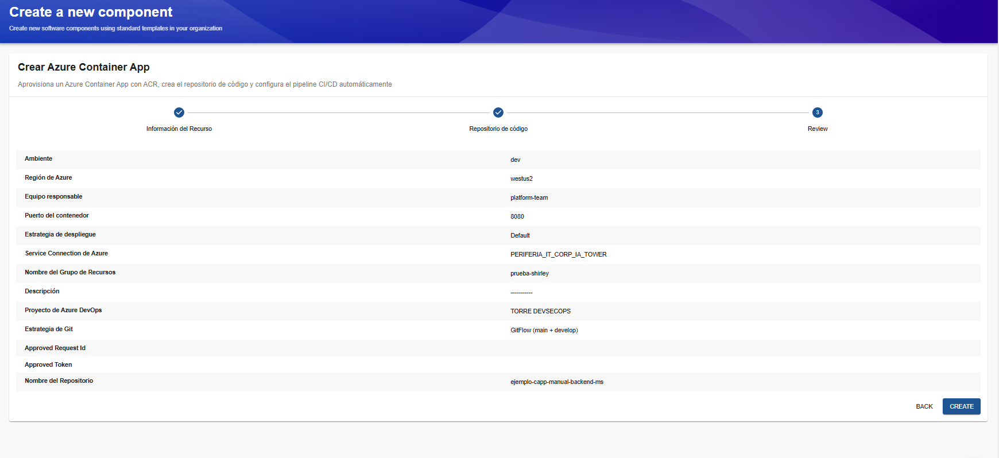
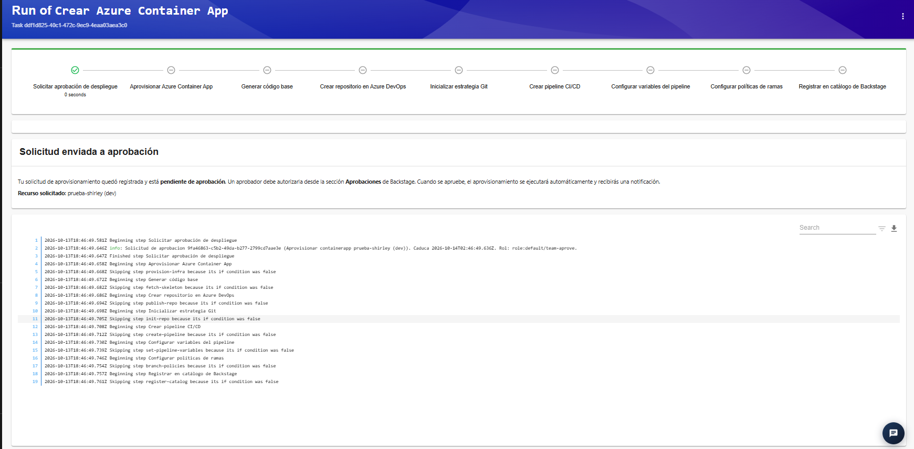

# Plantilla: Crear Azure Container App

## 1. Descripción general

La plantilla **Crear Azure Container App** permite aprovisionar un recurso de Azure Container Apps utilizando Azure Container Registry (ACR) para gestionar las imágenes de contenedor. Además, permite generar un repositorio de código en Azure DevOps y configurar automáticamente los elementos necesarios para un pipeline de integración y entrega continua (CI/CD).

Azure Container Apps es un servicio administrado que permite ejecutar aplicaciones empaquetadas en contenedores sin necesidad de administrar directamente un clúster de Kubernetes.

La plantilla está organizada en tres etapas:

1. **Información del recurso:** permite definir las características del recurso que se va a aprovisionar en Azure.
2. **Repositorio de código:** permite configurar el repositorio donde se almacenará el código fuente de la aplicación.
3. **Review:** presenta un resumen de la configuración antes de enviar la solicitud.

Después de enviar la solicitud, el IDP inicia el flujo de aprobación correspondiente. Una vez aprobada, se ejecutan las tareas de aprovisionamiento y configuración definidas por la plantilla.

## 2. Paso 1. Información del recurso

En esta etapa se configuran los parámetros principales del recurso Azure Container App, incluyendo el grupo de recursos, el ambiente, la región, el equipo responsable, el puerto del contenedor y la estrategia de despliegue.

### Campos disponibles

**Nombre del Grupo de Recursos**

Campo obligatorio que permite definir el nombre base del grupo de recursos donde se aprovisionará la infraestructura.
Ejemplo: `ejemplo-manual`.
Se recomienda utilizar nombres descriptivos, sin espacios ni caracteres especiales, siguiendo las convenciones de nomenclatura de Azure.

**Descripción**

Permite registrar información sobre el propósito de la aplicación o del servicio que se va a crear.
Se recomienda incluir una descripción breve que facilite la identificación del recurso.

**Ambiente**

Campo obligatorio que identifica el ambiente de despliegue.
En el ejemplo se utiliza `dev`, correspondiente al entorno de desarrollo.
Se debe seleccionar el ambiente que corresponda al propósito de la aplicación y a las políticas definidas por la organización.

**Región de Azure**

Permite seleccionar la región geográfica donde se aprovisionará el recurso.
Para esta implementación, la región disponible es `westus2`.

**Equipo responsable**

Permite identificar el equipo encargado de la administración y el mantenimiento de la aplicación.
En el ejemplo se utiliza `platform-team`.
Se recomienda asignar el equipo que tendrá la responsabilidad técnica y operativa del servicio.

**Puerto del contenedor**

Define el puerto en el que la aplicación escucha dentro del contenedor.
En el ejemplo se utiliza `8080`.

**Estrategia de despliegue**

Permite seleccionar la estrategia que se utilizará para publicar nuevas revisiones de la aplicación.
La opción seleccionada en el ejemplo es `Default`.
Según la descripción mostrada en la interfaz, esta opción asigna el 100 % del tráfico a la nueva revisión. También se describe la estrategia `BlueGreen`, en la que la nueva revisión se crea inicialmente con el 0 % del tráfico y una URL propia para realizar pruebas. El cambio del tráfico al 100 % requiere aprobación manual.

La elección depende de los mecanismos de validación y liberación que necesite la aplicación.

**Service Connection de Azure**

Identifica la conexión de servicio de Azure DevOps que utilizará la automatización para aprovisionar los recursos.
En el ejemplo aparece `PERIFERIA_IT_CORP_IA_TOWER`.
La conexión debe existir previamente y contar con los permisos necesarios para realizar las operaciones requeridas en Azure.

### Consideraciones importantes

- **Región:** utilizar `westus2` para esta implementación.
- **Puerto:** confirmar que coincida con la configuración interna de la aplicación.
- **Estrategia de despliegue:** revisar cómo se gestionará el tráfico hacia las nuevas revisiones.
- **Permisos:** comprobar que la Service Connection tenga los permisos requeridos para el aprovisionamiento.
- **Disponibilidad:** si el despliegue falla, revisar las cuotas y las restricciones aplicables a la suscripción y a la región seleccionada.

## 3. Paso 2. Repositorio de código

En esta etapa se define la configuración del repositorio que se creará en Azure DevOps para almacenar el código fuente de la aplicación. 

### Campos disponibles

**Nombre del proyecto**

Define el nombre base del proyecto que se utilizará para generar el repositorio. En el ejemplo se utiliza `manual`.

**Componente**

Permite seleccionar la categoría del componente.
En el ejemplo se utiliza `capp`, asociado a Azure Container Apps según la convención utilizada por la plantilla.

**Nombre del servicio**

Permite definir el nombre del servicio que se va a desarrollar.
En el ejemplo se utiliza `ejemplo`.

**Tipo de código**

Identifica el tipo de código que contendrá el repositorio.
En el ejemplo se selecciona `frontend`.
Se debe elegir la opción que corresponda a la aplicación que se desarrollará.

**Arquitectura**

Permite definir la arquitectura asociada al servicio. En el ejemplo se utiliza `ms`, de acuerdo con las opciones disponibles en la plantilla.

**Nombre generado**

La plantilla genera automáticamente el nombre del repositorio a partir de los valores introducidos.
En el ejemplo se genera:
`manual-capp-ejemplo-frontend-ms`
La interfaz muestra un indicador de disponibilidad. Antes de continuar, verifica que el nombre sea válido y esté disponible.

**Proyecto de Azure DevOps**

Identifica el proyecto donde se creará el repositorio.
En el ejemplo se utiliza `TORRE DEVSECOPS`.
La interfaz indica que se puede conservar el valor predeterminado si no es necesario cambiarlo.

**Estrategia de Git**

Permite seleccionar el modelo de ramificación del repositorio.
En el ejemplo se utiliza `GitFlow (main + develop)`.
La estrategia seleccionada determina cómo se organizan las ramas y cómo se gestionan los cambios durante el desarrollo.

**Tag Versión inicial (opcional)**

Permite definir una etiqueta para identificar la versión inicial del proyecto.
Por ejemplo: `0.1.0`.
Si no se requiere establecer una versión inicial, el campo puede dejarse vacío.

## 4. Paso 3. Review

La pantalla Review presenta un resumen de los datos introducidos durante la configuración.

Entre los campos que se pueden verificar se encuentran:

- Ambiente.
- Región de Azure.
- Equipo responsable.
- Puerto del contenedor.
- Estrategia de despliegue.
- Service Connection de Azure.
- Nombre del grupo de recursos.
- Descripción.
- Proyecto de Azure DevOps.
- Estrategia de Git.
- Nombre del repositorio generado.

## 5. Solicitud de aprobación y ejecución

Después de pulsar **Create**, el IDP presenta la pantalla de ejecución de la plantilla.
En la prueba realizada se muestra el mensaje **Solicitud enviada a aprobación**, indicando que la solicitud quedó registrada y está pendiente de autorización.
Un aprobador debe autorizarla desde la sección **Aprobaciones** de Backstage. Cuando se apruebe, el flujo de aprovisionamiento podrá continuar y se generará una notificación.

### Etapas del flujo de ejecución

La interfaz presenta las siguientes tareas:

1. **Solicitar aprobación de despliegue:** registra la solicitud y espera la autorización.
2. **Aprovisionar Azure Container App:** crea el recurso de Azure Container Apps según la configuración definida.
3. **Generar código base:** prepara la estructura inicial del proyecto.
4. **Crear repositorio en Azure DevOps:** genera el repositorio para almacenar el código.
5. **Inicializar estrategia Git:** configura la estrategia de ramificación seleccionada.
6. **Crear pipeline CI/CD:** configura el pipeline de integración y entrega continua.
7. **Configurar variables del pipeline:** establece las variables necesarias para la automatización.
8. **Configurar políticas de ramas:** aplica las políticas definidas por la plantilla.
9. **Registrar en catálogo de Backstage:** registra el componente en el catálogo del IDP.

### Procedimiento de validación

1. Confirma que el IDP muestre el mensaje de solicitud enviada a aprobación.
2. Accede a la sección **Aprobaciones** de Backstage.
3. Consulta el estado de la solicitud y espera la autorización.
4. Revisa las notificaciones generadas por la plataforma.
5. Consulta los registros de ejecución una vez que el flujo continúe.
6. Verifica en Azure que el recurso se haya creado en la región `westus2`.
7. Comprueba que la aplicación utilice la imagen de contenedor esperada y que la configuración de ACR sea correcta.
8. Verifica que el puerto de la aplicación coincida con el configurado en el contenedor.
9. Comprueba que el repositorio y el pipeline existan en Azure DevOps.
10. Valida las variables, la estrategia de Git y las políticas de ramas.
11. Si se seleccionó la estrategia BlueGreen, verifica el comportamiento de las revisiones y la distribución del tráfico según la configuración aplicada.

## 6. Consideraciones generales

- **Región:** seleccionar `westus2`, conforme a la disponibilidad definida para esta implementación.
- **Grupo de recursos:** utilizar una nomenclatura coherente con el ambiente y el servicio.
- **Puerto del contenedor:** debe coincidir con el puerto interno en el que escucha la aplicación.
- **Azure Container Registry:** verificar que la imagen esté disponible y que el flujo tenga los permisos necesarios para utilizarla.
- **Estrategia de despliegue:** comprender el comportamiento de las revisiones y del tráfico antes de seleccionar Default o BlueGreen.
- **Permisos:** validar la Service Connection de Azure y los permisos del usuario de compilación de Azure DevOps.
- **Repositorio:** comprobar que el nombre generado esté disponible y que corresponda al componente.
- **Aprobación:** diferenciar entre el registro de la solicitud y la finalización del aprovisionamiento.
- **Validación final:** revisar los registros y confirmar la existencia y el estado de los recursos en Azure y Azure DevOps.

## 7. Resultado esperado

Cuando la automatización finaliza correctamente, se espera contar con un recurso de Azure Container Apps configurado en la región `westus2`, con la configuración de contenedor y estrategia de despliegue seleccionadas. También se espera disponer de un repositorio de código en Azure DevOps y de un pipeline CI/CD configurado con las variables, la estrategia de Git y las políticas de ramas correspondientes. El resultado debe confirmarse mediante los registros de ejecución y la validación de los recursos creados. 