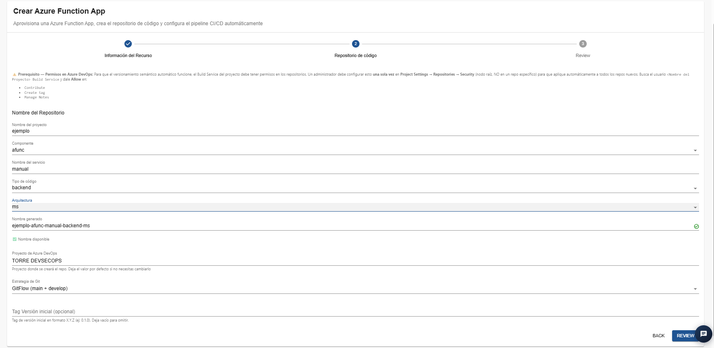
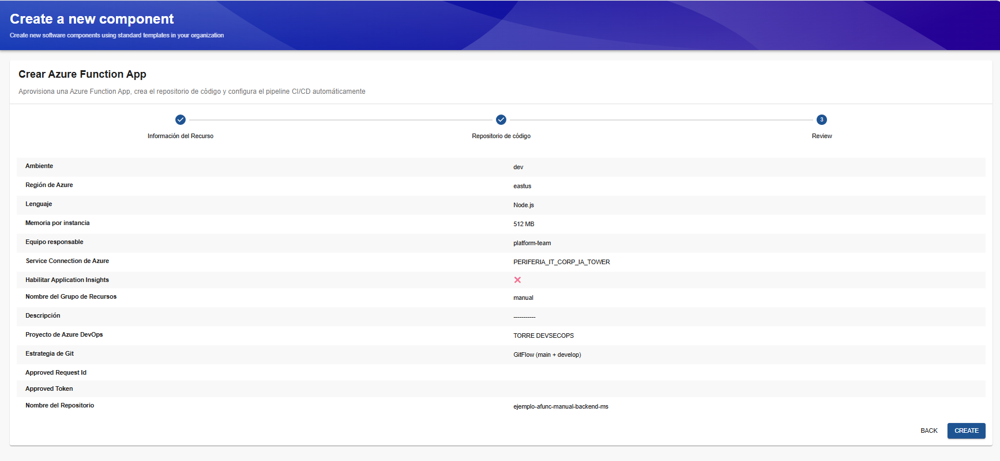
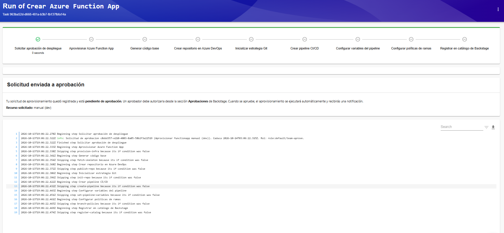

# Plantilla: Crear Azure Function App

## 1. Descripción general

La plantilla **Crear Azure Function App** permite aprovisionar una aplicación de Azure Functions, generar un repositorio de código en Azure DevOps y configurar automáticamente los elementos necesarios para un pipeline de integración y entrega continua (CI/CD). Azure Functions es un servicio de computación sin servidor (*serverless*) que permite ejecutar funciones de código en respuesta a eventos, solicitudes HTTP, temporizadores y otros desencadenadores, sin tener que administrar directamente la infraestructura subyacente.

La plantilla está organizada en tres etapas:

1. **Información del recurso:** permite definir los parámetros de la Function App y sus recursos asociados.
2. **Repositorio de código:** permite configurar el repositorio donde se almacenará el código fuente.
3. **Review:** presenta un resumen de los parámetros antes de enviar la solicitud.

Una vez enviada la solicitud, el IDP registra la operación y solicita la aprobación correspondiente. Cuando la solicitud es aprobada, el flujo puede continuar con las tareas de aprovisionamiento y configuración automatizada.

## 2. Paso 1. Información del recurso

En esta etapa se configuran los parámetros principales de la Azure Function App, como el grupo de recursos, el ambiente, la región, el lenguaje de programación, la memoria por instancia, el equipo responsable y la conexión de servicio de Azure.

### Campos disponibles

**Nombre del Grupo de Recursos**

Campo obligatorio que permite definir el nombre base del grupo de recursos asociado al despliegue.
En el ejemplo se utiliza `prueba-shirley`.
Se recomienda emplear nombres descriptivos y coherentes con las convenciones de nomenclatura establecidas para los recursos de Azure.

**Descripción**

Permite registrar información sobre el propósito de la función o del servicio que se va a crear.
Este campo puede utilizarse para facilitar la identificación del recurso y su finalidad.

**Ambiente**

Campo obligatorio que identifica el entorno en el que se aprovisionará la aplicación.
En el ejemplo se utiliza `dev`, correspondiente al entorno de desarrollo.
Se debe seleccionar el ambiente apropiado según el uso previsto para la función.

**Región de Azure**

Permite seleccionar la región geográfica donde se aprovisionará el recurso.
Para esta implementación, la región disponible es `westus2`.
En la prueba realizada, el campo ya aparece configurado con este valor. Se debe verificar que se conserve antes de continuar. La región puede influir en la disponibilidad de los servicios, las cuotas de suscripción, la latencia y los costos de operación.

**Lenguaje**

Campo obligatorio que permite seleccionar el lenguaje de programación con el que se desarrollará la función.
En el ejemplo se utiliza `Node.js`.
La selección debe corresponder al lenguaje y al modelo de ejecución que utilizará el código de la aplicación.

**Memoria por instancia**

Permite seleccionar la memoria asignada a cada instancia de ejecución, según las opciones disponibles en la plantilla.
En el ejemplo se utiliza `512 MB`.
Antes de seleccionar este valor, se recomienda considerar el consumo esperado de memoria, la carga de trabajo y los requisitos de la aplicación. También debe verificarse que la opción sea compatible con la configuración de Azure Functions que utiliza la plantilla.

**Equipo responsable**

Permite identificar el equipo encargado de administrar y mantener el servicio.
En el ejemplo se utiliza `platform-team`.
Se recomienda asignar el equipo que asumirá la responsabilidad técnica y operativa de la función.

**Service Connection de Azure**

Identifica la conexión de servicio de Azure DevOps que utilizará la automatización para aprovisionar los recursos.
En el ejemplo se utiliza `PERIFERIA_IT_CORP_IA_TOWER`.
La conexión debe existir previamente y contar con los permisos necesarios para las operaciones de aprovisionamiento.

**Habilitar Application Insights**

Es una casilla opcional que permite habilitar la integración con Application Insights para recopilar información de telemetría y facilitar el diagnóstico de la aplicación.
Cuando se habilita y la plantilla la configura correctamente, Application Insights puede ayudar a consultar solicitudes, excepciones, trazas y métricas de ejecución.
Se recomienda evaluar su habilitación cuando se requiera monitorear el comportamiento de la función y diagnosticar posibles errores.

## 3. Paso 2. Repositorio de código

En esta etapa se define la configuración del repositorio que se creará en Azure DevOps para almacenar el código fuente de la Azure Function App. La pantalla incluye una advertencia sobre los permisos requeridos para el versionamiento semántico automático.

### Campos disponibles

**Nombre del proyecto**

Define el nombre base utilizado para generar el repositorio.
En el ejemplo se utiliza `ejemplo`.

**Componente**

Permite seleccionar la categoría del componente.
En el ejemplo se utiliza `afunc`, identificador utilizado por esta plantilla para Azure Function App.

**Nombre del servicio**

Permite definir el nombre del servicio que se desarrollará.
En el ejemplo se utiliza `manual`.

**Tipo de código**

Identifica el tipo de código que contendrá el repositorio.
En el ejemplo se selecciona `backend`.
La selección debe corresponder al propósito del componente que se va a implementar.

**Arquitectura**

Permite definir la arquitectura asociada al servicio.
En el ejemplo se utiliza `ms`, según las opciones disponibles en la plantilla.

**Nombre generado**

La plantilla genera automáticamente el nombre del repositorio a partir de los valores introducidos.
En el ejemplo se genera:
`ejemplo-afunc-manual-backend-ms`
La interfaz muestra un indicador de disponibilidad. Se debe comprobar que el nombre generado sea válido y esté disponible antes de continuar.

**Proyecto de Azure DevOps**

Identifica el proyecto en el que se creará el repositorio.
En el ejemplo se utiliza `TORRE DEVSECOPS`.
Se recomienda verificar que corresponda al proyecto autorizado para el servicio.

**Estrategia de Git**

Permite seleccionar el modelo de ramificación que utilizará el repositorio.
En el ejemplo se utiliza `GitFlow (main + develop)`.
La estrategia seleccionada determina cómo se organizan las ramas y cómo se gestionan los cambios durante el desarrollo.

**Tag Versión inicial (opcional)**

Permite definir una etiqueta para identificar la versión inicial del proyecto.
Por ejemplo, `0.1.0`.
Si no se requiere una versión inicial, el campo puede dejarse vacío.

## 4. Paso 3. Review

La pantalla Review presenta un resumen de los valores configurados en las etapas anteriores.
Entre los datos que se deben verificar se encuentran:

- Ambiente.
- Región de Azure.
- Lenguaje.
- Memoria por instancia.
- Equipo responsable.
- Service Connection de Azure.
- Estado de la opción Habilitar Application Insights.
- Nombre del grupo de recursos.
- Descripción.
- Proyecto de Azure DevOps.
- Estrategia de Git.
- Nombre del repositorio generado.

## 5. Solicitud de aprobación y ejecución

Después de pulsar **Create**, el IDP presenta la pantalla de ejecución de la plantilla.
En la prueba realizada se muestra el mensaje **Solicitud enviada a aprobación**, que indica que la solicitud quedó registrada y está pendiente de autorización.
Un aprobador debe autorizarla desde la sección **Aprobaciones** de Backstage. Una vez aprobada, el flujo de aprovisionamiento podrá continuar y se generará una notificación.

### Etapas del flujo de ejecución

La interfaz presenta las siguientes tareas:

1. **Solicitar aprobación de despliegue:** registra la solicitud y espera la autorización.
2. **Aprovisionar Azure Function App:** crea el recurso de Azure Functions según los parámetros definidos.
3. **Generar código base:** prepara la estructura inicial del proyecto.
4. **Crear repositorio en Azure DevOps:** genera el repositorio para almacenar el código.
5. **Inicializar estrategia Git:** configura el modelo de ramificación seleccionado.
6. **Crear pipeline CI/CD:** configura el pipeline de integración y entrega continua.
7. **Configurar variables del pipeline:** establece las variables necesarias para la automatización.
8. **Configurar políticas de ramas:** aplica las políticas definidas por la plantilla.
9. **Registrar en catálogo de Backstage:** registra el componente en el catálogo del IDP.

### Procedimiento de validación

1. Confirma que se muestre el mensaje de solicitud enviada a aprobación.
2. Accede a la sección **Aprobaciones** de Backstage.
3. Consulta el estado de la solicitud y espera la autorización.
4. Revisa las notificaciones generadas por el IDP.
5. Consulta los registros cuando el flujo continúe.
6. Verifica en Azure que la Function App se haya creado en `westus2`.
7. Comprueba que el runtime y el lenguaje de programación sean los esperados.
8. Si se habilitó Application Insights, verifica que la integración de monitoreo se haya configurado correctamente.
9. Comprueba que el repositorio exista en el proyecto de Azure DevOps indicado.
10. Verifica que el pipeline CI/CD, las variables y las políticas de ramas se hayan configurado.
11. Realiza una prueba funcional de la función, utilizando el desencadenador que corresponda a su implementación.

## 7. Resultado esperado

Cuando la automatización finaliza correctamente, se espera contar con una Azure Function App aprovisionada en la región `westus2`, configurada con el lenguaje, la memoria y los parámetros seleccionados. También se espera disponer de un repositorio de código en Azure DevOps y de un pipeline CI/CD configurado con las variables, la estrategia de Git y las políticas de ramas correspondientes.

Si se habilitó Application Insights, también se espera que la integración de monitoreo quede configurada según las capacidades de la plantilla. El resultado debe confirmarse mediante los registros de ejecución y la validación de los recursos en Azure y Azure DevOps. 