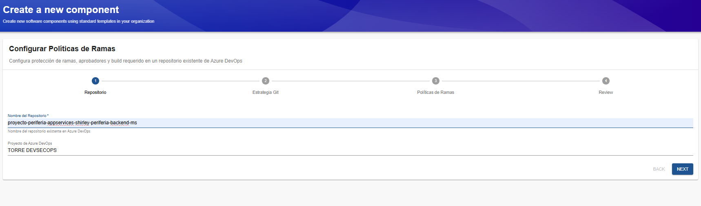
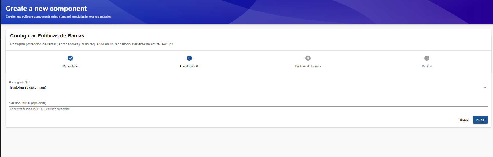
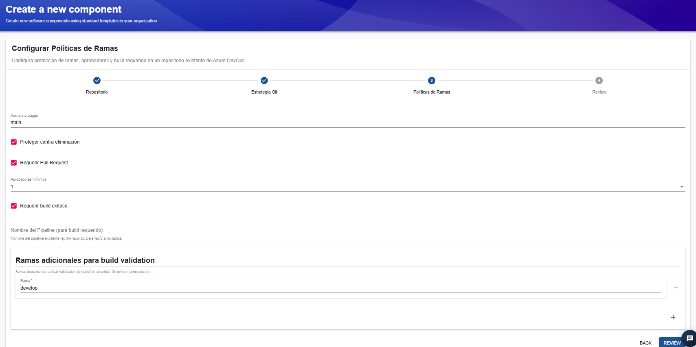
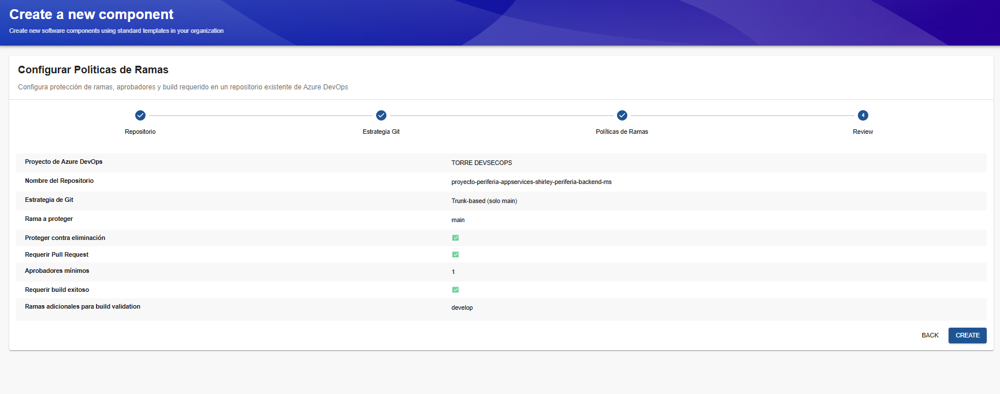

# Plantilla: Configurar Políticas de Ramas

## 1. Descripción general

La plantilla **Configurar Políticas de Ramas** permite establecer reglas de protección, aprobación y validación de compilaciones (*build validation*) sobre un repositorio existente de Azure DevOps.

Su objetivo es fortalecer la gobernanza del código fuente, controlar la integración de cambios y asegurar que las modificaciones cumplan con las condiciones definidas antes de incorporarse a las ramas protegidas.

La plantilla está organizada en cuatro etapas:

1. **Repositorio:** selección del proyecto y del repositorio existente.
2. **Estrategia Git:** selección de la estrategia de ramificación.
3. **Políticas de Ramas:** configuración de las reglas de protección y validación.
4. **Review:** revisión de los parámetros antes de aplicar la configuración.

## 2. Paso 1. Repositorio

En esta etapa se identifica el repositorio de Azure DevOps al que se aplicarán las políticas.

### Campos disponibles

**Nombre del Repositorio**

Campo obligatorio que permite especificar el nombre del repositorio existente en Azure DevOps.
En el ejemplo se utiliza `pipeline-appservices-periferia-backend-ms`.

**Proyecto de Azure DevOps**

Identifica el proyecto donde se encuentra el repositorio seleccionado.
En el ejemplo se utiliza `TORRE DEVSECOPS`.

### Consideraciones

- El repositorio debe existir previamente en Azure DevOps.
- Se recomienda verificar que el repositorio corresponda al componente.

## 3. Paso 2. Estrategia Git

En esta etapa se selecciona la estrategia de ramificación que se utilizará para organizar el desarrollo y definir las ramas sobre las que se aplicarán las políticas.

La plantilla dispone de dos alternativas: **Trunk-based** y **GitFlow**.

### 3.1. Trunk-based

Esta estrategia promueve la integración frecuente de cambios en una rama principal compartida, reduciendo la duración de las ramas de desarrollo.
En la plantilla se presenta la opción `Trunk-based (solo main)`.
Su configuración se orienta a trabajar con la rama principal `main`, utilizando Pull Requests y validaciones automáticas para controlar la incorporación de cambios.
Se recomienda cuando el equipo busca integrar cambios con frecuencia, mantener un flujo de desarrollo sencillo y facilitar la entrega continua.

### 3.2. GitFlow

GitFlow establece un modelo de ramificación con ramas que cumplen funciones diferenciadas durante el desarrollo y la preparación de versiones.
En la implementación del IDP se utiliza la opción `GitFlow (main + develop)`.
Este modelo contempla principalmente:

- **main:** contiene las versiones estables o preparadas para producción.
- **develop:** integra los cambios destinados a la siguiente versión.
- **feature:** permite desarrollar funcionalidades de manera aislada.
- **release:** facilita la preparación de una versión.
- **hotfix:** permite corregir problemas urgentes sobre una versión publicada.

Las ramas `feature`, `release` y `hotfix` forman parte del modelo GitFlow convencional; la existencia y configuración de cada una deben verificarse.

### Comparación de estrategias

| Aspecto | Trunk-based | GitFlow |
|---|---|---|
| Rama principal | `main` | `main` y `develop` |
| Integración de cambios | Frecuente sobre la rama principal mediante el flujo definido | Mediante ramas de desarrollo, integración y preparación de versiones |
| Complejidad | Menor cantidad de ramas permanentes | Mayor cantidad de ramas con funciones diferenciadas |
| Entrega continua | Adecuada para integrar cambios frecuentemente | Requiere coordinar las ramas y el ciclo de versiones |
| Consideración principal | Mantener validaciones automatizadas y cambios pequeños | Mantener sincronizadas las ramas y controlar las versiones |

### Versión inicial (opcional)

Permite especificar una etiqueta para identificar la versión inicial del repositorio o componente.
Por ejemplo, `0.1.0`.
Si no se requiere una versión inicial, el campo puede dejarse vacío.

## 4. Paso 3. Políticas de Ramas

Esta etapa permite definir las reglas que protegerán las ramas del repositorio.

### Rama a proteger

Especifica la rama sobre la que se aplicarán las políticas.
En el ejemplo se utiliza `main`.
El valor debe corresponder a una rama existente en el repositorio.

### Proteger contra eliminación

Cuando está habilitada, la plantilla configura la protección contra la eliminación de la rama seleccionada, según los permisos y mecanismos disponibles en Azure DevOps.
Esta opción ayuda a evitar la eliminación accidental de ramas importantes.
**Recomendación:** mantenerla habilitada para las ramas principales y otras ramas críticas.

### Requerir Pull Request

Cuando está habilitada, exige utilizar un Pull Request para integrar cambios en la rama protegida, de acuerdo con la política configurada.
Esto permite revisar las modificaciones antes de incorporarlas, mantener un registro de las decisiones y aplicar controles de gobernanza.

### Aprobadores mínimos

Define la cantidad mínima de aprobaciones requeridas para completar un Pull Request.
En el ejemplo se configura el valor `1`.
Esto significa que se establece una aprobación mínima para permitir la integración, siempre que también se cumplan las demás políticas aplicables.
Se recomienda definir el número de aprobaciones según la criticidad del componente, las necesidades del equipo y las políticas organizacionales.

### Requerir build exitoso

Cuando está habilitada, exige que la validación de compilación asociada al Pull Request finalice correctamente antes de permitir la integración, de acuerdo con la configuración de Azure DevOps.
Este control ayuda a detectar fallos de compilación o de las validaciones automatizadas antes de incorporar cambios.

### Nombre del Pipeline (para build requerido)

Permite especificar el pipeline existente que se utilizará para validar los cambios.
Este campo debe corresponder al pipeline que ejecutará las comprobaciones requeridas.
Si la validación de compilación no aplica, la indicación de la plantilla permite dejarlo vacío. Si se habilita **Requerir build exitoso**, se debe verificar que el pipeline correspondiente esté configurado y pueda ejecutarse sobre la rama.

### Ramas adicionales para build validation

Esta sección permite registrar ramas adicionales sobre las que se aplicará la validación de compilación.
En el ejemplo se incluye la rama `develop`.
El botón **+** permite añadir ramas adicionales y el control de eliminación permite retirar una rama de la lista.
Esta configuración resulta útil cuando se necesita validar más de una rama, especialmente en repositorios que utilizan GitFlow.

## 5. Paso 4. Review

La pantalla Review presenta el resumen de los parámetros que se aplicarán al repositorio.

Se deben revisar los siguientes elementos:

- Proyecto de Azure DevOps.
- Nombre del repositorio.
- Estrategia Git seleccionada.
- Rama a proteger.
- Protección contra eliminación.
- Requisito de Pull Request.
- Número mínimo de aprobadores.
- Requisito de build exitoso.
- Ramas adicionales para build validation.

## 6. Resultado esperado

Al finalizar correctamente la ejecución, el repositorio debe contar con las políticas de ramas definidas en la plantilla.

Se espera que la configuración permita:

- Proteger las ramas seleccionadas contra eliminación.
- Exigir Pull Requests cuando se haya habilitado esa opción.
- Establecer un mínimo de aprobaciones.
- Requerir validaciones de compilación exitosas cuando corresponda.
- Aplicar validaciones a las ramas adicionales configuradas.

La validación final debe realizarse directamente en Azure DevOps, dentro de la configuración de seguridad y políticas del repositorio.

## 7. Consideraciones generales

- **Selección de estrategia:** utilizar Trunk-based o GitFlow de acuerdo con el flujo de trabajo establecido para el repositorio.
- **Coherencia de ramas:** evitar configurar ramas adicionales que no existan o que no correspondan a la estrategia seleccionada.
- **Aprobaciones:** establecer un mínimo de aprobadores acorde con la criticidad del código.
- **Build validation:** comprobar que el pipeline exista, tenga los permisos necesarios y se ejecute correctamente sobre las ramas configuradas.
- **Gobernanza:** mantener las reglas alineadas con las políticas de desarrollo y seguridad de la organización.
- **Validación posterior:** confirmar que las políticas se hayan aplicado realmente en Azure DevOps y que se comporten como se espera al crear un Pull Request.